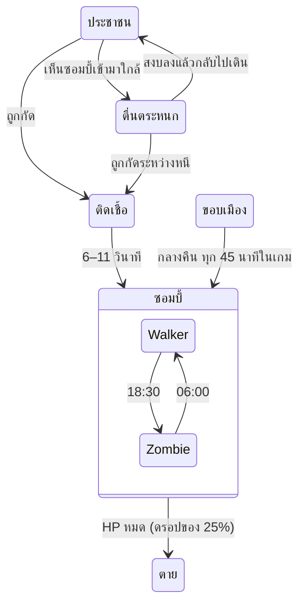

# วันธรรมดา (Ordinary Day) — สรุปโปรเจกต์เกม

Oct 20, 2026 · @Moonwolf

## ภาพรวม

"วันธรรมดา" (Ordinary Day) คือเกม zombie survival แนว open-world sandbox มุมกล้อง isometric 3D ที่หายนะเริ่มต้นจากเช้าวันอังคารธรรมดา ผู้เล่นเกิดมาตัวเปล่า ต้องเก็บอาวุธ กระสุน และยาที่ตกอยู่ทั่วเมือง แล้วเอาชีวิตรอดให้นานที่สุด

- **แรงบันดาลใจหลัก:** เกม STILL จาก Instagram reels ของ still.the.game มุมมอง isometric ภาพสมจริงโทนหม่น เมืองเก่าทรุดโทรม ฝนตกมีแอ่งน้ำบนถนน นาฬิกาตัวใหญ่กลางจอ และแนวคิดว่าการระบาดเริ่มจากวันธรรมดา
- **เกมที่ใกล้เคียงที่สุด:** Project Zomboid (simulation survival มุม isometric)
- **Prototype ที่เล่นได้:** [เปิดเล่นบนเบราว์เซอร์](https://claude.ai/artifact/JgmJvxwsGhe5bkgZCU3syF) ทั้งมือถือและคอม

**แนวคิดหลักที่ prototype ใช้อยู่ (design pillars)**

1. **ชีวิตปกติก่อนหายนะ:** เมืองมีคนเดินไปทำงาน แม่ค้าเฝ้าแผง ข่าววิทยุค่อย ๆ แปลกขึ้น ก่อนการระบาดจะเริ่ม
2. **กลางวันพัก กลางคืนเสี่ยง:** กลางวันซอมบี้เชื่องช้าให้ออกหาของ กลางคืนซอมบี้เร็ว หูไว และมีของระดับ Police / Military ให้เสี่ยงออกไปหา
3. **เริ่มจากศูนย์:** ไม่มีอะไรติดตัว ทุกอย่างต้องหาเอง
4. **เสียงมีราคา:** ปืนแรงกว่าอาวุธประชิด แต่เสียงปืนเรียกซอมบี้จากระยะไกล

## สถานะปัจจุบันและเทคโนโลยี

เกมอยู่ที่ prototype v0.3 (รวมระบบจากเอกสาร Game System Design Draft 01 ของทีม) ตั้งแต่ v0.3.1 โค้ดแยกเป็น ES modules ใน `src/` เล่นบนเบราว์เซอร์ได้โดยไม่ต้องติดตั้งหรือ build แต่ต้องเปิดผ่าน dev server หรือ GitHub Pages

| หัวข้อ | รายละเอียด |
| --- | --- |
| Engine / ไลบรารี | Three.js r128 (WebGL) โค้ด JavaScript ล้วน |
| ไฟล์ | `index.html` (HTML + CSS) กับ ES modules ใน `src/` ไม่มีขั้นตอน build ไม่มีไฟล์ภาพหรือเสียงภายนอก |
| กราฟิก | low-poly 3D, texture วาดด้วยโค้ด (procedural canvas texture), เงา real-time, tone mapping แบบ ACES |
| กล้อง | orthographic camera มุมก้มประมาณ 41° ติดตามผู้เล่น ซูมได้ |
| แพลตฟอร์ม | มือถือ (virtual joystick + ปุ่มบนจอ) และคอม (คีย์บอร์ด + เมาส์) |
| UI | ภาษาไทย ฟอนต์ Chakra Petch และ Big Shoulders Display |

**ประวัติเวอร์ชัน (ใหม่สุดก่อน)**

| เวอร์ชัน | สิ่งที่เพิ่ม |
| --- | --- |
| v0.6 | เข้าไปในตึกได้ 1 หลังต่อบล็อกเมือง (11 หลัง, `world/interiors.js`) ตัดหลังคาให้เห็นข้างใน, ประตูเปิดปิดได้และพังได้ (`systems/doors.js`), ผนังบังการมองเห็น การตี และแรงระเบิด, ซอมบี้หาทางอ้อมมาที่ประตู, จุดเกิดของในตึก 22 จุด |
| v0.5 | อาวุธประชิดมีความทนและพังได้, หิวและกระหาย (อาหารกระป๋อง น้ำดื่ม), Armor Walker เกราะเฉพาะด้านหน้า, Tyrant ทุบรถ กองขยะ ม้านั่งที่ขวางทาง (`systems/obstacles.js`), ระดับความยาก ง่าย / ปกติ / ยาก (`config/difficulty.js`) พร้อมสถิติแยกตามระดับ |
| v0.4.3 | แผนที่เล็กมุมซ้ายบน (`ui/minimap.js`) หมุนตามมุมกล้อง พร้อมจุดสำคัญ ซอมบี้ใกล้ตัว และ Tyrant · จำกัดความกว้างข้อความกลางจอบนจอคอมไม่ให้ทับแผนที่ |
| v0.4.2 | รถพยาบาลข้างตลาดเป็นแหล่ง Resurrection Kit 1 ชุดต่อเกม (ไม่แตะค่า 1% ที่ยืนยันแล้ว), คำแนะนำสำหรับผู้เล่นใหม่ 12 ข้อ ปิดเปิดได้ในหน้าหยุดเกม |
| v0.4.1 | หน้าหยุดเกม (ปุ่ม ❚❚, P, Esc) พร้อมเซฟเอง เสียง และกลับหน้าแรก หยุดเองเมื่อพับหน้าเว็บ · เพิ่ม `<!doctype html>` และ viewport meta ที่ขาดไป (เดิมพึ่ง claude.ai เติมให้) ทำให้บนมือถือจริงหน้าเว็บไม่ย่อเหลือ 980px อีก และจัด HUD ให้พอดีจอ 360–400px |
| v0.4 | หน้าสรุปตอนจบ + สถิติดีสุด, เสียงสังเคราะห์ (WebAudio), ติดเชื้อเมื่อโดนกัด + Antibiotic รักษา, เป้าหมายรอด 7 คืนแล้วขึ้นเฮลิคอปเตอร์กู้ภัย |
| v0.3.3 | ระบบเซฟอัตโนมัติ 1 ช่องใน localStorage, ปุ่มเล่นต่อบนหน้าเริ่มเกม, เซฟถูกลบเมื่อตัวละครตาย |
| v0.3.2 | ใช้คำตอบ Decision Log ที่ยืนยันแล้ว: ดาเมจอาวุธ = คะแนน × 5 (Q07), Armor Walker รวมไม่เกิน 6 ตัวต่อคืน (Q05), เตือน NIGHT INCOMING ตั้งแต่ 16:00 (Q11) |
| v0.3.1 | แยกโค้ดจาก `index.html` เป็น ES modules ใน `src/` (config, world, entities, systems, ui) พฤติกรรมเกมเหมือน v0.3 ทุกอย่าง · แก้บั๊ก CSS ที่ทำให้กระเป๋า ฉากเริ่มเกม และแถบ HP บอสไม่ซ่อนเมื่อเปิดนอก claude.ai (เช่น GitHub Pages) |
| v0.3 | แบ่งเฟส DAY / NIGHT, อาวุธ 3 ระดับ (Civilian / Police / Military) 18 ชิ้น, loot ตามเวลา, รถตำรวจและรถทหารเป็นแหล่งของพิเศษ, ยา 5 ชนิด + Resurrection Kit, ซอมบี้ 6 คลาส, แถบ HP บอส |
| v0.2 | 1 วันในเกม = 5 นาทีจริง, ระบบกระเป๋า, อาวุธ 3 ช่อง (หลัก รอง ประชิด), ปืน 3 แบบ + กระสุน 3 ชนิด, รีโหลด, loot สุ่มตามโซน, เกิดมาตัวเปล่า |
| v0.1 | เมือง isometric, day/night cycle, ฝน, ประชาชนเดินตามทางเท้า, ไทม์ไลน์การระบาด, การติดเชื้อ, ผู้เล่นตีด้วยท่อเหล็ก |

## โลกและเมือง

เมืองเป็นตาราง 4×4 บล็อก ขนาดรวมประมาณ 136×136 หน่วย (1 หน่วย ≈ 1 เมตร) ถนนกว้าง 8 หน่วย มีทางเท้ากว้าง 2 หน่วยรอบทุกบล็อก และกำแพงคอนกรีตกั้นขอบแผนที่ ผังเมืองสร้างจาก seed เดียวกันทุกครั้ง เมืองจึงหน้าตาเหมือนเดิมทุกรอบ

| ประเภทบล็อก | จำนวน | มีอะไร |
| --- | --- | --- |
| เมือง (city) | 11 | ตึก 2–5 ชั้น แบ่งเป็น 1, 2 หรือ 4 หลังต่อบล็อก บางล็อตเป็นลานหลังตึกมีถุงขยะ ตู้คอนเทนเนอร์ ต้นไม้แห้ง |
| ตลาด (market) | 1 | แผงลอย 3 แถว หลังคาสังกะสีขึ้นสนิม ลังผลไม้สีต่าง ๆ แม่ค้า 6 คน ตู้คอนเทนเนอร์ 2 ตู้ |
| สวน (park) | 2 | สนามหญ้า ต้นไม้ ม้านั่ง น้ำพุร้างตรงกลาง |
| ลานตู้คอนเทนเนอร์ (lot) | 2 | ตู้คอนเทนเนอร์ 4–6 ตู้ (มีตู้ซ้อน) รถเก่า กองขยะ |

- **ตึก:** ผนัง 6 สี (อิฐแดง เบจ เทา ชมพูซีด เหลืองหม่น น้ำตาล) หน้าต่างบางบานถูกตีไม้ปิด หลังคามีขอบกันตก แอร์ ถังน้ำ ห้องบันได บางหลังเป็นหลังคาสังกะสี
- **พร็อพบนถนน:** เสาไฟถนน 80 ต้น ต้นไม้ริมทางที่ทาสีขาวโคนต้น รถจอดริมถนนราว 18 คัน รถตำรวจ 3 คัน (ไฟไซเรนกะพริบตอนกลางคืน) รถทหาร 1 คันในลานตู้คอนเทนเนอร์ แอ่งน้ำ 46 จุดที่จะปรากฏเมื่อถนนเปียก
- **การบังตัวละคร:** ตึกที่อยู่ระหว่างกล้องกับผู้เล่นจะโปร่งใสอัตโนมัติ (occlusion fade) ผู้เล่นจึงไม่หายไปหลังตึก
- **ตึกที่เข้าได้ (v0.6):** บล็อกเมืองละ 1 หลัง (11 หลัง) เลือกหลังที่ใหญ่ที่สุดที่ด้านใดด้านหนึ่งเปิดออกสู่ทางเท้าได้ ประตูหันออกถนน (หันเข้ากล้องถ้าทำได้) มีป้ายไฟสีส้มเหนือประตู ผนังหนา 0.3 ม. ประตูกว้าง 1.6 ม. ข้างในมีพื้น เฟอร์นิเจอร์ชิดผนัง 0–3 ชิ้น (ชั้นวาง เคาน์เตอร์ โซฟา ตู้) และจุดเกิดของ 2 จุด (zone `indoor` ใช้ตารางเดียวกับจุดในเมือง) สร้างหลัง `buildCity()` ด้วย rng แยก (`mulberry32(606)`) ผังเมืองเดิมและลำดับจุดเกิดของเดิมจึงไม่เปลี่ยน
- **มุมมองในตึก (cutaway):** เมื่อผู้เล่นเข้าไป ตัวตึก หลังคา และของบนหลังคาของหลังนั้นจะซ่อน เหลือพื้น ผนังสูง 1 ม. เฟอร์นิเจอร์ และประตู ตึกอื่นยังโปร่งใสเมื่อบังตามเดิม
- **ข้อจำกัดตอนนี้:** ตึกอื่นยังเป็นกล่องทึบ เข้าได้แค่ชั้นล่าง ไม่มีหน้าต่างหรือบันได ฝนยังตกในตึก

## เวลา บรรยากาศ และเหตุการณ์

1 วันในเกมยาว 5 นาทีจริง (เวลาเดิน 4.8 นาทีในเกมต่อ 1 วินาที) กดเร่งได้ ×1 ×2 ×4 เกมเริ่ม 07:30 ของวันอังคาร การระบาดเริ่ม 09:30 แล้ววันจะวนเป็นเฟสกลางวันกับกลางคืน

| เฟส | เวลาในเกม | เวลาจริง (×1) | สิ่งที่เกิดขึ้น |
| --- | --- | --- | --- |
| DAY | 06:00–15:59 | \~2.1 นาที | Walker เชื่องช้า ไม่ไล่ผู้เล่น ไม่มีซอมบี้ใหม่เกิด เกิดเฉพาะของ Civilian Grade |
| NIGHT INCOMING | 16:00–18:29 | \~31 วินาที | ข้อความเตือนและป้ายเฟสกะพริบสีแดง |
| NIGHT | 18:30–05:59 | \~2.4 นาที | Walker กลายเป็น Zombie ซอมบี้ใหม่และตัวพิเศษเกิด ของ Police / Military เกิดทั่วเมือง |
| DAWN | 06:00 | ทันที | ตัวพิเศษถอยหนีและหายไปนอกจอ Zombie กลับเป็น Walker (เหลือไม่เกิน 18 ตัว) จุดว่างได้ของ Civilian ใหม่ 30% |

ใต้นาฬิกามีป้ายเฟสบอก DAY / NIGHT INCOMING / NIGHT พร้อมนับถอยหลังเป็นเวลาจริงจนถึงเฟสถัดไป

- **กลางวัน/กลางคืน (day/night cycle):** ดวงอาทิตย์ขึ้นราว 06:00 ตกราว 19:00 เงาเคลื่อนตามเวลา แสงโทนส้มตอนเช้าและเย็น กลางคืนมีแสงจันทร์สีฟ้า
- **แสงกลางคืน:** ไฟถนนเปิดเอง หน้าต่างตึกบางบานเปิดไฟ ผู้เล่นมีไฟฉายส่องทางข้างหน้า
- **อากาศ:** ฝนตกเป็นเส้น ถนนค่อย ๆ เปียก สะท้อนแสง และมีแอ่งน้ำ ฝนหยุดแล้วถนนค่อย ๆ แห้ง หลัง 14:00 ระบบสุ่มเปลี่ยนอากาศทุก 90 นาทีในเกม โอกาส 35%
- **ข้อความบนจอ:** มี 3 แบบ คือคำบรรยายปกติ ข่าววิทยุ (สีเหลืองอำพัน) และคำเตือน (สีแดงส้ม)

| เวลาในเกม | เหตุการณ์ | ประเภท |
| --- | --- | --- |
| 07:31 | ทุกอย่างเริ่มต้นจากวันธรรมดา | คำบรรยาย |
| 07:50 | บอกผู้เล่นว่าออกจากบ้านมาตัวเปล่า ให้ลองดูของตามทาง | คำบรรยาย |
| 08:20 | รถพยาบาลหลายคันวิ่งเข้าไปทางตลาด | วิทยุ |
| 09:00 | มีรายงานผู้ป่วยก้าวร้าวผิดปกติหลายราย | วิทยุ |
| 09:30 | **การระบาดเริ่ม** ประชาชน 1 คนห่างผู้เล่นราว 16 ม. กลายเป็น Walker มีวงแดงกะพริบชี้ตำแหน่ง | คำเตือน |
| 10:15 | ทางการขอให้ประชาชนอยู่ในอาคาร | วิทยุ |
| 11:00 | ฝนเริ่มตก | คำบรรยาย |
| 12:30 | สัญญาณโทรศัพท์เริ่มขาดหาย | วิทยุ |
| 13:20 | ฝนหยุด | ระบบ |
| ทุกวัน 16:00 | NIGHT INCOMING เตือนให้เตรียมอาวุธ กระสุน และยา | คำเตือน |
| ทุกวัน 18:30 | NIGHT เริ่ม และสุ่มว่าคืนนี้มี Armor Walker (60%) และ Tyrant (40%) หรือไม่ | คำเตือน |
| คืนที่สุ่มได้ 19:00 เป็นต้นไป | วิทยุแจ้งพบตำรวจติดเชื้อสวมเกราะ เมื่อ Armor Walker ตัวแรกโผล่ | วิทยุ |
| คืนที่สุ่มได้ 00:00 | เสียงคำรามจากที่ไกล Tyrant ออกล่า | คำเตือน |
| ทุกวัน 06:00 | รุ่งเช้า ซอมบี้กลับมาเชื่องช้า | คำบรรยาย |

## ประชากร ซอมบี้ และ AI

เมืองเริ่มด้วยประชาชน 42 คน (คนเดินทั่วไป 36 คน + แม่ค้าในตลาด 6 คน) ทุกคนที่ถูกกัดจะกลายเป็นซอมบี้ จำนวนซอมบี้จึงโตเร็วถ้าผู้เล่นไม่หยุดมัน

- **ประชาชน:** เดินบนทางเท้าตามกราฟจุดหัวมุม (sidewalk node graph) ข้ามถนนตรงทางแยก แวะหยุดยืนเป็นครั้งคราว แม่ค้ายืนประจำแผงจนกว่าจะเห็นซอมบี้
- **การหนี (panic):** วิ่งหนีเมื่อเห็น Walker ในระยะ 3.5 ม. หรือซอมบี้คลาสอื่นในระยะ 9 ม. ความเร็ว 3.6 ม./วิ
- **การติดเชื้อ:** ถูกกัดแล้วยังวิ่งต่อได้แต่ช้าลง ผิวค่อย ๆ เป็นสีเขียวเทา และกลายเป็น Walker (กลางวัน) หรือ Zombie (กลางคืน) ภายใน 6–11 วินาทีจริง
- **กลางวัน:** Walker ไม่ไล่ผู้เล่นและไม่สนเสียงปืน แต่ยังเดินเข้าหาประชาชนในระยะ 6 ม. การระบาดวันแรกจึงยังลามช้า ๆ
- **กลางคืน:** ซอมบี้เกิดจากขอบเมืองทุก 45 นาทีในเกม ครั้งละ 2 ตัว (เพิ่มเป็นสูงสุด 4 ตัวในคืนหลัง ๆ) สุ่มคลาสเป็น Zombie 65% · Sprinter 20% · Boomer 15% และคืนต่อไปจะมีตัวพิเศษมากขึ้น
- **เสียง:** กลางคืนซอมบี้ได้ยินเสียงปืนไกลขึ้น 1.5 เท่า และได้ยินเสียงผู้เล่นวิ่งในระยะราว 7.5 ม.
- **เพดาน:** ทั้งเมืองมีคนและซอมบี้รวมไม่เกินราว 95 ตัว (ยกเว้น Tyrant)



ประชาชนถูกกัดได้ทั้งตอนเดินปกติและตอนวิ่งหนี และซอมบี้ที่มาจากนอกเมืองเข้าสู่สถานะเดียวกันกับคนที่กลายพันธุ์ในเมือง

| คลาส | HP | เกิดเมื่อ | ความเร็ว | ดาเมจต่อผู้เล่น | พฤติกรรมและของดรอป |
| --- | --- | --- | --- | --- | --- |
| Walker | 30 | กลางวันเท่านั้น | 0.9 ม./วิ | 6 | ไม่ไล่ผู้เล่น ตีเมื่ออยู่ติดตัว |
| Zombie | 30 | กลางคืนเท่านั้น | 2.6 ม./วิ | 15 | ไล่เหยื่อในระยะ 15 ม. ตาแดงเรืองแสง |
| Sprinter | 30 | กลางคืนเท่านั้น | 6.2 ม./วิ | 12 | เร็วกว่าผู้เล่นวิ่ง (5.8) หยุดชะงัก 1.3 วิหลังตี |
| Boomer | 120 | กลางคืนเท่านั้น | 1.6 ม./วิ | 45 (ระเบิด) | เข้าใกล้ 2.2 ม. แล้วพองตัวเตือน 1.2 วิ ก่อนระเบิดรัศมี 4.2 ม. ทำซอมบี้รอบข้างเจ็บด้วย ถ้าถูกฆ่าก่อนจะไม่ระเบิด |
| Armor Walker | 150 | กลางคืน ถ้าสุ่มผ่าน 60% | 1.9 ม./วิ | 15 | เกราะลดดาเมจปืน 50% เฉพาะกระสุนที่โดนด้านหน้า ยิงด้านหลังได้ดาเมจเต็ม · โผล่ทุก 60 นาทีในเกม รวมไม่เกิน 6 ตัวต่อคืน · ดรอป Police Grade 2 ชิ้น 100% |
| Tyrant | 300 | เที่ยงคืน ถ้าสุ่มผ่าน 40% · คืนละไม่เกิน 1 ตัว | 2.2 ม./วิ | 35 + กระแทก | ตัวใหญ่ 1.8 เท่า มีวงแดงเตือน 0.85 วิ ก่อนทุบรัศมี 3.2 ม. · แถบ HP บอสบนจอ · ดรอป Military Grade 2 ชิ้น 100% · ติดรถ กองขยะ หรือม้านั่งนานเกิน 0.5 วิจะทุบพัง (ตู้คอนเทนเนอร์และตึกไม่พัง) |

HP และกติกาการเกิดมาจาก Draft 01 ของทีม ส่วนความเร็ว ดาเมจ และระยะต่าง ๆ เป็นค่าทดลอง (placeholder) ซอมบี้ธรรมดาที่ตายมีโอกาส 25% ดรอปกระสุนหรือยาตามเฟส

สิ่งที่ Tyrant ทุบพังจะถูกเอาออกจากกล่องชน ทรุดลงเหลือ 30% ของความสูง ส่งเสียงดังเรียกซอมบี้ในระยะ 30 ม. เซฟไว้ใน `G.broken` และกลับมาเมื่อเริ่มเกมใหม่

**ผนัง ประตู และการหลบในตึก (v0.6)**

- ถ้าผู้เล่นกับซอมบี้อยู่คนละฝั่งผนัง ซอมบี้จะรู้ตัวก็ต่อเมื่อมองเห็นผ่านช่องประตูที่เปิดอยู่ หรืออยู่ห่างไม่เกิน 2.5 ม. (ได้ยินผ่านผนัง) ถ้าอยู่นอกตึกทั้งคู่ ระบบการมองเห็นเหมือนเดิมทุกอย่าง
- ซอมบี้ที่ไล่อยู่แล้วเสียการมองเห็นเพราะผนังหรือประตู จะจำตำแหน่งสุดท้ายไว้ 20 วินาทีแล้วตามไป
- ซอมบี้หาทางเข้าออกตึกผ่านประตู: อยู่หลังตึกจะไปมุมหลัง แล้วเลียบด้านข้างมามุมหน้า แล้วเข้าประตู ซอมบี้ที่ติดอยู่ในตึกจะเดินออกทางประตูก่อนกลับไปเดินบนทางเท้า
- ประตูที่ปิดเป็นสิ่งกีดขวาง กันการเดิน กระสุน และการมองเห็น ซอมบี้ที่ต้องผ่านประตูที่ปิดจะตีประตูแทน ทุก `rate` วินาที ครั้งละเท่าดาเมจของมัน ประตูมี 120 Tyrant พังในทีเดียว Boomer พองตัวแล้วระเบิดใส่ประตู (ประตูในรัศมี 4.2 ม. เสีย 60) ระหว่างที่ผู้เล่นอยู่ในตึกนั้น ซอมบี้ที่ได้ยินจะไม่เลิกตีจนประตูพัง และจอขึ้นข้อความเตือนพร้อม % ของประตู
- เสียงที่เกิดในตึกที่ประตูปิดดังออกไป 0.5 เท่า ประตูพังมีเสียงดังรัศมี 20 ม.
- การตีประชิด aim assist แรงระเบิด Boomer และการทุบของ Tyrant ไม่ทะลุผนัง ผู้เล่นและซอมบี้ถูกดันทะลุผนังบางไม่ได้ (การดันกันของฝูงจะเช็กการชนทุกครั้ง)
- ค่าเหล่านี้อยู่ใน `config/shelter.js` และเป็น placeholder ทั้งหมด

ซอมบี้ที่ติดมุมตึกนานเกิน 1.2 วินาทีจะเปลี่ยนไปเดินสุ่มตามทางเท้า 3 วินาทีก่อนกลับมาไล่ต่อ

## ผู้เล่น กระเป๋า อาวุธ และกระสุน

ผู้เล่นเกิดที่หัวมุมกลางเมืองด้วยมือเปล่า HP 100 และกระเป๋ากางเกง 6 ช่อง HP ฟื้นเอง 1.5 ต่อวินาทีเมื่อไม่โดนตีนาน 6 วินาที (และอาหารกับน้ำไม่ต่ำกว่า 25) ถ้า HP หมดแต่มี Resurrection Kit ในกระเป๋า จะล้มลง 1.8 วินาทีแล้วฟื้นด้วย HP เต็ม อมตะ 3 วินาที และผลักซอมบี้รอบตัวออก ถ้าไม่มีจะจบเกม

**การควบคุม**

| การกระทำ | คอม | มือถือ |
| --- | --- | --- |
| เดิน / วิ่ง | WASD / Shift | ลากนิ้วซ้าย / ดันสุดขอบ |
| เล็ง | ตามเมาส์ | เล็งให้อัตโนมัติ (aim assist) |
| โจมตี | คลิกค้าง หรือ Space | กดปุ่มโจมตีค้าง หรือแตะจอฝั่งขวา |
| สลับอาวุธ | 1 2 3 | ปุ่ม หลัก รอง ประชิด |
| รีโหลด / เก็บของ / รักษา | R / E / H | ปุ่ม R / ปุ่มเก็บ / ปุ่ม ✚ |
| กิน / ดื่ม | G | ปุ่ม 🍴 |
| เปิด / ปิดประตู | E (ยืนใกล้ประตู) | ปุ่มประตู (ขึ้นที่ตำแหน่งปุ่มเก็บ) |
| กระเป๋า | Tab | ปุ่มกระเป๋า (เกมหยุดระหว่างเปิด) |
| หยุดเกม | P หรือ Esc | ปุ่ม ❚❚ มุมขวาบน |
| เปิด/ปิดเสียง | M | ปุ่มเสียงในหน้ากระเป๋าหรือหน้าหยุดเกม |

**เป้าหมาย (goal)**

รอดให้ครบ 7 คืน (คืนหนึ่งนับเมื่อถึง 06:00 ของเช้าถัดไป) แล้วตั้งแต่เช้าวันที่ 8 เฮลิคอปเตอร์กู้ภัยจะลงจอดที่สี่แยกมุมสวนสาธารณะ ทุกวันเวลา 08:00–12:00 มีลูกศรใต้นาฬิกาชี้ทางและบอกระยะ เดินเข้าไปในวงลงจอดเพื่อชนะ ถ้าไปไม่ทันจะกลับมาใหม่วันถัดไป

**ระดับความยาก (difficulty)**

เลือกที่หน้าเริ่มเกม ใช้กับเกมใหม่ เกมที่เซฟไว้ใช้ระดับเดิม (เซฟเก่าก่อน v0.5 เป็นปกติ) ปรับเฉพาะค่าที่ยังเป็น placeholder ค่า HP ซอมบี้ เวลา และกติกาการเกิดที่ยืนยันแล้วไม่เปลี่ยน ตัวคูณทั้งหมดเป็น placeholder

| ค่า | ง่าย | ปกติ | ยาก |
| --- | --- | --- | --- |
| ดาเมจที่ผู้เล่นโดน | ×0.6 | ×1 | ×1.4 |
| ซอมบี้เกิดกลางคืนต่อรอบ | −1 (อย่างน้อย 1) | ตามเดิม | +1 |
| โอกาสติดเชื้อเมื่อโดนกัด | ×0.5 | ×1 | ×1.5 |
| ความเร็วที่หิวและกระหาย | ×0.7 | ×1 | ×1.3 |

**หิวและกระหาย (needs)**

แถบอาหารและน้ำใต้แถบ HP เริ่มที่ 100 ลดตามนาทีในเกม (×2 / ×4 ไม่ทำให้หิวเร็วขึ้นเมื่อเทียบกับเวลาในเกม) ค่าทั้งหมดอยู่ใน `config/needs.js` และเป็น placeholder

- อาหารหมดใน 2880 นาทีในเกม (2 วัน) น้ำหมดใน 1800 นาที (30 ชั่วโมง) วิ่งแล้วน้ำลดเร็วขึ้น 1.5 เท่า
- ต่ำกว่า 25 ขึ้นเตือนและ HP ไม่ฟื้นเอง
- แถบไหนหมด HP ลด 0.15 ต่อนาทีในเกมต่อแถบ ถ้าตายจากตรงนี้หน้าสรุปบอกว่าอดอาหาร
- อาหารกระป๋อง +45 อาหาร น้ำดื่ม +50 น้ำ ซ้อนได้ 4 ชิ้น เก็บอัตโนมัติเมื่อเดินทับ กด G / ปุ่ม 🍴 จะใช้ของที่แก้แถบที่ต่ำกว่าก่อน
- Resurrection Kit ที่ทำงานเติมอาหารและน้ำให้อย่างน้อย 30

**ความทนของอาวุธประชิด (durability)**

อาวุธประชิดตีโดนได้จำนวนครั้งตามตาราง (placeholder): Baseball Bat 70 · Knife 60 · Steel Pipe 90 · Police Baton 120 · Fire Axe 100 ตีโดนครั้งละ 1 หมดแล้วพังและกลับไปใช้หมัด (หมัดไม่พัง) อาวุธที่สุ่มเกิดมีความทน 40–100% ดรอปการันตีเต็ม 100% แสดงเป็น % ในช่องอาวุธและกระเป๋า ต่ำกว่า 20% เป็นสีแดง

**การติดเชื้อ (infection)**

ซอมบี้ที่กัดมีโอกาสทำให้ติดเชื้อ (Walker 10% · Zombie, Sprinter, Armor Walker 20% · ระเบิดของ Boomer และการทุบของ Tyrant ไม่ติดเชื้อ ค่าเหล่านี้เป็น placeholder) เชื้อลามจาก 0% ถึง 100% ใน 8 ชั่วโมงในเกม (ราว 100 วินาทีจริงที่ ×1) ระหว่างติดเชื้อ HP ไม่ฟื้นเอง ถึง 100% จะกลายเป็นซอมบี้และจบเกม Antibiotic รักษาได้ (ใช้ได้แม้ HP เต็ม และปุ่มรักษาจะเลือก Antibiotic ก่อนเมื่อติดเชื้อ) Resurrection Kit ที่ทำงานก็ล้างเชื้อด้วย

**เสียง (audio)**

เสียงทั้งหมดสังเคราะห์ด้วย WebAudio ไม่มีไฟล์เสียง: ปืนแต่ละแบบ อาวุธประชิด โดนตี ระเบิด เสียงเตือน Boomer พองตัว Tyrant คำรามตอนโผล่และก่อนทุบ Sprinter กรีดร้องตอนเริ่มไล่ ไซเรนเตือนก่อนมืด เสียงวิทยุ เก็บของ ใช้ยา ใบพัดเฮลิคอปเตอร์ เสียงดังเบาตามระยะและซ้ายขวาตามตำแหน่ง ปิดเปิดได้ที่ปุ่มในหน้ากระเป๋าหรือกด M (จำค่าไว้ในเบราว์เซอร์)

**หน้าสรุปตอนจบ**

ตอนจบเกมมีหน้าสรุป: สาเหตุ (บาดเจ็บ ติดเชื้อ อดอาหาร หรือรอดสำเร็จ) คืนที่รอด เวลา วันที่ จำนวนซอมบี้ที่กำจัดแยกตามคลาส และสถิติดีสุดของเครื่องนั้นแยกตามระดับความยาก (คืนที่รอดมากสุด กำจัดมากสุด จำนวนครั้งที่รอดสำเร็จ) ขึ้น "สถิติใหม่!" เมื่อทำลายสถิติ

**แผนที่ (minimap)**

แผนที่เล็กใต้แถบ HP มุมซ้ายบน หมุนให้ตรงกับมุมกล้อง (ด้านบนของแผนที่คือด้านบนของจอ) แสดงถนน บล็อก ตึก (ตึกที่เข้าได้เป็นกรอบกลวง ประตูสีส้มคือเปิด สีน้ำตาลคือปิด สีแดงคือพัง) สวน รถตำรวจ (ฟ้า) รถทหาร (ทอง) รถพยาบาล (กากบาทแดง จางลงเมื่อเก็บชุดชุบชีวิตไปแล้ว) จุดลงจอดเฮลิคอปเตอร์ในเช้าที่มารับ Tyrant (จุดแดงกะพริบ) และซอมบี้ที่อยู่ใกล้ไม่เกิน 18 เมตร ลูกศรสีอำพันคือผู้เล่นและทิศที่หัน ขนาด 152px บนจอคอม 78px บนมือถือ

**คำแนะนำสำหรับผู้เล่นใหม่ (tips)**

คำแนะนำสั้น ๆ จะขึ้นครั้งแรกที่เจอสถานการณ์นั้น เช่น วิธีเก็บของ รถพยาบาล ก่อนมืด ตึกที่เข้าไปหลบได้ กลางคืน เจอ Sprinter / Boomer / Armor Walker / Tyrant ครั้งแรก HP ใกล้หมด ติดเชื้อ หิวหรือกระหาย อาวุธประชิดใกล้พัง และรอดคืนแรก ขึ้นทีละข้อ ข้อละ 9 วินาที จำไว้ในเบราว์เซอร์ว่าเห็นแล้ว ปิดได้หรือเปิดให้แสดงใหม่ทั้งหมดได้ที่ปุ่มคำแนะนำในหน้าหยุดเกม

**หยุดเกม (pause)**

กดปุ่ม ❚❚ มุมขวาบน หรือกด P / Esc เพื่อหยุดเกม ในหน้าหยุดเกมมีปุ่มเล่นต่อ เซฟเกม (บอกวันและเวลาที่บันทึก) เปิดปิดเสียง และเซฟแล้วกลับหน้าแรก เกมจะหยุดเองเมื่อสลับแอปหรือพับหน้าเว็บ กลับมาจึงเจอหน้าหยุดเกมแทนการโดนรุม

**ระบบเซฟ (save)**

เกมบันทึกอัตโนมัติทุก 15 วินาทีระหว่างเล่น และทุกครั้งที่ปิดหรือพับหน้าเว็บ เปิดเกมครั้งถัดไปจะมีปุ่ม **เล่นต่อ** บอกวันที่และเวลาในเกมที่เซฟไว้ เซฟเก็บในเบราว์เซอร์เครื่องนั้น (localStorage) มีช่องเดียว กด **เริ่มวันใหม่** จะลบเซฟเดิม และเซฟจะถูกลบเมื่อตัวละครตาย สิ่งที่เซฟ: เวลาและสถานะเฟส อากาศ ระดับความยาก สิ่งที่ Tyrant ทุบพัง สถานะประตู (เปิด ปิด ความทน พัง) ตำแหน่ง HP อาหาร และน้ำของผู้เล่น กระเป๋าและอาวุธ ประชาชนและซอมบี้ทุกตัวที่ยังไม่ตาย (ตำแหน่ง คลาส HP สีเสื้อผ้า) และของบนพื้นทั้งหมด สิ่งที่ไม่เซฟ: คราบเลือด ศพ และเอฟเฟกต์ชั่วคราว

**ระบบกระเป๋า (inventory)**

- เริ่มที่ 6 ช่อง เจอ **กระเป๋าเป้** แล้วเพิ่มเป็น 14 ช่อง
- กระสุนและยาซ้อนรวมในช่องเดียวได้ (stack) อาวุธ 1 ชิ้นใช้ 1 ช่อง
- อาวุธที่ติดตัวใน 3 ช่องอาวุธไม่กินช่องกระเป๋า
- ในกระเป๋าทำได้: ติดตั้ง สลับ ถอดเก็บ ใช้ และทิ้งลงพื้น

**อาวุธ (weapon slots)**

| อาวุธ | ระดับ | ช่อง | DMG | FIRE RATE | กระสุน / แม็ก | จุดเด่น |
| --- | --- | --- | --- | --- | --- | --- |
| มือเปล่า | — | ประชิด | 1 | — | — | ติดตัวเสมอ |
| Knife | Civilian | ประชิด | 3 | — | — | เร็ว 0.30 วิ/ครั้ง |
| Steel Pipe | Civilian | ประชิด | 3 | — | — | โดนหลายตัวในวงฟัน |
| Baseball Bat | Civilian | ประชิด | 4 | — | — | กระแทกถอยไกล |
| Pistol | Civilian | รอง | 3 | 5 | 9mm / 12 |  |
| Pump Action Shotgun | Civilian | หลัก | 6 | 2 | 12 Gauge / 6 | กระจาย 7 ลูก |
| SMG | Civilian | หลัก | 2 | 7 | 9mm / 30 | ยิงอัตโนมัติ |
| Police Baton | Police | ประชิด | 4 | — | — | ตีเร็ว 0.45 วิ/ครั้ง |
| Pistol | Police | รอง | 4 | 7 | 9mm / 15 |  |
| Pump Action Shotgun | Police | หลัก | 7 | 4 | 12 Gauge / 7 |  |
| SMG | Police | หลัก | 4 | 7 | 9mm / 30 | ยิงอัตโนมัติ |
| Assault Rifle | Police | หลัก | 6 | 5 | 5.56mm / 30 | ยิงอัตโนมัติ |
| Axe | Military | ประชิด | 8 | — | — | วงฟันกว้าง |
| Pistol | Military | รอง | 5 | 8 | 9mm / 17 |  |
| Semi-Auto Shotgun | Military | หลัก | 7 | 6 | 12 Gauge / 8 |  |
| SMG | Military | หลัก | 5 | 9 | 9mm / 35 | ยิงอัตโนมัติ |
| Assault Rifle | Military | หลัก | 6 | 7 | 5.56mm / 30 | ยิงอัตโนมัติ |
| Sniper Rifle | Military | หลัก | 10 | 2 | 7.62mm / 5 | ทะลุได้ 3 ตัว ระยะ 46 ม. |
| Light Machine Gun | Military | หลัก | 7 | 9 | 5.56mm / 100 | เดินช้าลง 30% ขณะยิง รีโหลด 4.2 วิ |

ค่า DMG และ FIRE RATE (1–10) มาจาก Draft 01 ของทีม ในเกมแปลงเป็นดาเมจจริง = คะแนน × 5 (Q07) และเวลาต่อนัด = 1.6 ÷ คะแนน (placeholder) ลูกซองแบ่งดาเมจเป็น 7 ลูกและแรงลดตามระยะ Knife กับ Steel Pipe ยกมาจาก v0.2 ส่วนดาบถูกตัดออก

กระสุนหยุดที่ผนัง รถ และตู้คอนเทนเนอร์ ไม่โดนประชาชน เสียงปืนเรียกซอมบี้ในรัศมี 20–44 ม. ตามชนิดปืน (กลางคืนไกลขึ้น 1.5 เท่า) อาวุธที่ถืออยู่แสดงชื่อระดับและแถบสีตามระดับในกล่องอาวุธมุมขวาล่าง

**กระสุนและยา**

| ไอเท็ม | ใช้กับ / ผล | ซ้อนได้ต่อช่อง | เจอครั้งละ |
| --- | --- | --- | --- |
| 9mm | Pistol, SMG | 60 | 10–24 นัด |
| 5.56mm | Assault Rifle, LMG | 90 | 20–40 นัด |
| 12 Gauge | Shotgun ทุกแบบ | 24 | 4–10 นัด |
| 7.62mm | Sniper Rifle (ชนิดใหม่) | 20 | 3–8 นัด |
| Bandage | ฟื้น 25% ของ HP สูงสุด | 5 | 1 ชิ้น |
| Antibiotic | ฟื้น 35% | 4 | 1 ชิ้น |
| Painkiller | ฟื้น 50% (เจอเฉพาะกลางคืน) | 3 | 1 ชิ้น |
| First Aid Kit | ฟื้น 80% (เจอเฉพาะกลางคืน) | 2 | 1 ชิ้น |
| Resurrection Kit | ชุบชีวิตอัตโนมัติด้วย HP 100% เมื่อ HP หมด | 1 | 1 ชิ้น |

ปุ่มรักษา (H หรือ ✚) จะใช้ยาที่ฟื้นน้อยที่สุดก่อน เรียงจาก Bandage ไป First Aid Kit

## ระบบ loot

ของเกิดตามจุดสุ่ม (loot spawn) ราว 70 จุดทั่วเมือง บวกจุดในตึกที่เข้าได้ 22 จุด (v0.6 ใช้กติกาเดียวกับจุดปกติ) และตารางที่ใช้สุ่มขึ้นกับเฟส กลางวันเกิดเฉพาะของ Civilian ส่วนของ Police และ Military เกิดเฉพาะตอนกลางคืน ของที่เกิดแล้วยังอยู่บนพื้นแม้เปลี่ยนเฟส

| จังหวะเกิดของ | จุดปกติ | จุดข้างรถตำรวจ (3 จุด) | จุดข้างรถทหาร (2 จุด) |
| --- | --- | --- | --- |
| เริ่มเกม | 60% ได้ของกลางวัน | ว่าง | ว่าง |
| ทุก 06:00 | จุดว่าง 30% ได้ของกลางวัน | ไม่เติม | ไม่เติม |
| ทุก 18:30 | จุดว่าง 40% ได้ของกลางคืน | ได้ของ Police 100% | ได้ของ Military 70% |

- **รถพยาบาล:** มีรถพยาบาลจอดทิ้งไว้ฝั่งตะวันตกของตลาด หลังรถมี Resurrection Kit 1 ชุดทุกเกม (ไม่เติมใหม่ระหว่างเกม) โอกาสดรอป 1% ของ Resurrection Kit ในตารางยายังเหมือนเดิมตามที่ยืนยันไว้
- **การันตีตอนเริ่ม:** มีอาวุธประชิด Civilian 1 ชิ้น (Steel Pipe, Knife หรือ Baseball Bat) ตกอยู่ใกล้จุดเกิดเสมอ
- **การเก็บ:** กระสุน ยา และอาหารเก็บอัตโนมัติเมื่อเดินทับ อาวุธและกระเป๋าเป้ต้องกดปุ่มเก็บ
- **อาวุธที่เก็บได้:** ถ้าช่องอาวุธนั้นว่างจะติดตั้งและถือทันที ถ้าไม่ว่างจะเข้ากระเป๋า ปืนที่เจอมีกระสุนในแม็กสุ่ม 0–60%
- **ของดรอปการันตี:** Armor Walker และ Tyrant ดรอปอาวุธ 1 ชิ้น (แม็กเต็ม) + กระสุนที่ใช้กับอาวุธนั้น 1 กอง จากระดับ Police และ Military ตามลำดับ
- **มองเห็นของ:** วงแหวนบนพื้นเป็นสีตามระดับ Civilian เขียว Police ฟ้า Military ทอง (มีวงแหวนสองชั้น) กระสุนสีครีม ยาเป็นสีตามชนิด

เปอร์เซ็นต์ใน Draft 01 (อาวุธ 70 / 40 / 10 และยา 50 / 30 / 15 / 5 / 1) ใช้เป็นน้ำหนักการสุ่ม (weight) ภายในตารางของแต่ละเฟส ไม่ใช่โอกาสรวมที่ต้องครบ 100% เมื่อจุดหนึ่งได้ของ เกมจะสุ่มหมวดก่อน แล้วสุ่มระดับหรือชนิดยาต่อ

| ขั้นการสุ่ม | กลางวัน | กลางคืน |
| --- | --- | --- |
| หมวด | อาวุธ 22 · กระสุน 38 · ยา 30 · กระเป๋าเป้ 6 · อาหาร 24 | อาวุธ 32 · กระสุน 42 · ยา 26 · อาหาร 16 |
| ชนิดอาหาร (v0.5 placeholder) | อาหารกระป๋อง 1 · น้ำดื่ม 1.2 | อาหารกระป๋อง 1 · น้ำดื่ม 1.2 |
| ระดับอาวุธ / กระสุน | Civilian 70 | Police 40 · Military 10 (ลานตู้คอนเทนเนอร์ Military 20) |
| ชนิดยา | Bandage 50 · Antibiotic 30 · Resurrection 1 | Bandage 50 · Antibiotic 30 · Painkiller 15 · First Aid 5 · Resurrection 1 |
| กระสุนที่เจอ | 9mm, 12 Gauge | Police: 9mm, 12 Gauge, 5.56mm · Military: + 7.62mm |

## Decision Log และสิ่งที่ยังไม่มี

ผู้สร้างเกมยืนยันคำตอบ Q01–Q12 แล้วเมื่อ 20 ต.ค. 2026 (ข้ามรอบทีมไปก่อน) 9 ข้อคงค่าที่ v0.3 ใช้อยู่ อีก 3 ข้อเปลี่ยนใน v0.3.2 คือ Q05, Q07 และ Q11

| ID | คำถาม | สิ่งที่เกมใช้อยู่ | สถานะ |
| --- | --- | --- | --- |
| Q01 | Military Drop Rate 10% ทั้ง grade หรือเฉพาะ LMG | ทั้ง Military Grade | ยืนยันแล้ว |
| Q02 | 70 / 40 / 10 หมายถึงอะไร | น้ำหนักการสุ่มภายในตารางของเฟส | ยืนยันแล้ว |
| Q03 | ยารวม 101% | น้ำหนักการสุ่มภายในตารางยา | ยืนยันแล้ว |
| Q04 | Armor 60% / Tyrant 40% สุ่มต่ออะไร | สุ่มครั้งเดียวต่อคืนตอน 18:30 | ยืนยันแล้ว |
| Q05 | Armor Walker สูงสุด 6 ตัว | รวมไม่เกิน 6 ตัวต่อคืน โผล่ทีละตัวทุก 60 นาทีในเกม (เดิมนับพร้อมกัน) | ยืนยันแล้ว · เปลี่ยนใน v0.3.2 |
| Q06 | ดรอปการันตี 2 ชิ้นคืออะไร | อาวุธ 1 ชิ้น + กระสุน 1 กอง | ยืนยันแล้ว |
| Q07 | แปลงคะแนน 1–10 อย่างไร | ดาเมจ = คะแนน × 5 · เวลาต่อนัด = 1.6 ÷ คะแนน (เดิม × 10) | ยืนยันแล้ว · เปลี่ยนใน v0.3.2 |
| Q08 | Recover เป็น % ของ Max HP ไหม | ใช่ | ยืนยันแล้ว |
| Q09 | Resurrection Kit เล่นคนเดียว | ใช้อัตโนมัติเมื่อ HP หมด ล้ม 1.8 วิ แล้วฟื้น | ยืนยันแล้ว |
| Q10 | ตัวพิเศษตอนเช้า | ถอยหนีผู้เล่นแล้วหายไปเมื่ออยู่นอกจอ | ยืนยันแล้ว |
| Q11 | เวลา NIGHT | 18:30–05:59 เตือนตอน 16:00 (เดิม 17:30) | ยืนยันแล้ว · เปลี่ยนใน v0.3.2 |
| Q12 | Walker ตีผู้เล่นได้ไหม | ตีได้เมื่ออยู่ติดตัว (6 ดาเมจ) แต่ไม่ไล่ | ยืนยันแล้ว |
| D01 | การระบาดวันแรกเกิดตอนกลางวัน | Walker ยังกัดประชาชนในระยะ 6 ม. เพื่อให้เชื้อลาม | ตัดสินใจเพิ่มใน v0.3 |
| D02 | อาวุธ v0.2 ที่ไม่อยู่ในสเปก | เก็บ Knife และ Steel Pipe เป็น Civilian ตัดดาบออก | ตัดสินใจเพิ่มใน v0.3 |
| D03 | ชื่อ Splinter | ใช้ Sprinter ในเกม (คำมาตรฐานของซอมบี้วิ่งเร็ว) | ตัดสินใจเพิ่มใน v0.3 |
| D04 | กระสุนของ SMG และ Sniper | SMG ใช้ 9mm, Sniper ใช้ 7.62mm ชนิดใหม่ | ตัดสินใจเพิ่มใน v0.3 |

**ยังไม่มีใน prototype**

- เข้าได้แค่ 11 ตึก ชั้นล่างอย่างเดียว ยังตีไม้กั้นหน้าต่างหรือซ่อมประตูไม่ได้ และฝนยังตกในตึก
- Armor Walker ยังไม่มีจุดอ่อนหัวหรือแขนขา มีแค่ด้านหลังที่ไม่มีเกราะ
- Tyrant ทุบได้แค่รถ กองขยะ และม้านั่ง ยังทำลายตู้คอนเทนเนอร์หรือตึกไม่ได้
- ยังไม่มีเพลงประกอบ (มีแต่เสียงเอฟเฟกต์)
- ยังไม่มีความเหนื่อย (stamina) อาวุธปืนไม่สึก และยังไม่มีการซ่อมอาวุธ
- ไม่มีการคราฟต์ (crafting) หรือสร้างฐาน (base building)
- ยังเล่นได้คนเดียว
- ช่วงกลางวันและกลางคืนยาวอย่างละประมาณ 2.4 นาทีจริง ยังไม่ได้ทดสอบว่าพอสำหรับสู้ Tyrant หรือไม่
- ค่าความเร็ว ดาเมจ และระยะของซอมบี้ทุกคลาสยังเป็น placeholder

**คำถามเปิดสำหรับรอบถัดไป**

1. (ตอบแล้วใน v0.4: รอด 7 คืนแล้วขึ้นเฮลิคอปเตอร์) ควรมีเนื้อเรื่องเฉลยต้นตอการระบาดเพิ่มไหม
2. ควรยืดเวลากลางคืนให้ยาวกว่ากลางวันไหม เพื่อให้มีเวลาออกล่าของ Military และสู้ Tyrant
3. ควรให้เข้าตึกได้แบบไหน ตัดหลังคาออกแบบ Project Zomboid หรือโหลดฉากภายในแยก
4. (ตอบแล้วใน v0.4: ติดเชื้อได้ Antibiotic รักษา) โอกาสติดเชื้อและเวลาลามเหมาะไหม ต้องเล่นทดสอบ
5. ควรมีผู้รอดชีวิต NPC ที่ช่วยหรือแย่งของกับผู้เล่นไหม
6. เกมนี้ควรเป็น single-player หรือมี co-op ออนไลน์ ซึ่งจะทำให้ Resurrection Kit ใช้ชุบเพื่อนได้
7. เมืองควรมีเอกลักษณ์แบบไหน อิงเมืองไทย (ตลาดสด ซอย ตึกแถว) หรือเมืองยุโรปตะวันออกแบบ STILL

**ข้อความสำหรับส่งให้ AI ของเพื่อน**

```
นี่คือเอกสารสรุปเกม "วันธรรมดา" (Ordinary Day) prototype v0.3 เกม zombie survival มุมกล้อง isometric 3D บนเว็บด้วย Three.js ซึ่งรวมระบบจาก Game System Design Draft 01 แล้ว อ่านทั้งเอกสาร จากนั้น (1) ตรวจตาราง Decision Log ว่าค่าตั้งต้นข้อไหนควรเปลี่ยน พร้อมเหตุผล (2) เสนอค่าความเร็ว ดาเมจ และระยะของซอมบี้ 6 คลาสที่สมดุลกับอาวุธในตาราง (3) ตอบคำถามเปิดสำหรับรอบถัดไป และ (4) เสนอฟีเจอร์ถัดไป 3 อย่างเรียงตามความคุ้มค่า โดยแยกให้ชัดว่าข้อไหนเป็นข้อเสนอ ข้อไหนเป็นสิ่งที่มีอยู่แล้ว
```

## อภิธานศัพท์

คำภาษาอังกฤษในเอกสารนี้เป็นคำมาตรฐานของวงการเกม ใช้ค้นหาข้อมูลต่อได้ตรง ๆ

| คำศัพท์ | ความหมาย |
| --- | --- |
| Isometric view | มุมกล้องมองเฉียงลงมาจากด้านบน เห็นทั้งหลังคาและผนังพร้อมกัน |
| Orthographic camera | กล้องที่ไม่มีมิติลึก ของไกลไม่เล็กลง ทำให้ภาพดูเป็นแบบ isometric |
| Open-world sandbox | เกมโลกเปิดที่ผู้เล่นเลือกไปไหนทำอะไรเองได้ |
| Day/night cycle | ระบบกลางวันกลางคืนที่เวลาเดินจริงในเกม |
| Phase | ช่วงเวลาที่กติกาเกมต่างกัน เช่น DAY กับ NIGHT |
| Procedural texture | ลวดลายพื้นผิวที่สร้างด้วยโค้ดแทนไฟล์ภาพ |
| Occlusion fade | ทำให้วัตถุที่บังตัวละครโปร่งใส |
| Inventory | ระบบกระเป๋าเก็บของ |
| Stack | การซ้อนไอเท็มชนิดเดียวกันไว้ในช่องเดียว |
| Weapon slots (primary / secondary / melee) | ช่องอาวุธหลัก รอง และประชิด |
| Item rank / grade | ระดับความหายากของไอเท็ม ในเกมนี้คือ Civilian / Police / Military |
| Magazine (แม็ก) / Reload | ซองกระสุนในปืน / การเติมกระสุนจากกระเป๋าเข้าแม็ก |
| Assault rifle | ปืนไรเฟิลจู่โจม ต่างจาก machine gun (ปืนกล) ที่เป็นปืนขนาดใหญ่ยิงต่อเนื่อง |
| Light Machine Gun (LMG) | ปืนกลเบา ยิงต่อเนื่องได้นาน แม็กใหญ่ แต่หนักและรีโหลดช้า |
| Pierce | กระสุนทะลุเป้าหมายแรกไปโดนตัวถัดไปได้ |
| Aim assist | ระบบช่วยเล็งเป้าอัตโนมัติ ใช้บนมือถือ |
| Loot spawn / Loot table | จุดเกิดของ / ตารางที่กำหนดว่าจุดนั้นสุ่มได้ของอะไร |
| Weight vs chance | weight คือน้ำหนักเทียบกันในตารางเดียว ไม่ต้องรวมได้ 100 · chance คือโอกาสเกิดของสิ่งนั้นโดยตรง |
| Guaranteed drop | ของที่ดรอปแน่นอน 100% เมื่อฆ่าศัตรูตัวนั้น |
| Node graph | เครือข่ายจุดที่ NPC ใช้เดินจากจุดหนึ่งไปอีกจุด |
| Noise / aggro | เสียงที่ดึงความสนใจศัตรู / การที่ศัตรูหันมาไล่ผู้เล่น |
| Common / Special / Elite / Boss infected | การแบ่งชั้นของซอมบี้ จากตัวธรรมดาไปจนถึงตัวบอส |
| Sprinter | ซอมบี้วิ่งเร็ว (คำที่ทีมเขียนว่า Splinter แปลว่าเสี้ยนไม้) |
| Telegraph | สัญญาณเตือนก่อนศัตรูโจมตี ให้ผู้เล่นมีโอกาสหลบ |
| Area of Effect (AoE) | การโจมตีที่โดนทุกอย่างในรัศมี เช่น ระเบิดของ Boomer |
| Downed / Revive | สถานะล้มลงก่อนตาย / การชุบให้ฟื้น |
| Placeholder | ค่าชั่วคราวที่ใส่ไว้ให้ระบบทำงานได้ก่อน รอปรับสมดุลภายหลัง |
| Survival stats | ค่าความหิว กระหายน้ำ ความเหนื่อย ในเกมเอาชีวิตรอด |
| Weapon durability | ความทนทานของอาวุธ ใช้ไปเรื่อย ๆ แล้วพัง |
| GDD (Game Design Document) | เอกสารออกแบบเกม แบบที่เอกสารนี้เป็น |
