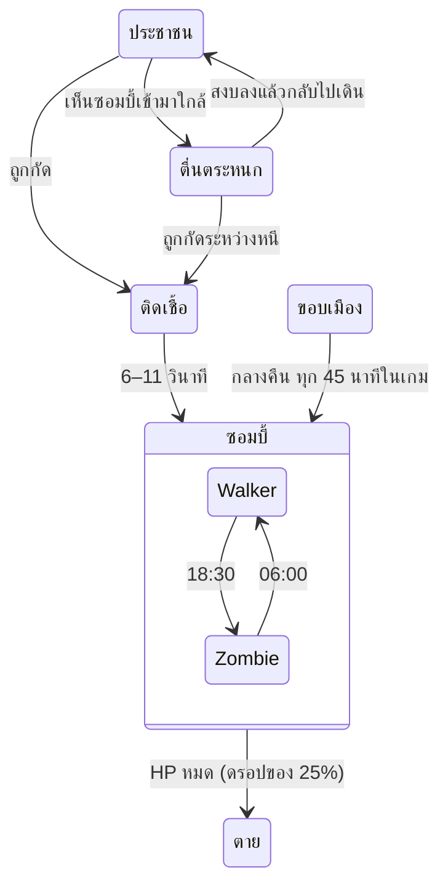

# วันธรรมดา (Ordinary Day) — สรุปโปรเจกต์เกม

Oct 20, 2026 · @Moonwolf

## ภาพรวม

"วันธรรมดา" (Ordinary Day) คือเกม zombie survival แนว open-world sandbox มุมกล้อง isometric 3D ที่หายนะเริ่มต้นจากเช้าวันอังคารธรรมดา ผู้เล่นเกิดมาตัวเปล่า ต้องเก็บอาวุธ กระสุน และยาที่ตกอยู่ทั่วเมือง แล้วเอาชีวิตรอดให้นานที่สุด

- **แรงบันดาลใจหลัก:** เกม STILL จาก Instagram reels ของ still.the.game มุมมอง isometric ภาพสมจริงโทนหม่น เมืองเก่าทรุดโทรม ฝนตกมีแอ่งน้ำบนถนน นาฬิกาตัวใหญ่กลางจอ และแนวคิดว่าการระบาดเริ่มจากวันธรรมดา
- **เกมที่ใกล้เคียงที่สุด:** Project Zomboid (simulation survival มุม isometric)
- **Prototype ที่เล่นได้:** [เปิดเล่นบนเบราว์เซอร์](https://claude.ai/artifact/JgmJvxwsGhe5bkgZCU3syF) ทั้งมือถือและคอม

**แนวคิดหลักที่ prototype ใช้อยู่ (design pillars)**

1. **ชีวิตปกติก่อนหายนะ:** เมืองมีคนเดินไปทำงาน แม่ค้าเฝ้าแผง ข่าววิทยุค่อย ๆ แปลกขึ้น ก่อนการระบาดจะเริ่ม
2. **กลางวันพัก กลางคืนเสี่ยง:** กลางวันซอมบี้เชื่องช้าให้ออกหาของ กลางคืนซอมบี้เร็ว หูไว และมีของระดับ Police / Military ให้เสี่ยงออกไปหา
3. **เริ่มจากศูนย์:** ไม่มีอะไรติดตัว ทุกอย่างต้องหาเอง
4. **เสียงมีราคา:** ปืนแรงกว่าอาวุธประชิด แต่เสียงปืนเรียกซอมบี้จากระยะไกล

## สถานะปัจจุบันและเทคโนโลยี

เกมอยู่ที่ prototype v0.26 (ระบบจากเอกสาร Game System Design Draft 01 ของทีมอยู่ตั้งแต่ v0.3 ประวัติแต่ละเวอร์ชันดูตารางด้านล่าง) ตั้งแต่ v0.3.1 โค้ดแยกเป็น ES modules ใน `src/` เล่นบนเบราว์เซอร์ได้โดยไม่ต้องติดตั้งหรือ build แต่ต้องเปิดผ่าน dev server หรือ GitHub Pages

| หัวข้อ | รายละเอียด |
| --- | --- |
| Engine / ไลบรารี | Three.js r128 (WebGL) โค้ด JavaScript ล้วน |
| ไฟล์ | `index.html` (HTML + CSS) กับ ES modules ใน `src/` ไม่มีขั้นตอน build (โมเดล 3D ใน `assets/` ตั้งแต่ v0.13 และไฟล์เสียงใน `assets/sounds/` ตั้งแต่ v0.19) |
| กราฟิก | low-poly 3D, texture วาดด้วยโค้ด (procedural canvas texture), เงา real-time, tone mapping แบบ ACES |
| กล้อง | orthographic camera มุมก้มประมาณ 41° ติดตามผู้เล่น ซูมได้ |
| แพลตฟอร์ม | มือถือ (virtual joystick + ปุ่มบนจอ) และคอม (คีย์บอร์ด + เมาส์) |
| UI | ภาษาไทย ฟอนต์ Chakra Petch และ Big Shoulders Display |

**ประวัติเวอร์ชัน (ใหม่สุดก่อน)**

| เวอร์ชัน | สิ่งที่เพิ่ม |
| --- | --- |
| v0.17 | เมืองยุค 70: ผนังอิฐ ปูนลอก คอนกรีตเปื้อน หน้าต่างตีไม้และแตก (`wallTex()`), โทนมืดลง, ตัวเลือกภาพฟิล์มเก่า (`settings.film`, `#grain`), ร้านค้าและโรงพยาบาล 6 แห่ง (`config/places.js`, `r.place`, `PLACE_W`, `shopShelves()`, ป้าย `placeSign()`, ตู้ `medcab` `gunrack` `grocery` `tools`) |
| v0.18 | ปิดการติดเชื้อและ Antibiotic ชั่วคราว (`INFECTION.on`), วงแหวนของบนพื้นแยกสีตามประเภท (`RING`, `ringColor()`), อาวุธประชิดใหม่ 6 แบบ, เหตุการณ์สุ่มทุกวัน (`DAILY`, `planDaily()`, `G.site` `G.alarm` `G.fog` `G.heat`), เมืองรกและห้องแน่น (`world/clutter.js`: `heavy`, `roomDecor`, `buildClutter()`), โมเดลจาก City Pack และ Weapons Pack 002 |
| v0.19 | เสียงจริงชุดแรก (`assets/sounds/`, `FILES`, `loadSounds()`, `sample()`): คนกรีดร้องตอนโดนกัดและผู้เล่นตาย (`sfx.scream`), เสียงกรีดร้องไกล ๆ หลังการระบาด, ฝนวน (`updateAmbience()`), ฟ้าแลบและฟ้าร้องตอนฝนหนัก (`playLocal('thunder')` ใน `weather.js`) |
| v0.20 | เสียงซอมบี้ (`groan` `zscream`, `sfx.growl` ตอนเห็นผู้เล่น `a.growlAt`, Sprinter / Tyrant ใช้เสียงจริง), ซอมบี้ใกล้ ๆ ครางเอง, เสียงหัวใจจริงและเต้นตอน HP ต่ำ, เสียงเจ็บของผู้เล่น, ลมสังเคราะห์ (`makeWind()`) ที่พาเสียงกรีดร้องไกล ๆ มา |
| v0.21 | เสียงปืนจริง (`GUN_REC`) และรีโหลด (`RELOAD_REC`, `reload(model)`), ตีโดน (`sfx.hit`), ประตู, ไซเรนก่อนมืด (`sfx.alarm`) และตอนระบาด (`sfx.outbreak`), เฮลิคอปเตอร์ (`rotor`), ลมจากไฟล์ (`makeWind()` แทนลมสังเคราะห์เมื่อโหลดเสร็จ), เสียงวนตามแหล่ง `near()` (ไซเรนรถตำรวจกลางคืน ไฟไหม้ที่รถไหม้และรถตำรวจคว่ำ), เสียงเท้าบนพื้นไม้ในตึก |
| v0.22 | ฟาร์มนอกเมือง (`world/farm.js` `buildFarm()`, `FARM` `WALL_X` `GATE` `inFarm()` `inWorld()` `clampWorld()` ใน `config/world.js`), ประตูกำแพงตะวันตก, ห้องใหม่ 3 ห้องผ่าน `addRoom()` (โรงนาเป็น place `BARN`), ตู้ `farm` และตาราง `PLACE_W.farm`, `furnish()` / `solidAt()` จาก `clutter.js`, ซอมบี้เดินในฟาร์ม (`farmWander`) เกิดที่ขอบฟาร์ม และเดินผ่านประตู (`navStep`), แผนที่เล็กเลื่อนตามไปฟาร์ม, โมเดล Kenney |
| v0.23 | ฟาร์มเสริม (ข้าวโพด 3D `crop`, ข้าวสาลี, บ่อน้ำ `farm.pond`, เรือนกระจก, ราวตากผ้า), อาวุธฟาร์ม `FARM_POOL`, ของเมือง `world/extras.js` (ป้ายรถเมล์ ม้านั่ง ป้าย Stop ป้ายโฆษณา ATM ไซต์ก่อสร้าง), ถังแก๊สระเบิดได้ `tanks` / `G.blown` / `systems/blast.js` (`blast()`, `ignite()`, `blowTank()`, `tankOnRay()`), Molotov และระเบิดมือ (`throwPick()`, `pickThrow`, `p.gear.throwId`), `config/blast.js`, `world/live-props.js` |
| v0.24 | ย่านบ้านชานเมือง (`world/suburb.js` `buildSuburb()`), พื้นที่นอกเมืองเป็นรายการ `AREAS` (`areaAt()`, `beyond()`, `inWorld()` / `clampWorld()` รวมทุกพื้นที่, ประตูใน `navStep`, `areaWander`, จุดเกิดซอมบี้ในพื้นที่), `mapPaint` สำหรับแผนที่เล็ก, `cityWall.south` |
| v0.25 | แม่น้ำและสะพานฝั่งตะวันออก (`world/river.js` `buildRiver()`, พื้นที่ `EAST`, `RIVER` / `riverSide()` และทางข้ามสะพานใน `navStep`), ฝูงซอมบี้ข้ามสะพาน (`HORDE.bridge`), กระท่อมตกปลา, ด่านตรวจ (จุดของ police), ป่าฝั่งตรงข้าม |
| v0.28 | มุมมองบุคคลที่หนึ่งแบบทดลอง (`ui/fps.js`: `setFps()` `toggleFps()` `look()` `fpsMove()` `updateFps()`, `view` / `fpsCam` / `activeCam()` / `screenAngle()` ใน `core/renderer.js`), pointer lock, นิ้วขวาหันมองบนมือถือ, อาวุธหน้ากล้อง, ผนังเต็มความสูงและเพดานของห้อง (`r.walls` `r.y0` `r.wallMat` `r.shell` ใน `world/interiors.js`, `slab()` export), หมอกใกล้ขึ้น, ไม่ทำให้ตึกโปร่งใส, ปุ่ม 👁 และแถบปุ่มบนจอแคบเล็กลง |
| v0.27 | ท่าซอมบี้จาก Mixamo (`tools/mixamo-clips.mjs` แปลงท่าเข้าโครงกระดูก Quaternius ต่อท้าย `anims.glb` เป็นท่า `Z_*`, `skinFrame()` เลือกท่าซอมบี้ `ZV`), คนโดนกัดล้มก่อนกลายร่างแล้วลุกขึ้นช้า ๆ (`RISE`, `a.rise` เซฟและส่งถึงเพื่อนออนไลน์เป็นค่า pose ใน snapshot) |
| v0.26 | ค่ายผู้รอดชีวิต (`world/camp.js` `buildCamp()`, `systems/camp.js` `updateCamp()` `applyTraps()` `campGuards()`), กับดักหมี (`G.traps`, `a.trapT` / `p.trapT`), กองไฟถาวร (`staticFlames()`), วิทยุ (`G.campRadio`), พลุ (`flare`, `updateLures()`, `FLARE`), ตาราง `PLACE_W.camp` และ `CAMP_GRADE`, `CAMP_CFG` |
| v0.16 | เมืองหลังวันธรรมดา: ต้นไม้ หญ้า พุ่มไม้ ป้าย และไฟจราจรจากแพ็ก Trees / Nature / Streets (`world/decor.js`, `setTown()`), คราบเลือด น้ำมัน ขยะ, รถไฟไหม้, ไฟถนนดับและกะพริบ (`flickers`), โทนสีเทาและหมอกตอนเช้า |
| v0.15 | ค้นเฟอร์นิเจอร์ในตึก (`config/search.js`, `systems/search.js`, `boxes` / `boxNear()` ใน `world/interiors.js`, `G.searched`, ปุ่ม/action `use`) แทนตู้กับข้าว · โมเดลเฟอร์นิเจอร์จากแพ็ก Furnitures |
| v0.14.1 | กระเป๋ารวมของชนิดเดียวกันช่องเดียวไม่จำกัด เรียงตามหมวด (`tidyBag()` ใน `systems/inventory.js`, ลบ `stack` ออกจาก `DEF`) · ปืนในมือชี้ไปทางที่หันทุกท่า |
| v0.14 | อาหารในตึก: ตู้กับข้าว 11 จุด (`zone:'pantry'`, `PANTRY`) และตาราง `INDOOR_W` · โมเดลปืน ของ และรถจาก Quaternius (`assets/props/props.glb`, `world/prop-models.js`, `core/gltf.js`, `tools/build-props.mjs`) |
| v0.13.1 | HUD มือถือแนวนอน (`@media (max-height:500px) and (orientation:landscape)` ใน `index.html`) และกันหน้าเว็บซูม (viewport `maximum-scale=1, user-scalable=no`, `touch-action:pan-x pan-y` ในหน้าที่เลื่อนได้, `noZoom()` ใน `ui/input.js`) |
| v0.13 | ตัวละคร 3D จาก Quaternius (`entities/skins.js`, `assets/characters/`) ซอมบี้ทำจากคนกลุ่มเดียวกัน กราฟิกต่ำหรือโหลดไม่ได้ใช้ตัวละครแบบเรียบ |
| v0.12 | เฟส 4 เล่นออนไลน์: ห้องด้วยรหัส 5 ตัวผ่าน PeerJS, host รันเกม เพื่อนส่ง input/คำสั่ง รับ snapshot (`src/net/`), คำสั่งของผู้เล่นรวมใน `systems/actions.js`, ผู้เล่นที่หลุด `p.away`, เซฟเก็บตัวละครของเพื่อน, `tools/net-test.js` |
| v0.11 | เฟส 4 ขั้นเตรียม: กติกาเล่นหลายคน (Q13–Q17 ใน Decision Log), Resurrection Kit ชุบเพื่อนที่ตาย, ดูเพื่อนหลังตาย (`viewed()`), คิวส่งข้อความ เสียง และเอฟเฟกต์ไปเครื่องอื่น (`core/bus.js`, `uiFor(p)`, `sfxFor(p)`, `receive()`) |
| v0.10 | เฟส 3 ข้อ 13–14: ล้มรอเพื่อนช่วย (`p.bleed`, `startHelp()`, `config/party.js`) และสเกลโลกตามจำนวนผู้เล่น (`PARTY`, `partySize()`) · แก้ท่าล้มของ Resurrection Kit ที่ถูก animation ทับจนไม่แสดงตั้งแต่ v0.7 |
| v0.9 | เฟส 2 ปรับโครงสร้างให้รองรับหลายผู้เล่น ไม่เปลี่ยนวิธีเล่น: `players[]` + `player` (คนในเครื่อง), กระเป๋า `p.gear` ต่อคน, การควบคุมผ่าน `p.input`, คำสั่งรับผู้เล่นเป็นพารามิเตอร์, `uiFor(p)` ส่งข้อความถึงคนเดียว, ซอมบี้เลือกเป้าคนที่ใกล้สุด, ระเบิดและทุบโดนทุกคน, เกมจบเมื่อทุกคนตาย, เฮลิคอปเตอร์ต้องได้ทุกคนที่ยังรอด, จำลองเกมเป็นจังหวะคงที่ 1/60 วินาที (`simStep()`), เซฟเวอร์ชัน 2 (แปลงเซฟเวอร์ชัน 1 ได้), แผนที่เล็กแสดงผู้เล่นคนอื่น |
| v0.8 | เฟส 3 ส่วนที่ไม่ผูกจำนวนผู้เล่น: เหตุการณ์ประจำวัน (`systems/events.js`), หน้าตั้งค่า (`ui/settings.js`), เพลงสังเคราะห์ (`updateMusic()`) · แก้ smoke test เรื่องอดอาหารที่ล้มแบบสุ่มเพราะซอมบี้ตีแทรก |
| v0.7 | เฟส 1 "ความตึงเครียด": `REFILL` / `TAKEN` ใน `config/loot.js` ทำให้ของบนพื้นลดจากเต็ม 103 จุดเหลือราว 56 ภายในวันที่ 7, กลิ่น (`G.stay` ใน `systems/doors.js`) ส่งซอมบี้มาหาคนที่หลบตึกเดิมนานตอนกลางคืน, ไม้กระดาน (`fixDoor()`), ย่องและขวดแก้ว (`config/stealth.js`, `systems/throw.js`) |
| v0.6.2 | ปุ่มแจ้งบั๊กในหน้าหยุดเกม (`ui/report.js`) แนบเวอร์ชัน สถานะเกม อุปกรณ์ และ error ล่าสุด, เวอร์ชันอยู่ที่ `config/version.js`, CI รัน smoke test ทุก PR, แก้ `.sheet` ที่กว้างเกินจอมือถือ 34px (ไม่มี border-box), เปลี่ยนชื่อเอกสารนี้จาก `project-summary-v0.3.md` |
| v0.6.1 | แก้บั๊กจากผู้เล่น: ทิ้งของแล้วเด้งกลับ (ของที่ทิ้งวางห่าง 1.15 ม. และไม่เก็บอัตโนมัติจนกว่าจะเดินออกไป 1.4 ม.), เก็บกระสุนไม่ได้ตอนกระเป๋าเต็ม (มีปุ่มบอกและเปิดกระเป๋า), ของดรอปในจุดที่เข้าไม่ถึงถูกย้ายไปจุดว่างใกล้สุด, ปุ่มประตูมีคำว่า "เก็บ" เกินมา |
| v0.6 | เข้าไปในตึกได้ 1 หลังต่อบล็อกเมือง (11 หลัง, `world/interiors.js`) ตัดหลังคาให้เห็นข้างใน, ประตูเปิดปิดได้และพังได้ (`systems/doors.js`), ผนังบังการมองเห็น การตี และแรงระเบิด, ซอมบี้หาทางอ้อมมาที่ประตู, จุดเกิดของในตึก 22 จุด |
| v0.5 | อาวุธประชิดมีความทนและพังได้, หิวและกระหาย (อาหารกระป๋อง น้ำดื่ม), Armor Walker เกราะเฉพาะด้านหน้า, Tyrant ทุบรถ กองขยะ ม้านั่งที่ขวางทาง (`systems/obstacles.js`), ระดับความยาก ง่าย / ปกติ / ยาก (`config/difficulty.js`) พร้อมสถิติแยกตามระดับ |
| v0.4.3 | แผนที่เล็กมุมซ้ายบน (`ui/minimap.js`) หมุนตามมุมกล้อง พร้อมจุดสำคัญ ซอมบี้ใกล้ตัว และ Tyrant · จำกัดความกว้างข้อความกลางจอบนจอคอมไม่ให้ทับแผนที่ |
| v0.4.2 | รถพยาบาลข้างตลาดเป็นแหล่ง Resurrection Kit 1 ชุดต่อเกม (ไม่แตะค่า 1% ที่ยืนยันแล้ว), คำแนะนำสำหรับผู้เล่นใหม่ 12 ข้อ ปิดเปิดได้ในหน้าหยุดเกม |
| v0.4.1 | หน้าหยุดเกม (ปุ่ม ❚❚, P, Esc) พร้อมเซฟเอง เสียง และกลับหน้าแรก หยุดเองเมื่อพับหน้าเว็บ · เพิ่ม `<!doctype html>` และ viewport meta ที่ขาดไป (เดิมพึ่ง claude.ai เติมให้) ทำให้บนมือถือจริงหน้าเว็บไม่ย่อเหลือ 980px อีก และจัด HUD ให้พอดีจอ 360–400px |
| v0.4 | หน้าสรุปตอนจบ + สถิติดีสุด, เสียงสังเคราะห์ (WebAudio), ติดเชื้อเมื่อโดนกัด + Antibiotic รักษา, เป้าหมายรอด 7 คืนแล้วขึ้นเฮลิคอปเตอร์กู้ภัย |
| v0.3.3 | ระบบเซฟอัตโนมัติ 1 ช่องใน localStorage, ปุ่มเล่นต่อบนหน้าเริ่มเกม, เซฟถูกลบเมื่อตัวละครตาย |
| v0.3.2 | ใช้คำตอบ Decision Log ที่ยืนยันแล้ว: ดาเมจอาวุธ = คะแนน × 5 (Q07), Armor Walker รวมไม่เกิน 6 ตัวต่อคืน (Q05), เตือน NIGHT INCOMING ตั้งแต่ 16:00 (Q11) |
| v0.3.1 | แยกโค้ดจาก `index.html` เป็น ES modules ใน `src/` (config, world, entities, systems, ui) พฤติกรรมเกมเหมือน v0.3 ทุกอย่าง · แก้บั๊ก CSS ที่ทำให้กระเป๋า ฉากเริ่มเกม และแถบ HP บอสไม่ซ่อนเมื่อเปิดนอก claude.ai (เช่น GitHub Pages) |
| v0.3 | แบ่งเฟส DAY / NIGHT, อาวุธ 3 ระดับ (Civilian / Police / Military) 18 ชิ้น, loot ตามเวลา, รถตำรวจและรถทหารเป็นแหล่งของพิเศษ, ยา 5 ชนิด + Resurrection Kit, ซอมบี้ 6 คลาส, แถบ HP บอส |
| v0.2 | 1 วันในเกม = 5 นาทีจริง, ระบบกระเป๋า, อาวุธ 3 ช่อง (หลัก รอง ประชิด), ปืน 3 แบบ + กระสุน 3 ชนิด, รีโหลด, loot สุ่มตามโซน, เกิดมาตัวเปล่า |
| v0.1 | เมือง isometric, day/night cycle, ฝน, ประชาชนเดินตามทางเท้า, ไทม์ไลน์การระบาด, การติดเชื้อ, ผู้เล่นตีด้วยท่อเหล็ก |

## โลกและเมือง

เมืองเป็นตาราง 4×4 บล็อก ขนาดรวมประมาณ 136×136 หน่วย (1 หน่วย ≈ 1 เมตร) ถนนกว้าง 8 หน่วย มีทางเท้ากว้าง 2 หน่วยรอบทุกบล็อก และกำแพงคอนกรีตกั้นขอบแผนที่ ผังเมืองสร้างจาก seed เดียวกันทุกครั้ง เมืองจึงหน้าตาเหมือนเดิมทุกรอบ

| ประเภทบล็อก | จำนวน | มีอะไร |
| --- | --- | --- |
| เมือง (city) | 11 | ตึก 2–5 ชั้น แบ่งเป็น 1, 2 หรือ 4 หลังต่อบล็อก บางล็อตเป็นลานหลังตึกมีถุงขยะ ตู้คอนเทนเนอร์ ต้นไม้แห้ง |
| ตลาด (market) | 1 | แผงลอย 3 แถว หลังคาสังกะสีขึ้นสนิม ลังผลไม้สีต่าง ๆ แม่ค้า 6 คน ตู้คอนเทนเนอร์ 2 ตู้ |
| สวน (park) | 2 | สนามหญ้า ต้นไม้ ม้านั่ง น้ำพุร้างตรงกลาง |
| ลานตู้คอนเทนเนอร์ (lot) | 2 | ตู้คอนเทนเนอร์ 4–6 ตู้ (มีตู้ซ้อน) รถเก่า กองขยะ |

- **ตึก:** ผนัง 6 สี (อิฐแดง เบจ เทา ชมพูซีด เหลืองหม่น น้ำตาล) หน้าต่างบางบานถูกตีไม้ปิด หลังคามีขอบกันตก แอร์ ถังน้ำ ห้องบันได บางหลังเป็นหลังคาสังกะสี
- **พร็อพบนถนน:** เสาไฟถนน 80 ต้น ต้นไม้ริมทางที่ทาสีขาวโคนต้น รถจอดริมถนนราว 18 คัน รถตำรวจ 3 คัน (ไฟไซเรนกะพริบตอนกลางคืน) รถทหาร 1 คันในลานตู้คอนเทนเนอร์ แอ่งน้ำ 46 จุดที่จะปรากฏเมื่อถนนเปียก
- **การบังตัวละคร:** ตึกที่อยู่ระหว่างกล้องกับผู้เล่นจะโปร่งใสอัตโนมัติ (occlusion fade) ผู้เล่นจึงไม่หายไปหลังตึก
- **ตึกที่เข้าได้ (v0.6):** บล็อกเมืองละ 1 หลัง (11 หลัง) เลือกหลังที่ใหญ่ที่สุดที่ด้านใดด้านหนึ่งเปิดออกสู่ทางเท้าได้ ประตูหันออกถนน (หันเข้ากล้องถ้าทำได้) มีป้ายไฟสีส้มเหนือประตู ผนังหนา 0.3 ม. ประตูกว้าง 1.6 ม. ข้างในมีพื้น เฟอร์นิเจอร์ชิดผนัง 0–3 ชิ้น (ชั้นวาง เคาน์เตอร์ โซฟา ตู้) และจุดเกิดของ 2 จุด (zone `indoor` ใช้ตารางเดียวกับจุดในเมือง) สร้างหลัง `buildCity()` ด้วย rng แยก (`mulberry32(606)`) ผังเมืองเดิมและลำดับจุดเกิดของเดิมจึงไม่เปลี่ยน
- **มุมมองในตึก (cutaway):** เมื่อผู้เล่นเข้าไป ตัวตึก หลังคา และของบนหลังคาของหลังนั้นจะซ่อน เหลือพื้น ผนังสูง 1 ม. เฟอร์นิเจอร์ และประตู ตึกอื่นยังโปร่งใสเมื่อบังตามเดิม
- **ข้อจำกัดตอนนี้:** ตึกอื่นยังเป็นกล่องทึบ เข้าได้แค่ชั้นล่าง ไม่มีหน้าต่างหรือบันได ฝนยังตกในตึก

## เวลา บรรยากาศ และเหตุการณ์

1 วันในเกมยาว 5 นาทีจริง (เวลาเดิน 4.8 นาทีในเกมต่อ 1 วินาที) กดเร่งได้ ×1 ×2 ×4 เกมเริ่ม 07:30 ของวันอังคาร การระบาดเริ่ม 09:30 แล้ววันจะวนเป็นเฟสกลางวันกับกลางคืน

| เฟส | เวลาในเกม | เวลาจริง (×1) | สิ่งที่เกิดขึ้น |
| --- | --- | --- | --- |
| DAY | 06:00–15:59 | \~2.1 นาที | Walker เชื่องช้า ไม่ไล่ผู้เล่น ไม่มีซอมบี้ใหม่เกิด เกิดเฉพาะของ Civilian Grade |
| NIGHT INCOMING | 16:00–18:29 | \~31 วินาที | ข้อความเตือนและป้ายเฟสกะพริบสีแดง |
| NIGHT | 18:30–05:59 | \~2.4 นาที | Walker กลายเป็น Zombie ซอมบี้ใหม่และตัวพิเศษเกิด ของ Police / Military เกิดทั่วเมือง |
| DAWN | 06:00 | ทันที | ตัวพิเศษถอยหนีและหายไปนอกจอ Zombie กลับเป็น Walker (เหลือไม่เกิน 18 ตัว) จุดว่างได้ของ Civilian ใหม่ 30% |

ใต้นาฬิกามีป้ายเฟสบอก DAY / NIGHT INCOMING / NIGHT พร้อมนับถอยหลังเป็นเวลาจริงจนถึงเฟสถัดไป

- **กลางวัน/กลางคืน (day/night cycle):** ดวงอาทิตย์ขึ้นราว 06:00 ตกราว 19:00 เงาเคลื่อนตามเวลา แสงโทนส้มตอนเช้าและเย็น กลางคืนมีแสงจันทร์สีฟ้า
- **แสงกลางคืน:** ไฟถนนเปิดเอง หน้าต่างตึกบางบานเปิดไฟ ผู้เล่นมีไฟฉายส่องทางข้างหน้า
- **อากาศ:** ฝนตกเป็นเส้น ถนนค่อย ๆ เปียก สะท้อนแสง และมีแอ่งน้ำ ฝนหยุดแล้วถนนค่อย ๆ แห้ง หลัง 14:00 ระบบสุ่มเปลี่ยนอากาศทุก 90 นาทีในเกม โอกาส 35%
- **ข้อความบนจอ:** มี 3 แบบ คือคำบรรยายปกติ ข่าววิทยุ (สีเหลืองอำพัน) และคำเตือน (สีแดงส้ม)

| เวลาในเกม | เหตุการณ์ | ประเภท |
| --- | --- | --- |
| 07:31 | ทุกอย่างเริ่มต้นจากวันธรรมดา | คำบรรยาย |
| 07:50 | บอกผู้เล่นว่าออกจากบ้านมาตัวเปล่า ให้ลองดูของตามทาง | คำบรรยาย |
| 08:20 | รถพยาบาลหลายคันวิ่งเข้าไปทางตลาด | วิทยุ |
| 09:00 | มีรายงานผู้ป่วยก้าวร้าวผิดปกติหลายราย | วิทยุ |
| 09:30 | **การระบาดเริ่ม** ประชาชน 1 คนห่างผู้เล่นราว 16 ม. กลายเป็น Walker มีวงแดงกะพริบชี้ตำแหน่ง | คำเตือน |
| 10:15 | ทางการขอให้ประชาชนอยู่ในอาคาร | วิทยุ |
| 11:00 | ฝนเริ่มตก | คำบรรยาย |
| 12:30 | สัญญาณโทรศัพท์เริ่มขาดหาย | วิทยุ |
| 13:20 | ฝนหยุด | ระบบ |
| ทุกวัน 16:00 | NIGHT INCOMING เตือนให้เตรียมอาวุธ กระสุน และยา | คำเตือน |
| ทุกวัน 18:30 | NIGHT เริ่ม และสุ่มว่าคืนนี้มี Armor Walker (60%) และ Tyrant (40%) หรือไม่ | คำเตือน |
| คืนที่สุ่มได้ 19:00 เป็นต้นไป | วิทยุแจ้งพบตำรวจติดเชื้อสวมเกราะ เมื่อ Armor Walker ตัวแรกโผล่ | วิทยุ |
| คืนที่สุ่มได้ 00:00 | เสียงคำรามจากที่ไกล Tyrant ออกล่า | คำเตือน |
| ทุกวัน 06:00 | รุ่งเช้า ซอมบี้กลับมาเชื่องช้า | คำบรรยาย |

## ประชากร ซอมบี้ และ AI

เมืองเริ่มด้วยประชาชน 42 คน (คนเดินทั่วไป 36 คน + แม่ค้าในตลาด 6 คน) ทุกคนที่ถูกกัดจะกลายเป็นซอมบี้ จำนวนซอมบี้จึงโตเร็วถ้าผู้เล่นไม่หยุดมัน

- **ประชาชน:** เดินบนทางเท้าตามกราฟจุดหัวมุม (sidewalk node graph) ข้ามถนนตรงทางแยก แวะหยุดยืนเป็นครั้งคราว แม่ค้ายืนประจำแผงจนกว่าจะเห็นซอมบี้
- **การหนี (panic):** วิ่งหนีเมื่อเห็น Walker ในระยะ 3.5 ม. หรือซอมบี้คลาสอื่นในระยะ 9 ม. ความเร็ว 3.6 ม./วิ
- **การติดเชื้อ:** ถูกกัดแล้วยังวิ่งต่อได้แต่ช้าลง ผิวค่อย ๆ เป็นสีเขียวเทา และกลายเป็น Walker (กลางวัน) หรือ Zombie (กลางคืน) ภายใน 6–11 วินาทีจริง
- **กลางวัน:** Walker ไม่ไล่ผู้เล่นและไม่สนเสียงปืน แต่ยังเดินเข้าหาประชาชนในระยะ 6 ม. การระบาดวันแรกจึงยังลามช้า ๆ
- **กลางคืน:** ซอมบี้เกิดจากขอบเมืองทุก 45 นาทีในเกม ครั้งละ 2 ตัว (เพิ่มเป็นสูงสุด 4 ตัวในคืนหลัง ๆ) สุ่มคลาสเป็น Zombie 65% · Sprinter 20% · Boomer 15% และคืนต่อไปจะมีตัวพิเศษมากขึ้น
- **เสียง:** กลางคืนซอมบี้ได้ยินเสียงปืนไกลขึ้น 1.5 เท่า และได้ยินเสียงผู้เล่นวิ่งในระยะราว 7.5 ม.
- **เพดาน:** ทั้งเมืองมีคนและซอมบี้รวมไม่เกินราว 95 ตัว (ยกเว้น Tyrant)



ประชาชนถูกกัดได้ทั้งตอนเดินปกติและตอนวิ่งหนี และซอมบี้ที่มาจากนอกเมืองเข้าสู่สถานะเดียวกันกับคนที่กลายพันธุ์ในเมือง

| คลาส | HP | เกิดเมื่อ | ความเร็ว | ดาเมจต่อผู้เล่น | พฤติกรรมและของดรอป |
| --- | --- | --- | --- | --- | --- |
| Walker | 30 | กลางวันเท่านั้น | 0.9 ม./วิ | 6 | ไม่ไล่ผู้เล่น ตีเมื่ออยู่ติดตัว |
| Zombie | 30 | กลางคืนเท่านั้น | 2.6 ม./วิ | 15 | ไล่เหยื่อในระยะ 15 ม. ตาแดงเรืองแสง |
| Sprinter | 30 | กลางคืนเท่านั้น | 6.2 ม./วิ | 12 | เร็วกว่าผู้เล่นวิ่ง (5.8) หยุดชะงัก 1.3 วิหลังตี |
| Boomer | 120 | กลางคืนเท่านั้น | 1.6 ม./วิ | 45 (ระเบิด) | เข้าใกล้ 2.2 ม. แล้วพองตัวเตือน 1.2 วิ ก่อนระเบิดรัศมี 4.2 ม. ทำซอมบี้รอบข้างเจ็บด้วย ถ้าถูกฆ่าก่อนจะไม่ระเบิด |
| Armor Walker | 150 | กลางคืน ถ้าสุ่มผ่าน 60% | 1.9 ม./วิ | 15 | เกราะลดดาเมจปืน 50% เฉพาะกระสุนที่โดนด้านหน้า ยิงด้านหลังได้ดาเมจเต็ม · โผล่ทุก 60 นาทีในเกม รวมไม่เกิน 6 ตัวต่อคืน · ดรอป Police Grade 2 ชิ้น 100% |
| Tyrant | 300 | เที่ยงคืน ถ้าสุ่มผ่าน 40% · คืนละไม่เกิน 1 ตัว | 2.2 ม./วิ | 35 + กระแทก | ตัวใหญ่ 1.8 เท่า มีวงแดงเตือน 0.85 วิ ก่อนทุบรัศมี 3.2 ม. · แถบ HP บอสบนจอ · ดรอป Military Grade 2 ชิ้น 100% · ติดรถ กองขยะ หรือม้านั่งนานเกิน 0.5 วิจะทุบพัง (ตู้คอนเทนเนอร์และตึกไม่พัง) |

HP และกติกาการเกิดมาจาก Draft 01 ของทีม ส่วนความเร็ว ดาเมจ และระยะต่าง ๆ เป็นค่าทดลอง (placeholder) ซอมบี้ธรรมดาที่ตายมีโอกาส 25% ดรอปกระสุนหรือยาตามเฟส

สิ่งที่ Tyrant ทุบพังจะถูกเอาออกจากกล่องชน ทรุดลงเหลือ 30% ของความสูง ส่งเสียงดังเรียกซอมบี้ในระยะ 30 ม. เซฟไว้ใน `G.broken` และกลับมาเมื่อเริ่มเกมใหม่

**เหตุการณ์ประจำวัน (v0.8)**

`G.plan` สุ่มตอนเริ่มเกม (เซฟไปด้วย) วันที่ 2–7: เสบียงทิ้งจากฟ้า 60% (เวลา 10:00–15:00), ฝูงซอมบี้ 50% ตั้งแต่วันที่ 3 (21:00–23:30, เตือน 19:00) ไม่งั้นไฟดับ 35% (19:00 ถึง 06:00) วันที่ไม่ได้อะไรเลยได้เสบียง ค่าใน `config/events.js` เป็น placeholder

- **เสบียง:** กล่องเป็นสิ่งกีดขวาง 1.2×1.2 ม. ไฟแดงกะพริบ ของ 6 ชิ้นรอบกล่องรัศมี 1.5 ม.: อาวุธ Civilian 1, กระสุน Civilian 2, ยาตาราง MED_W กลางวัน 1, อาหารกระป๋อง 1, น้ำ 1 ไม่ใช้ของ Police / Military เพราะยืนยันแล้วว่าเกิดเฉพาะกลางคืน Walker 3 ตัวรอบกล่อง 7–10 ม. `G.drop` เก็บตำแหน่ง กล่องหายตอน 06:00 วันถัดไป ของที่เหลือยังอยู่
- **ฝูง:** ซอมบี้ 5 + วันที่ ตัว (สูงสุด 12, ทุกตัวที่ 5 เป็น Boomer, ข้ามถ้ามีตัวละครเกิน 115) เข้าทางขอบแผนที่บนถนน RC[1..3] แนวใดแนวหนึ่ง มี `a.march` เป็นจุดปลายทางอีกฝั่ง เดิน 75% ของความเร็ว ถึงแล้วออกจากแผนที่ ระหว่างทางทำงานเหมือนซอมบี้ปกติ (เห็น ได้ยิน ไล่) แผนที่เล็กแสดงทุกตัวเป็นจุดส้มแดงไม่จำกัดระยะ
- **ไฟดับ:** `G.blackout` ไฟถนนดับ ไฟหน้าต่างเหลือ 7% ไฟฉายยังทำงาน หมดตอนเช้า

**ตั้งค่า (v0.8)** `ui/settings.js` เก็บใน localStorage `ordinary-day.settings`: คุณภาพ (`QUALITY` ใน `core/renderer.js`: สูง ratio 2 เงา 2048, กลาง 1.6 เงา 1024, ต่ำ 1 ไม่มีเงา), เสียงรวม เพลง เอฟเฟกต์ (แยก bus ใน `systems/audio.js`), FPS แสดงกลางล่างจอและแนบในรายงานบั๊ก

**เพลง (v0.8)** `updateMusic()` ทุกเฟรม: คอร์ด triangle 3 เสียงทุก 5.5 วินาที (กลางคืน 7 วินาที) วน 4 คอร์ด เมเจอร์ก่อนระบาด ไมเนอร์หลังระบาด ต่ำลงตอนกลางคืน + sawtooth หึ่ง 55 Hz ตามระดับกลางคืน + เสียงหัวใจเต้นตาม danger = ซอมบี้ที่กำลังไล่ ÷ 4

**กลิ่น ไม้กระดาน ย่อง และขวด (v0.7)**

- **กลิ่น:** `G.stay` จำว่าผู้เล่นอยู่ตึกไหนตั้งแต่กี่โมง (เซฟไปด้วย) ตอนกลางคืน ถ้าอยู่ตึกเดิมเกิน 90 นาทีในเกม ทุก 45 นาทีซอมบี้ที่ใกล้ที่สุดในระยะ 40 ม. (ไม่นับ Walker และตัวที่ถอย) จะได้ตำแหน่งผู้เล่นเป็นจุดที่ได้ยิน 25 วินาที แล้วมาพังประตู จำนวนต่อรอบ = 1 + ชั่วโมงที่เกินมา ÷ 2 สูงสุด 3 รอบแรกขึ้นข้อความเตือน
- **ไม้กระดาน (`planks`, เจอทีละ 1–2):** ยืนใกล้ประตูแล้วกด B / ปุ่ม 🔨 ประตูที่ปิดอยู่ +40 ความทน สูงสุด 200 (เห็นไม้ขวางด้านในประตูตอนอยู่ในตึก) ประตูที่พังใช้ 2 แผ่นซ่อมกลับมาเป็นประตูปิดความทน 60 ประตูที่เปิดอยู่ต้องปิดก่อน เสียงค้อนรัศมี 18 ม. (ลดครึ่งเมื่อประตูปิด)
- **ย่อง:** กด C ค้าง (เร็ว 1.7 ม./วิ) หรือดันจอยสติ๊กไม่ถึง 45% ซอมบี้ที่ยังไม่ได้ไล่ผู้เล่นจะรู้ตัวในระยะครึ่งเดียวของระยะมองปกติ ตัวที่ไล่อยู่แล้วไม่เสียเป้า ตัวละครก้มตัวลง
- **ขวดแก้ว (`bottle`):** กด Q / ปุ่ม 🍾 ขว้างไปทางที่เล็ง (เมาส์) หรือทางที่หัน (มือถือ ไกล 10.8 ม.) ไกลสุด 12 ม. แตกที่จุดตกหรือผนังแรก เสียงรัศมี 22 ม. (กลางคืน ×1.5) Walker กลางวันไม่สนใจเสียง
- ค่าอยู่ใน `config/shelter.js` (กลิ่น ไม้) และ `config/stealth.js` (ย่อง ขวด) เป็น placeholder ทั้งหมด

**ผนัง ประตู และการหลบในตึก (v0.6)**

- ถ้าผู้เล่นกับซอมบี้อยู่คนละฝั่งผนัง ซอมบี้จะรู้ตัวก็ต่อเมื่อมองเห็นผ่านช่องประตูที่เปิดอยู่ หรืออยู่ห่างไม่เกิน 2.5 ม. (ได้ยินผ่านผนัง) ถ้าอยู่นอกตึกทั้งคู่ ระบบการมองเห็นเหมือนเดิมทุกอย่าง
- ซอมบี้ที่ไล่อยู่แล้วเสียการมองเห็นเพราะผนังหรือประตู จะจำตำแหน่งสุดท้ายไว้ 20 วินาทีแล้วตามไป
- ซอมบี้หาทางเข้าออกตึกผ่านประตู: อยู่หลังตึกจะไปมุมหลัง แล้วเลียบด้านข้างมามุมหน้า แล้วเข้าประตู ซอมบี้ที่ติดอยู่ในตึกจะเดินออกทางประตูก่อนกลับไปเดินบนทางเท้า
- ประตูที่ปิดเป็นสิ่งกีดขวาง กันการเดิน กระสุน และการมองเห็น ซอมบี้ที่ต้องผ่านประตูที่ปิดจะตีประตูแทน ทุก `rate` วินาที ครั้งละเท่าดาเมจของมัน ประตูมี 120 Tyrant พังในทีเดียว Boomer พองตัวแล้วระเบิดใส่ประตู (ประตูในรัศมี 4.2 ม. เสีย 60) ระหว่างที่ผู้เล่นอยู่ในตึกนั้น ซอมบี้ที่ได้ยินจะไม่เลิกตีจนประตูพัง และจอขึ้นข้อความเตือนพร้อม % ของประตู
- เสียงที่เกิดในตึกที่ประตูปิดดังออกไป 0.5 เท่า ประตูพังมีเสียงดังรัศมี 20 ม.
- การตีประชิด aim assist แรงระเบิด Boomer และการทุบของ Tyrant ไม่ทะลุผนัง ผู้เล่นและซอมบี้ถูกดันทะลุผนังบางไม่ได้ (การดันกันของฝูงจะเช็กการชนทุกครั้ง)
- ค่าเหล่านี้อยู่ใน `config/shelter.js` และเป็น placeholder ทั้งหมด

ซอมบี้ที่ติดมุมตึกนานเกิน 1.2 วินาทีจะเปลี่ยนไปเดินสุ่มตามทางเท้า 3 วินาทีก่อนกลับมาไล่ต่อ

## ผู้เล่น กระเป๋า อาวุธ และกระสุน

ผู้เล่นเกิดที่หัวมุมกลางเมืองด้วยมือเปล่า HP 100 และกระเป๋ากางเกง 6 ช่อง HP ฟื้นเอง 1.5 ต่อวินาทีเมื่อไม่โดนตีนาน 6 วินาที (และอาหารกับน้ำไม่ต่ำกว่า 25) ถ้า HP หมดแต่มี Resurrection Kit ในกระเป๋า จะล้มลง 1.8 วินาทีแล้วฟื้นด้วย HP เต็ม อมตะ 3 วินาที และผลักซอมบี้รอบตัวออก ถ้าไม่มีจะจบเกม

**การควบคุม**

| การกระทำ | คอม | มือถือ |
| --- | --- | --- |
| เดิน / วิ่ง | WASD / Shift | ลากนิ้วซ้าย / ดันสุดขอบ |
| เล็ง | ตามเมาส์ | เล็งให้อัตโนมัติ (aim assist) |
| โจมตี | คลิกค้าง หรือ Space | กดปุ่มโจมตีค้าง หรือแตะจอฝั่งขวา |
| สลับอาวุธ | 1 2 3 | ปุ่ม หลัก รอง ประชิด |
| รีโหลด / เก็บของ / รักษา | R / E / H | ปุ่ม R / ปุ่มเก็บ / ปุ่ม ✚ |
| กิน / ดื่ม | G | ปุ่ม 🍴 |
| เปิด / ปิดประตู | E (ยืนใกล้ประตู) | ปุ่มประตู (ขึ้นที่ตำแหน่งปุ่มเก็บ) |
| ตอกไม้ / ซ่อมประตู | B (ยืนใกล้ประตู มีไม้กระดาน) | ปุ่ม 🔨 เหนือปุ่มประตู |
| ย่อง | กด C ค้าง | ดันจอยสติ๊กเบา ๆ |
| ขว้างขวด | Q (ไปทางเมาส์) | ปุ่ม 🍾 ข้างปุ่ม R (ขึ้นเมื่อมีขวด) |
| กระเป๋า | Tab | ปุ่มกระเป๋า (เกมหยุดระหว่างเปิด) |
| หยุดเกม | P หรือ Esc | ปุ่ม ❚❚ มุมขวาบน |
| เปิด/ปิดเสียง | M | ปุ่มเสียงในหน้ากระเป๋าหรือหน้าหยุดเกม |

**เป้าหมาย (goal)**

รอดให้ครบ 7 คืน (คืนหนึ่งนับเมื่อถึง 06:00 ของเช้าถัดไป) แล้วตั้งแต่เช้าวันที่ 8 เฮลิคอปเตอร์กู้ภัยจะลงจอดที่สี่แยกมุมสวนสาธารณะ ทุกวันเวลา 08:00–12:00 มีลูกศรใต้นาฬิกาชี้ทางและบอกระยะ เดินเข้าไปในวงลงจอดเพื่อชนะ ถ้าไปไม่ทันจะกลับมาใหม่วันถัดไป

**ระดับความยาก (difficulty)**

เลือกที่หน้าเริ่มเกม ใช้กับเกมใหม่ เกมที่เซฟไว้ใช้ระดับเดิม (เซฟเก่าก่อน v0.5 เป็นปกติ) ปรับเฉพาะค่าที่ยังเป็น placeholder ค่า HP ซอมบี้ เวลา และกติกาการเกิดที่ยืนยันแล้วไม่เปลี่ยน ตัวคูณทั้งหมดเป็น placeholder

| ค่า | ง่าย | ปกติ | ยาก |
| --- | --- | --- | --- |
| ดาเมจที่ผู้เล่นโดน | ×0.6 | ×1 | ×1.4 |
| ซอมบี้เกิดกลางคืนต่อรอบ | −1 (อย่างน้อย 1) | ตามเดิม | +1 |
| โอกาสติดเชื้อเมื่อโดนกัด | ×0.5 | ×1 | ×1.5 |
| ความเร็วที่หิวและกระหาย | ×0.7 | ×1 | ×1.3 |

**หิวและกระหาย (needs)**

แถบอาหารและน้ำใต้แถบ HP เริ่มที่ 100 ลดตามนาทีในเกม (×2 / ×4 ไม่ทำให้หิวเร็วขึ้นเมื่อเทียบกับเวลาในเกม) ค่าทั้งหมดอยู่ใน `config/needs.js` และเป็น placeholder

- อาหารหมดใน 2880 นาทีในเกม (2 วัน) น้ำหมดใน 1800 นาที (30 ชั่วโมง) วิ่งแล้วน้ำลดเร็วขึ้น 1.5 เท่า
- ต่ำกว่า 25 ขึ้นเตือนและ HP ไม่ฟื้นเอง
- แถบไหนหมด HP ลด 0.15 ต่อนาทีในเกมต่อแถบ ถ้าตายจากตรงนี้หน้าสรุปบอกว่าอดอาหาร
- อาหารกระป๋อง +45 อาหาร น้ำดื่ม +50 น้ำ เก็บอัตโนมัติเมื่อเดินทับ กด G / ปุ่ม 🍴 จะใช้ของที่แก้แถบที่ต่ำกว่าก่อน
- Resurrection Kit ที่ทำงานเติมอาหารและน้ำให้อย่างน้อย 30

**ความทนของอาวุธประชิด (durability)**

อาวุธประชิดตีโดนได้จำนวนครั้งตามตาราง (placeholder): Baseball Bat 70 · Knife 60 · Steel Pipe 90 · Police Baton 120 · Fire Axe 100 ตีโดนครั้งละ 1 หมดแล้วพังและกลับไปใช้หมัด (หมัดไม่พัง) อาวุธที่สุ่มเกิดมีความทน 40–100% ดรอปการันตีเต็ม 100% แสดงเป็น % ในช่องอาวุธและกระเป๋า ต่ำกว่า 20% เป็นสีแดง

**การติดเชื้อ (infection)**

**ปิดอยู่ตั้งแต่ v0.18 (`INFECTION.on`)** ซอมบี้ที่กัดมีโอกาสทำให้ติดเชื้อ (Walker 10% · Zombie, Sprinter, Armor Walker 20% · ระเบิดของ Boomer และการทุบของ Tyrant ไม่ติดเชื้อ ค่าเหล่านี้เป็น placeholder) เชื้อลามจาก 0% ถึง 100% ใน 8 ชั่วโมงในเกม (ราว 100 วินาทีจริงที่ ×1) ระหว่างติดเชื้อ HP ไม่ฟื้นเอง ถึง 100% จะกลายเป็นซอมบี้และจบเกม Antibiotic รักษาได้ (ใช้ได้แม้ HP เต็ม และปุ่มรักษาจะเลือก Antibiotic ก่อนเมื่อติดเชื้อ) Resurrection Kit ที่ทำงานก็ล้างเชื้อด้วย

**เสียง (audio)**

เสียงส่วนใหญ่สังเคราะห์ด้วย WebAudio: ปืนแต่ละแบบ อาวุธประชิด โดนตี ระเบิด เสียงเตือน Boomer พองตัว Tyrant คำรามตอนโผล่และก่อนทุบ Sprinter กรีดร้องตอนเริ่มไล่ ไซเรนเตือนก่อนมืด เสียงวิทยุ เก็บของ ใช้ยา ใบพัดเฮลิคอปเตอร์ เสียงดังเบาตามระยะและซ้ายขวาตามตำแหน่ง ปิดเปิดได้ที่ปุ่มในหน้ากระเป๋าหรือกด M (จำค่าไว้ในเบราว์เซอร์)

**เสียงจริง (v0.19)** ไฟล์ mp3 โมโนใน `assets/sounds/` (รวม 840 KB) จาก Pixabay ตัดเป็นท่อนและปรับความดังให้เท่ากัน โหลดหลังแตะหรือกดปุ่มครั้งแรกพร้อม WebAudio ระหว่างที่ยังโหลดไม่เสร็จหรือโหลดไม่ได้จะเงียบไปเฉย ๆ เกมไม่รอไฟล์ เสียงที่เหลือ (ปืน ซอมบี้) ยังเป็นเสียงสังเคราะห์

| เสียง | ไฟล์ | เล่นเมื่อ |
| --- | --- | --- |
| คนกรีดร้อง | ผู้ชาย 6 · ผู้หญิง 2 · กรีดร้องตื่นตระหนก 2 (สุ่ม ปรับระดับเสียง ±8%) | ซอมบี้กัดประชาชน และผู้เล่นตาย ได้ยินไกล 75 ม. ไกลแล้วทึบลง ห่างกันอย่างน้อย 0.7 วินาที (การระบาดกัดหลายคนพร้อมกัน) ส่งถึงทุกเครื่อง |
| กรีดร้องไกล ๆ | ชุดเดียวกัน เบาและทึบ ซ้ายขวาสุ่ม | หลังการระบาด ทุก 40–90 วินาทีจริง กลางคืนทุก 18–48 วินาที (PLACEHOLDER) เฉพาะเครื่องนี้ เงียบเมื่อตายหรือจบเกม |
| ฝน | วน 60 วินาที ต่อหัวท้ายให้เนียน | ดังตาม `G.rain` (สูงสุด 0.6) ในตึกเบาลงครึ่งหนึ่งและทึบ |
| ฟ้าร้อง | 3 ไฟล์ | ฝนหนัก (`G.rain` > 0.7) ฟ้าแลบ (แสงฟ้าวาบสองครั้ง กลางคืนสว่างกว่า) ทุก 14–40 วินาทีจริง (PLACEHOLDER) ฟ้าร้องตามหลัง 0.2–2.4 วินาที ยิ่งช้ายิ่งทึบ แต่ละเครื่องมีพายุของตัวเอง |

**เสียงซอมบี้และบรรยากาศ (v0.20)** ไฟล์เพิ่ม 12 ไฟล์ (รวมทั้งหมด 1.1 MB) จาก Pixabay

| เสียง | ไฟล์ | เล่นเมื่อ |
| --- | --- | --- |
| ซอมบี้คราง | 5 ไฟล์ (คราง คำราม พึมพำ) | ซอมบี้ในระยะ 24 ม. สุ่มทีละตัว ทุก 2.2–5.7 วินาที (ถ้ามีมากกว่า 4 ตัวทุก 1.2–3 วินาที, PLACEHOLDER) ดังจากตำแหน่งของมัน เฉพาะเครื่องนี้ |
| ซอมบี้ขู่ / กรีด | 5 ไฟล์ (กรีดร้อง 1 ซอมบี้ผู้หญิง 4) + คราง | ซอมบี้เริ่มเห็นผู้เล่น (`sfx.growl` สุ่มกรีดหรือคราง ห่างกันอย่างน้อย 1.2 วินาที ตัวเดิมไม่ร้องซ้ำภายใน 20 นาทีในเกมหลังเห็นครั้งล่าสุด) ส่งถึงทุกเครื่อง |
| Sprinter | เสียงกรีดชุดเดียวกัน เร็วขึ้น 12–22% | แทนเสียงสังเคราะห์ตอนเริ่มไล่ |
| Tyrant | เสียงกรีดเล่นช้าลงครึ่งหนึ่ง (ทุ้มต่ำ) ซ้อนเสียงคำรามสังเคราะห์เดิม | ตอนโผล่และก่อนทุบ |
| หัวใจเต้น | 1 จังหวะ (ตึก-ตัก) | แทนเสียงสังเคราะห์ เต้นเร็วและดังตามจำนวนซอมบี้ที่ไล่ หรือเมื่อ HP ต่ำกว่า 35 (เลือกค่าที่มากกว่า) อยู่ใน bus เพลง |
| ผู้เล่นเจ็บ | เสียงผู้ชายร้องเจ็บ 1 ไฟล์ สุ่มระดับเสียง ±8% | ทุกครั้งที่โดนตี ห่างกันอย่างน้อย 0.3 วินาที |
| ลม | สังเคราะห์ ไม่ใช้ไฟล์ | ตลอดเวลาที่เล่น: เสียงลมกว้าง + เสียงหวีดแคบ เป็นระลอกสุ่มทุก 1.5–5 วินาที แรงขึ้นตอนกลางคืน (×1.6) และตอนฝนตก (×1.5) ในตึกเบาและทึบ (ระดับลม PLACEHOLDER) เสียงกรีดร้องไกล ๆ มากับลมกระโชก (ลมแรงขึ้นก่อน 0.4 วินาที) |

ทุกเสียงผ่านตัวปรับ "เอฟเฟกต์" (หัวใจผ่าน "เพลง") และปุ่มปิดเสียงเดิม

**ปืน เมือง และบรรยากาศ (v0.21)** ไฟล์เพิ่ม 19 ไฟล์ (รวมทั้งหมด 45 ไฟล์ 1.7 MB) จาก Pixabay ทุกเสียงยังมีเสียงสังเคราะห์เดิมไว้ใช้ตอนไฟล์ยังโหลดไม่เสร็จ

| เสียง | ไฟล์ | เล่นเมื่อ |
| --- | --- | --- |
| ปืน | Pistol = 9mm · SMG = นัดสุดท้ายของชุดยิงรัว (เร็วขึ้น 5%) · LMG = ชุดเดียวกันช้าลง 15% และดังกว่า · Rifle = gun shot · Sniper = gun shot ช้าลง 22% และดังสุด · Shotgun = นัดแรกของ cinematic shotgun | ทุกนัด ได้ยินไกล 70 ม. ไกลแล้วทึบ สุ่มระดับเสียง ±3% |
| รีโหลด | Pistol = gun reload 2 · Shotgun = shotgun reload (ขึ้นลำ + ใส่กระสุน) · SMG / Rifle / LMG / Sniper = M4A1 reload | เริ่มรีโหลด (ค้นตู้ยังใช้เสียงสังเคราะห์) |
| ตีโดน | punch | อาวุธประชิดหรือหมัดโดนซอมบี้ (`sfx.hit`) |
| ประตู | open door | เปิดหรือปิดประตู |
| ไซเรน | air raid siren (9 วินาที) | เตือนก่อนมืด (เดิมเป็นเสียงบี๊บ) ทึบเหมือนดังจากไกล |
| ไซเรน | civil defense siren (9 วินาที) | ตอนการระบาดเริ่ม 09:30 เบาและไกล |
| ไซเรนตำรวจ | police siren วน 10 วินาที | กลางคืน ดังจากรถตำรวจคันที่ใกล้ที่สุด ได้ยินในระยะ 55 ม. (คู่กับไฟไซเรนที่กะพริบอยู่แล้ว) |
| ไฟไหม้ | fire crackling วน 24 วินาที | ใกล้รถไหม้ หรือรถตำรวจคว่ำของเหตุการณ์ ได้ยินในระยะ 20 ม. |
| เฮลิคอปเตอร์ | helicopter วน 6 วินาที | แทนเสียงใบพัดสังเคราะห์ตอนเฮลิคอปเตอร์มารับ |
| ลม | soft wind วน 6.6 วินาที | แทนลมสังเคราะห์ของ v0.20 เมื่อโหลดเสร็จ ยังเป็นระลอกกระโชกและพาเสียงกรีดร้องมาเหมือนเดิม |
| เสียงเท้า | footsteps on wood 4 ก้าว | เดินในตึก ทุก 0.75 ม. ย่องแล้วเบาลง (เฉพาะคนที่กล้องตาม เฉพาะเครื่องนี้) |

ไซเรนตำรวจ ไฟไหม้ และเสียงเท้าเป็นเสียงของเครื่องนี้ ไม่ส่งไปเครื่องอื่น (แต่ละเครื่องคำนวณจากตำแหน่งของตัวเอง) ระยะและความดังทั้งหมดเป็น PLACEHOLDER

**หน้าสรุปตอนจบ**

ตอนจบเกมมีหน้าสรุป: สาเหตุ (บาดเจ็บ ติดเชื้อ อดอาหาร หรือรอดสำเร็จ) คืนที่รอด เวลา วันที่ จำนวนซอมบี้ที่กำจัดแยกตามคลาส และสถิติดีสุดของเครื่องนั้นแยกตามระดับความยาก (คืนที่รอดมากสุด กำจัดมากสุด จำนวนครั้งที่รอดสำเร็จ) ขึ้น "สถิติใหม่!" เมื่อทำลายสถิติ

**แผนที่ (minimap)**

แผนที่เล็กใต้แถบ HP มุมซ้ายบน หมุนให้ตรงกับมุมกล้อง (ด้านบนของแผนที่คือด้านบนของจอ) แสดงถนน บล็อก ตึก (ตึกที่เข้าได้เป็นกรอบกลวง ประตูสีส้มคือเปิด สีน้ำตาลคือปิด สีแดงคือพัง) สวน รถตำรวจ (ฟ้า) รถทหาร (ทอง) รถพยาบาล (กากบาทแดง จางลงเมื่อเก็บชุดชุบชีวิตไปแล้ว) จุดลงจอดเฮลิคอปเตอร์ในเช้าที่มารับ Tyrant (จุดแดงกะพริบ) และซอมบี้ที่อยู่ใกล้ไม่เกิน 18 เมตร ลูกศรสีอำพันคือผู้เล่นและทิศที่หัน ขนาด 152px บนจอคอม 78px บนมือถือแนวตั้ง 88px บนมือถือแนวนอน

**HUD บนมือถือ (v0.13.1)**

จอไม่เกิน 640px (มือถือแนวตั้ง) ใช้ HUD ขนาดเล็กตั้งแต่ v0.4.1 ส่วนมือถือแนวนอน (สูงไม่เกิน 500px) กว้างเกิน 640px จึงเคยได้ HUD แบบคอมที่บังเมืองเกือบครึ่งจอ ตั้งแต่ v0.13.1 มีชุดของตัวเอง: แถบ HP ตัวเลข และแผนที่ 88px มุมซ้ายบน นาฬิกา 34px กลางบน (ช่วงเวลากับลูกศรจุดลงจอดอยู่แถวเดียวกัน) ปุ่มเครื่องมือมุมขวาบน แผงอาวุธเป็นแถวเดียวด้านล่างทางซ้ายของปุ่มรีโหลด (ไม่แสดงชื่อเกรด ดูจากสีขอบ) ปุ่มโจมตี 72px ปุ่มขวดอยู่เหนือปุ่มรีโหลด ปุ่มเก็บของและปุ่มค้อนอยู่เหนือปุ่มโจมตี ข้อความเก็บของมุมซ้ายล่าง HUD บังจอ 896×414 ราว 35% (เดิม 67%) อุปกรณ์สัมผัสทุกขนาดไม่แสดงคำอธิบายปุ่มคีย์บอร์ด

หน้าเว็บซูมไม่ได้: viewport `maximum-scale=1, user-scalable=no` หน้าแรกและหน้าต่าง (กระเป๋า หยุดเกม ตั้งค่า) เลื่อนด้วยนิ้วได้แต่ซูมไม่ได้ (`touch-action:pan-x pan-y`) และ `noZoom()` ใน `ui/input.js` บล็อก gesture ถ่างนิ้วและแตะสองครั้งของ Safari ถ้ายังซูมค้างอยู่จะเขียน viewport ใหม่ให้เด้งกลับ 1 เท่า ช่องพิมพ์แจ้งบั๊กบนจอสัมผัสใช้ตัวอักษร 16px เพราะ iOS ซูมเข้าเมื่อแตะช่องที่ตัวเล็กกว่านั้น

**คำแนะนำสำหรับผู้เล่นใหม่ (tips)**

คำแนะนำสั้น ๆ จะขึ้นครั้งแรกที่เจอสถานการณ์นั้น เช่น วิธีเก็บของ รถพยาบาล ก่อนมืด ตึกที่เข้าไปหลบได้ กลางคืน เจอ Sprinter / Boomer / Armor Walker / Tyrant ครั้งแรก HP ใกล้หมด ติดเชื้อ หิวหรือกระหาย อาวุธประชิดใกล้พัง และรอดคืนแรก ขึ้นทีละข้อ ข้อละ 9 วินาที จำไว้ในเบราว์เซอร์ว่าเห็นแล้ว ปิดได้หรือเปิดให้แสดงใหม่ทั้งหมดได้ที่ปุ่มคำแนะนำในหน้าหยุดเกม

**หยุดเกม (pause)**

กดปุ่ม ❚❚ มุมขวาบน หรือกด P / Esc เพื่อหยุดเกม ในหน้าหยุดเกมมีปุ่มเล่นต่อ เซฟเกม (บอกวันและเวลาที่บันทึก) เปิดปิดเสียง แจ้งบั๊ก และเซฟแล้วกลับหน้าแรก เกมจะหยุดเองเมื่อสลับแอปหรือพับหน้าเว็บ กลับมาจึงเจอหน้าหยุดเกมแทนการโดนรุม

**แจ้งบั๊ก (v0.6.2):** ปุ่มแจ้งบั๊กในหน้าหยุดเกมให้ผู้เล่นเล่าสั้น ๆ ว่าเกิดอะไรขึ้น แล้วแนบข้อมูลให้อัตโนมัติ: เวอร์ชัน วันและเวลาในเกม ระดับความยาก ความเร็ว HP อาหาร น้ำ ติดเชื้อ ของในกระเป๋า จำนวนซอมบี้และประชาชน สถานะประตู อุปกรณ์ (จอสัมผัสหรือไม่ ขนาดจอ user agent) และ error ล่าสุดไม่เกิน 5 รายการ ผู้เล่นเห็นข้อมูลทั้งหมดก่อนส่ง เลือกได้ว่าจะคัดลอกไปวางในแชต หรือเปิดหน้าแจ้งบั๊กบน GitHub (ต้องมีบัญชี)

**ระบบเซฟ (save)**

เกมบันทึกอัตโนมัติทุก 15 วินาทีระหว่างเล่น และทุกครั้งที่ปิดหรือพับหน้าเว็บ เปิดเกมครั้งถัดไปจะมีปุ่ม **เล่นต่อ** บอกวันที่และเวลาในเกมที่เซฟไว้ เซฟเก็บในเบราว์เซอร์เครื่องนั้น (localStorage) มีช่องเดียว กด **เริ่มวันใหม่** จะลบเซฟเดิม และเซฟจะถูกลบเมื่อตัวละครตาย สิ่งที่เซฟ: เวลาและสถานะเฟส อากาศ ระดับความยาก สิ่งที่ Tyrant ทุบพัง สถานะประตู (เปิด ปิด ความทน พัง) ตำแหน่ง HP อาหาร และน้ำของผู้เล่น กระเป๋าและอาวุธ ประชาชนและซอมบี้ทุกตัวที่ยังไม่ตาย (ตำแหน่ง คลาส HP สีเสื้อผ้า) และของบนพื้นทั้งหมด สิ่งที่ไม่เซฟ: คราบเลือด ศพ และเอฟเฟกต์ชั่วคราว

**ระบบกระเป๋า (inventory)**

- เริ่มที่ 6 ช่อง เจอ **กระเป๋าเป้** แล้วเพิ่มเป็น 14 ช่อง
- ของชนิดเดียวกัน (กระสุน ยา อาหาร น้ำ ไม้กระดาน ขวด) รวมอยู่ช่องเดียวเสมอ ไม่จำกัดจำนวน (v0.14.1 เดิมมีเพดานต่อช่อง) อาวุธ 1 ชิ้นใช้ 1 ช่อง ช่องเรียงตามหมวด: อาวุธ กระสุน ยา อาหารและน้ำ ไม้กระดาน ขวด เซฟเก่าที่มีของชนิดเดียวกันหลายช่องจะถูกรวมตอนโหลด
- อาวุธที่ติดตัวใน 3 ช่องอาวุธไม่กินช่องกระเป๋า
- ในกระเป๋าทำได้: ติดตั้ง สลับ ถอดเก็บ ใช้ และทิ้งลงพื้น

**อาวุธ (weapon slots)**

| อาวุธ | ระดับ | ช่อง | DMG | FIRE RATE | กระสุน / แม็ก | จุดเด่น |
| --- | --- | --- | --- | --- | --- | --- |
| มือเปล่า | — | ประชิด | 1 | — | — | ติดตัวเสมอ |
| Knife | Civilian | ประชิด | 3 | — | — | เร็ว 0.30 วิ/ครั้ง |
| Steel Pipe | Civilian | ประชิด | 3 | — | — | โดนหลายตัวในวงฟัน |
| Baseball Bat | Civilian | ประชิด | 4 | — | — | กระแทกถอยไกล |
| Pistol | Civilian | รอง | 3 | 5 | 9mm / 12 |  |
| Pump Action Shotgun | Civilian | หลัก | 6 | 2 | 12 Gauge / 6 | กระจาย 7 ลูก |
| SMG | Civilian | หลัก | 2 | 7 | 9mm / 30 | ยิงอัตโนมัติ |
| Police Baton | Police | ประชิด | 4 | — | — | ตีเร็ว 0.45 วิ/ครั้ง |
| Pistol | Police | รอง | 4 | 7 | 9mm / 15 |  |
| Pump Action Shotgun | Police | หลัก | 7 | 4 | 12 Gauge / 7 |  |
| SMG | Police | หลัก | 4 | 7 | 9mm / 30 | ยิงอัตโนมัติ |
| Assault Rifle | Police | หลัก | 6 | 5 | 5.56mm / 30 | ยิงอัตโนมัติ |
| Axe | Military | ประชิด | 8 | — | — | วงฟันกว้าง |
| Pistol | Military | รอง | 5 | 8 | 9mm / 17 |  |
| Semi-Auto Shotgun | Military | หลัก | 7 | 6 | 12 Gauge / 8 |  |
| SMG | Military | หลัก | 5 | 9 | 9mm / 35 | ยิงอัตโนมัติ |
| Assault Rifle | Military | หลัก | 6 | 7 | 5.56mm / 30 | ยิงอัตโนมัติ |
| Sniper Rifle | Military | หลัก | 10 | 2 | 7.62mm / 5 | ทะลุได้ 3 ตัว ระยะ 46 ม. |
| Light Machine Gun | Military | หลัก | 7 | 9 | 5.56mm / 100 | เดินช้าลง 30% ขณะยิง รีโหลด 4.2 วิ |

ค่า DMG และ FIRE RATE (1–10) มาจาก Draft 01 ของทีม ในเกมแปลงเป็นดาเมจจริง = คะแนน × 5 (Q07) และเวลาต่อนัด = 1.6 ÷ คะแนน (placeholder) ลูกซองแบ่งดาเมจเป็น 7 ลูกและแรงลดตามระยะ Knife กับ Steel Pipe ยกมาจาก v0.2 ส่วนดาบถูกตัดออก

กระสุนหยุดที่ผนัง รถ และตู้คอนเทนเนอร์ ไม่โดนประชาชน เสียงปืนเรียกซอมบี้ในรัศมี 20–44 ม. ตามชนิดปืน (กลางคืนไกลขึ้น 1.5 เท่า) อาวุธที่ถืออยู่แสดงชื่อระดับและแถบสีตามระดับในกล่องอาวุธมุมขวาล่าง

**กระสุนและยา**

| ไอเท็ม | ใช้กับ / ผล | ซ้อนได้ต่อช่อง (ก่อน v0.14.1) | เจอครั้งละ |
| --- | --- | --- | --- |
| 9mm | Pistol, SMG | 60 | 10–24 นัด |
| 5.56mm | Assault Rifle, LMG | 90 | 20–40 นัด |
| 12 Gauge | Shotgun ทุกแบบ | 24 | 4–10 นัด |
| 7.62mm | Sniper Rifle (ชนิดใหม่) | 20 | 3–8 นัด |
| Bandage | ฟื้น 25% ของ HP สูงสุด | 5 | 1 ชิ้น |
| Antibiotic | ฟื้น 35% | 4 | 1 ชิ้น |
| Painkiller | ฟื้น 50% (เจอเฉพาะกลางคืน) | 3 | 1 ชิ้น |
| First Aid Kit | ฟื้น 80% (เจอเฉพาะกลางคืน) | 2 | 1 ชิ้น |
| Resurrection Kit | ชุบชีวิตอัตโนมัติด้วย HP 100% เมื่อ HP หมด | 1 | 1 ชิ้น |

ตั้งแต่ v0.14.1 ไม่มีเพดานต่อช่องแล้ว ของชนิดเดียวกันรวมกันช่องเดียว

ปุ่มรักษา (H หรือ ✚) จะใช้ยาที่ฟื้นน้อยที่สุดก่อน เรียงจาก Bandage ไป First Aid Kit

## โครงสร้างหลายผู้เล่น (v0.9)

เตรียมไว้สำหรับเล่นออนไลน์ 4 คน (เฟส 4) ตอนนี้เกมยังเล่นคนเดียว แต่โค้ดรองรับผู้เล่นหลายคนในเกมเดียวแล้ว และทดสอบด้วยผู้เล่นคนที่ 2 ที่ bot บังคับ

- **ผู้เล่น:** `players` เก็บทุกคน `player` คือคนบนเครื่องนี้ (`p.local`) ใช้กับกล้อง HUD กระเป๋า แผนที่ เสียง cutaway และไฟฉาย แต่ละคนมี HP อาหาร น้ำ ติดเชื้อ กลิ่น (`p.stay`) และกระเป๋า `p.gear` = {bag, cap, eq, active} ของตัวเอง สีเสื้อต่างกัน 4 แบบ
- **การควบคุม:** ผู้เล่นขยับเฉพาะผ่าน `p.input` (ทิศ `mx`/`mz` บนพื้น, `mag`, `run`, `sneak`/`slow`, `face` จากเมาส์, `aim`, `fire`, `fireQ`) คนในเครื่องได้ค่าจาก `pollInput()` ทุกจังหวะ คนอื่นจะได้จากเน็ตในเฟส 4 คำสั่งครั้งเดียว (เก็บของ รีโหลด ยา กิน ประตู ไม้ ขวด สลับอาวุธ) เป็นฟังก์ชันที่รับผู้เล่นเป็นตัวแรก
- **ซอมบี้:** เลือกเป้าเป็นผู้เล่นที่ใกล้และมองเห็นได้ที่สุด (`targets()` คือคนที่ยังไม่ตายและไม่อยู่ในท่าล้มของ Resurrection Kit คนที่ล้มรอเพื่อนช่วยยังโดนตีได้) จำคนที่ไล่ใน `a.seenP` ระเบิดของ Boomer และการทุบของ Tyrant โดนทุกคนในรัศมี ซอมบี้ที่ถูกตีหันไปหาคนที่ตี
- **จบเกม:** ผู้เล่นคนหนึ่งตายไม่จบเกม เกมจบเมื่อทุกคนตาย เฮลิคอปเตอร์ออกเมื่อทุกคนที่ยังรอดอยู่ในวงลงจอดและไม่มีใครล้มอยู่
- **ล้มรอเพื่อนช่วย (v0.10):** HP หมดแล้วไม่มี Resurrection Kit และยังมีเพื่อนยืนอยู่อย่างน้อย 1 คน จะล้มลง (`p.bleed` นับถอยหลัง 45 วินาที) ระหว่างล้มคลานได้ 0.6 ม./วิ ใช้อาวุธ ยา กระเป๋า ประตู หรือเก็บของไม่ได้ เชื้อและความหิวหยุดนับ ซอมบี้ยังตีได้ และทุกดาเมจที่โดนลดเวลาลง 0.4 วินาทีต่อ 1 HP เพื่อนที่อยู่ในระยะ 1.6 ม. จะเห็นปุ่ม "ช่วยเพื่อนลุก" (E หรือปุ่มเก็บ) แล้วต้องยืนนิ่ง 4 วินาที (`startHelp()`) ระหว่างนั้นคนที่ล้มขยับไม่ได้ ถ้าคนช่วยเดิน ยิง หรือตีใหม่ การช่วยจะหยุด ช่วยสำเร็จได้ HP 30 และอมตะ 2 วินาที หมดเวลาคือตาย ถ้าไม่มีใครยืนเหลือ ทุกคนที่ล้มอยู่ตายทันทีและเกมจบ ลำดับความสำคัญคือ Resurrection Kit ก่อน (Q09 คงเดิม) และกลายเป็นซอมบี้จากเชื้อไม่ล้ม เล่นคนเดียวคือตายทันทีเหมือนเดิม แผนที่แสดงเพื่อนที่ล้มเป็นจุดแดง เซฟเก็บ `bleed`
- **กติกาเล่นหลายคน (v0.11):** เมื่อมีผู้เล่นมากกว่า 1 คน (`isSolo()` เป็นเท็จ) เปิดกระเป๋าหรือเมนูหยุดเกมแล้วโลกยังเดินต่อ (ตัวเราหยุดเดินและยิงระหว่างเปิด) ปุ่ม ×2 / ×4 ถูกซ่อนและความเร็วกลับเป็น ×1 กระสุนและการตีไม่โดนเพื่อน (ระเบิดของ Boomer ยังโดนทุกคน) เล่นคนเดียวยังหยุดเกมได้เหมือนเดิม
- **Resurrection Kit ชุบเพื่อน (v0.11):** เพื่อนที่ตายแล้ว (ร่างอยู่ที่เดิม) ชุบได้ด้วย Kit ในกระเป๋า ยืนข้างร่างในระยะ 1.6 ม. กด E หรือปุ่ม "ชุบเพื่อนด้วย Kit" แล้วยืนนิ่ง 4 วินาทีเหมือนการช่วยลุก เพื่อนกลับมาด้วย HP 100% ล้างเชื้อ และอาหารกับน้ำอย่างน้อย 30 เหมือนที่ Kit ทำกับเจ้าของ Kit หายไป 1 ชิ้น ไม่มี Kit ปุ่มจะขึ้นว่า "เพื่อนตาย · ต้องมี Kit" ชุบได้ทุกเวลาตราบที่ยังมีคนรอด (เกมจบเมื่อตายหมด) Kit ยังทำงานกับเจ้าของอัตโนมัติก่อนเสมอ (Q09)
- **ดูเพื่อนหลังตาย (v0.11):** ผู้เล่นในเครื่องตายแต่ยังมีเพื่อนรอด กล้อง ไฟฉาย เสียง และ cutaway ตามเพื่อนที่ยังยืนอยู่ (`viewed()`) พร้อมข้อความว่ารอให้เพื่อนชุบได้ เพื่อนได้ข้อความว่าใครตายและใช้ Kit ที่ร่างได้
- **คิวส่งไปเครื่องอื่น (v0.11):** เกมรันบนเครื่อง host เครื่องเดียว สิ่งที่ผู้เล่นเครื่องอื่นต้องเห็นหรือได้ยินเข้าคิว `bus.out` ใน `core/bus.js` เป็น `{to, kind, args}` (`to` = id ผู้เล่น หรือ `'*'` ทุกคน) เฉพาะตอน `bus.on` (ออนไลน์) ประเภท: `say` / `feed` (ข้อความถึงทุกคนจาก `say()` `feed()` หรือถึงคนเดียวจาก `uiFor(p)`), `hurt` (จอแดง), `loadout`, `sfx` (เสียงโลกจาก `sfx.*` ส่งถึงทุกคน เสียงส่วนตัวจาก `sfxFor(p)` ส่งถึงคนนั้น), `fx` (เลือด tracer ระเบิด) เครื่องปลายทางเรียก `receive(m)` ใน `ui/hud.js` เสียงปืนเป็นเสียงตามตำแหน่งคนยิงแล้ว (คนอื่นยิงไกล ๆ ได้ยินเบา) ที่ยังไม่อยู่ในคิว: ตำแหน่งตัวละคร ประตู สิ่งที่ Tyrant ทุบ ซึ่งจะส่งเป็น snapshot ในขั้นถัดไป
- **สเกลตามจำนวนผู้เล่น (v0.10):** นับผู้เล่นที่ยังไม่ตาย (`partySize()` ล้มก็นับ) แล้วใช้ตาราง `PARTY` ใน `config/party.js` คนเดียวไม่เปลี่ยนอะไร 2/3/4 คน: ซอมบี้กลางคืนต่อรอบ +1/+2/+3, ฝูงซอมบี้ ×1.35/×1.7/×2 (ยังติดเพดาน 115 ตัว), โอกาสเกิดของกลางวันและกลางคืน ×1.3/×1.55/×1.8 (ไม่เกิน 100%), เสบียงทิ้งจากฟ้า +2/+3/+4 ชิ้น (ระดับ Civilian เท่านั้น) · HP ซอมบี้ Armor Walker (ไม่เกิน 6 ตัวต่อคืน) และ Tyrant เป็นค่าที่ยืนยันแล้วจึงไม่สเกล
- **จังหวะจำลอง:** `simStep()` ใน `main.js` เดินทีละ 1/60 วินาที (ช้าสุด 5 จังหวะต่อเฟรม ถ้าค้างนานกว่านั้นจะไม่ไล่ตาม) เวลาในเกมต่อวินาทีจริงเท่ากันทั้งที่ 60 และ 20 fps ส่วนวาดภาพ animation เอฟเฟกต์ และ HUD ทำทุกเฟรม
- **เซฟเวอร์ชัน 2:** เก็บ `players` (ตำแหน่ง HP สถานะ กระเป๋า กลิ่น ตายหรือยัง) เซฟเวอร์ชัน 1 ถูกแปลงเป็นผู้เล่นคนเดียวตอนโหลด

## เล่นออนไลน์ (v0.12)

- **ห้อง:** เจ้าของห้อง (host) กด "เปิดห้องให้เพื่อนเข้า" ในเมนูหยุดเกม ได้รหัส 5 ตัว (ตัวอักษรและเลขที่อ่านพลาดยาก) เพื่อนกรอกรหัสที่หน้าแรก สูงสุด 4 คนรวม host (`MAX_PLAYERS`) เข้ากลางเกมได้ทุกเมื่อ ห้องต้องเปิดจากเกมที่กำลังเล่นอยู่ (เกมใหม่หรือเล่นต่อจากเซฟ) กลับหน้าแรกหรือกด "ปิดห้อง" คือปิดห้องและพาเพื่อนกลับหน้าแรก
- **การเชื่อมต่อ (Q17):** PeerJS 1.5.4 โหลดจาก jsDelivr ครั้งแรกที่เปิดหรือเข้าห้อง เซิร์ฟเวอร์กลางฟรีของ PeerJS ใช้แนะนำเครื่องให้รู้จักกัน (id ของห้องคือ `ordinary-day-` + รหัส) แล้วเครื่องคุยกันตรงด้วย WebRTC data channel แบบ reliable ส่ง JSON ใส่ `?peer=host:port` ใน URL เพื่อใช้เซิร์ฟเวอร์ PeerJS ของตัวเอง (ใช้ตอนทดสอบ)
- **ใครรันเกม:** host รันเกมทั้งหมดเหมือนเดิม เครื่องเพื่อน (client) ไม่มีตรรกะเกม วาดโลกตามที่ host ส่งมา
  - เพื่อน → host: `p.input` ประมาณ 20 ครั้งต่อวินาที (ส่งเมื่อเปลี่ยน หรือทุก 0.5 วินาที กดยิงส่งทันที) และคำสั่ง (`act()` ใน `systems/actions.js`: ใช้/เก็บ ซ่อมประตู รีโหลด ยา กิน ขว้าง สลับอาวุธ และปุ่มในกระเป๋า) host ตรวจค่าก่อนใช้
  - host → เพื่อน: snapshot 15 ครั้งต่อวินาที (`net/snapshot.js`) มีเวลา เฟส ฝน ผู้เล่นทุกคน ตัวละครทุกตัว (`nid` ตรงกันทุกเครื่อง) ของบนพื้น ประตู สิ่งที่ Tyrant ทุบ กล่องเสบียง และข้อมูลของผู้เล่นคนนั้นเอง (กระเป๋า สิ่งที่อยู่ในระยะเก็บ หิว น้ำ ติดเชื้อ) ส่วนที่เปลี่ยนไม่บ่อยส่งเฉพาะตอนเปลี่ยน และข้อความ เสียง เอฟเฟกต์จาก `core/bus.js` ทุกเฟรม
  - เครื่องเพื่อนเลื่อนตำแหน่งตัวละครเข้าหาตำแหน่งจาก host อย่างนุ่มนวล ยังไม่มีการเดาการเดินล่วงหน้า (prediction) ตัวเองจึงขยับช้ากว่าการกดราว 1–2 เฟรมของ snapshot บวกเวลาเน็ต
- **หลุดและกลับเข้า:** เบราว์เซอร์ของเพื่อนเก็บ token ไว้ (`ordinary-day.token`) เข้าห้องเดิมอีกครั้งได้ตัวละครเดิมพร้อมของ ระหว่างหลุด ตัวละครเป็น `p.away`: ยืนนิ่ง ไม่หิว ไม่ติดเชื้อเพิ่ม ซอมบี้ไม่สนใจ ไม่นับในจำนวนผู้เล่น (สเกล การช่วยลุก เฮลิคอปเตอร์) ห้องเต็มแล้วมีคนหลุด คนใหม่เข้าแทนตัวละครที่ว่างได้
- **เซฟ:** host เซฟเหมือนเดิมโดยเก็บตัวละครของเพื่อนและ token ไว้ด้วย โหลดเซฟแล้วตัวละครของเพื่อนรอเป็น `away` จนกว่าเพื่อนจะเข้าห้องอีกครั้ง เพื่อนเซฟเองไม่ได้ (ปุ่มเซฟถูกซ่อน)
- **จบเกมและเริ่มใหม่:** เกมจบบน host หน้าสรุปขึ้นทุกเครื่อง เพื่อนไม่มีปุ่มเล่นอีกครั้ง (รอ host) หรือกดออกจากห้อง host กดเล่นอีกครั้ง เพื่อนทุกคนได้ตัวละครใหม่ในเกมใหม่โดยอัตโนมัติ
- **เวอร์ชันต้องตรงกัน:** เวอร์ชันเกม (`VERSION`) ของ host กับเพื่อนต้องตรงกัน ไม่ตรงจะขึ้นข้อความให้รีเฟรช
- **ข้อจำกัด:**
  - host ต้องเปิดเกมค้างไว้ที่หน้าจอ เบราว์เซอร์หยุด requestAnimationFrame เมื่อสลับแท็บหรือพับจอ เกมของทุกคนจะหยุดตาม
  - บางเครือข่ายต่อ WebRTC ตรงกันไม่ได้ (ยังไม่มีเซิร์ฟเวอร์ TURN)
  - ยังไม่แสดงบนเครื่องเพื่อน: ขวดที่กำลังลอย, แสงปากกระบอกปืน, วงเตือนก่อน Tyrant ทุบ (ได้ยินเสียงและเห็นผลตามปกติ)
  - ข้อมูลต่อเพื่อน 1 คนประมาณ 3–6 KB ต่อ snapshot (ราว 50–90 KB/วินาที) ยังไม่บีบอัด

## ตัวละคร 3D (v0.13)

- **ที่มา:** Quaternius Ultimate Modular Men Pack และ Ultimate Modular Women Pack (CC0) แปลงด้วย `tools/build-characters.mjs` เป็น `assets/characters/` 16 แบบ ไฟล์ละ 280–510 KB และ `anims.glb` 332 KB รวม 5.6 MB (ตัดท่าทางออกจากทุกตัวแล้วเก็บไว้ไฟล์เดียว ตัดปืนที่ติดมากับบางชุด บีบตำแหน่งและน้ำหนักกระดูกเป็นจำนวนเต็ม) ทุกตัวใช้โครงกระดูก 62 ข้อเดียวกัน
- **ใครใส่ชุดอะไร:** ผู้เล่นคนที่ 1/2 Adventurer ชาย/หญิง (มีเป้), คนที่ 3/4 ชุดเดียวกันแต่ย้อมสีฟ้า/เขียว · ประชาชนสุ่มจาก 12 ชุด (ชาย Casual, Hoodie, Beach, Suit, Worker, Farmer, Punk · หญิง Casual, Formal, Suit, Worker, Punk) ตาม `nid` ทุกเครื่องในห้องออนไลน์จึงเห็นคนเดียวกันใส่ชุดเดียวกัน · ซอมบี้: คนเดิมที่กลายร่าง (ผิวตามสี `ZC.skin` ของคลาส เสื้อผ้าหม่นลง แขนยื่นไปข้างหน้า หัวก้ม) ซอมบี้ที่เกิดใหม่ใช้ชุดประชาชน บางตัวเป็นทหารหญิง (Soldier) · Armor Walker = SWAT · Tyrant = Worker ขยายตามสเกลเดิม · Boomer = Farmer พองตัวก่อนระเบิด
- **ท่าทาง (11 ท่า):** ยืน เดิน วิ่ง ตาย โดนตี ยิง ถือปืน วิ่งยิง ใช้ของ (ตอนรีโหลด) ต่อย ฟาด · ความเร็วท่าเดินและวิ่งปรับตามความเร็วจริง · ผู้เล่นถือปืนใช้ท่าถือปืน/วิ่งยิง ตีด้วยมือเปล่าใช้ท่าต่อย อาวุธประชิดใช้ท่าฟาด · ซอมบี้ตีใช้ท่าต่อย Tyrant ง้างใช้ท่าฟาด · ล้มรอเพื่อนช่วย ล้มด้วย Kit และตาย ใช้ท่าตาย
- **อาวุธในมือ:** โมเดลอาวุธติดที่กระดูกข้อมือขวา (`WristR`) มุมใน `HAND` ของ `entities/player.js` ตั้งแต่ v0.14.1 ปืนถูกหมุนทุกเฟรมให้ชี้ไปทางที่ผู้เล่นหันเสมอ (`skinFrame()`) เพราะท่าวิ่งและท่ายิงบิดข้อมือจนปืนชี้ขึ้นฟ้าหรือย้อนหลัง อาวุธประชิดยังตามข้อมือ
- **ความเร็ว:** ตัวที่อยู่นอกจออัปเดตท่าทางแค่ 4 ครั้งต่อวินาทีและไม่ถูกวาด ตัวละครละ 5,000–8,000 สามเหลี่ยม
- **ตัวละครแบบเรียบ (เดิม):** ยังสร้างทุกครั้งแต่ซ่อนไว้ใต้โมเดล ใช้เมื่อยังโหลดไม่เสร็จ (เกมเริ่มได้เลย คนจะเปลี่ยนเป็นโมเดลเมื่อโหลดเสร็จ หน้าแรกบอกความคืบหน้า), เมื่อตั้งกราฟิก "ต่ำ" หรือเมื่อโหลดไม่ได้ (ขึ้นข้อความที่หน้าแรก) โมเดลเป็นแค่ภาพ ตรรกะเกมไม่อ่านค่าจากโมเดลเลย
- **โหลด:** GLTFLoader และ SkeletonUtils ของ Three.js r128 จาก jsDelivr (`core/gltf.js` ใช้ร่วมกับโมเดลของ) แล้ว `assets/characters/*.glb`
- **ท่าซอมบี้ (v0.27):** ดูหัวข้อ "ท่าซอมบี้จาก Mixamo" ข้างล่าง ตั้งแต่ v0.27 ซอมบี้ไม่ใช้ท่าของคนกับแขนยื่นแล้ว

## โมเดลปืน ของ และรถ (v0.14)

- **ที่มา:** แพ็ก Guns, Survival Pack, Foods และ Cars ของ Quaternius (CC0, ไฟล์ FBX) แปลงด้วย `tools/build-props.mjs` (FBX2glTF + gltf-transform) รวมเป็นไฟล์เดียว `assets/props/props.glb` ประมาณ 1.3 MB 52 ชิ้น (v0.15 เพิ่มเฟอร์นิเจอร์ 13 ชิ้น v0.16 เพิ่มต้นไม้ พืช และป้าย 19 ชิ้น)
- **ปืน:** Pistol (ปืนพกทุกระดับ), SMG, Assault Rifle, Shotgun, Sniper Rifle และ Light Machine Gun (ใช้ไรเฟิลอีกแบบที่ใหญ่กว่า เพราะในแพ็กไม่มี LMG) ใช้โมเดลเดียวกันทุกระดับ ระดับยังดูจากวงแหวนบนพื้นและแผงอาวุธ · **อาวุธประชิด:** Knife, Axe (Baseball Bat, Steel Pipe และ Police Baton ไม่มีในแพ็ก ยังเป็นแบบเดิม) · ปืนบนพื้นวางนอน ขนาดเท่าโมเดลเดิม ในมือจับตรงด้ามตาม `GUN` ใน `world/item-models.js`
- **ของ:** อาหารกระป๋อง น้ำดื่ม Bandage First Aid Kit กระเป๋าเป้ และขวด (กระสุน Antibiotic Painkiller Resurrection Kit และไม้กระดาน ยังเป็นแบบเดิม)
- **เฟอร์นิเจอร์ (v0.15):** ตู้เย็น ตู้ครัว ซิงก์ เตาอบ ชั้นหนังสือ ชั้นวาง ตู้ลิ้นชัก และโซฟา จากแพ็ก Furnitures ต่อเป็นแถวตามความยาวของเฟอร์นิเจอร์แต่ละชิ้น ขนาดตามความสูงเดิม หลังชิดผนังหน้าหันเข้าห้อง (`FURN` ใน `world/prop-models.js`) กล่องชนเท่าเดิม
- **รถ:** รถทั่วไปสลับ 3 แบบที่ทาสีเดิมของรถคันนั้น (Normal Car 2 แบบ, SUV) แท็กซี่ และรถสปอร์ต รถตำรวจใช้ Cop ยาว 4.3 ม. กล่องชนเท่าเดิม 4.2 × 1.9 ม. Tyrant ทุบแล้วโมเดลยุบลงเหมือนรถแบบเดิม รถพยาบาลและรถทหารยังเป็นแบบเดิม (ไม่มีในแพ็ก)
- **แบบเดิม:** ใช้ตอนยังโหลดไม่เสร็จ ตอนกราฟิก "ต่ำ" และตอนโหลดไม่ได้ (`world/prop-models.js`: `props`, `setPropsOn()`, ของบนพื้นและในมือสร้างใหม่ด้วย `refreshItems()` ใน `systems/drops.js`) ตรรกะเกมไม่อ่านค่าจากโมเดล
- **ความเร็ว:** ในเครื่องทดสอบ (วาดภาพด้วย CPU) เฟรมเรตลดราว 5% เมื่อเปิดโมเดลของ

## เมืองหลังวันธรรมดา (v0.16)

แนวทางจากผู้สร้าง: เมืองแบบ Project Zomboid ดูธรรมดาแต่สิ้นหวัง ไม่ใช่เมืองไทย ผังเมือง ถนน ตึก การชน และจุดเกิดของเหมือนเดิมทุกอย่าง เพิ่มแค่ของตกแต่งและบรรยากาศ

- **ต้นไม้:** ต้นไม้ 43 ต้นเดิมใช้โมเดลจากแพ็ก Trees ของ Quaternius ต้นมีใบ 4 แบบ (สีใบสลับเขียวหม่น เหลือง และน้ำตาลแบบปลายฤดู) ต้นตาย 5 แบบ สูง 4.6–6.8 ม. กล่องชนต้นละ 0.44 ม. เท่าเดิม
- **ของตกแต่ง (`world/decor.js`, rng ของตัวเอง `mulberry32(1616)` สร้างหลังเมืองและตึก ไม่มีกล่องชน ไม่ทับจุดเกิดของและไม่อยู่ในตึก):** หญ้าขึ้นตามโคนกำแพง ขอบทางเท้า และรอยแตกริมถนน สวนและลานตู้คอนเทนเนอร์รก (พุ่มไม้ หญ้าสูง หิน ตอไม้ ท่อนไม้) สัญญาณไฟจราจรที่สี่แยกด้านใน 9 จุด ป้ายเตือนและป้ายห้ามจอด รวมราว 300 ชิ้น
- **คราบบนพื้น:** คราบเลือด 30 จุด คราบน้ำมัน ขยะกระดาษ 44 จุดบนถนนและทางเท้า เลือดและน้ำมันข้างรถตำรวจ รอยไหม้ใต้รถที่ไฟไหม้ (แสดงทุกระดับกราฟิก)
- **รถไฟไหม้:** รถทั่วไปทุกคันที่ 4 ไหม้ดำ (3 คัน เลือกตามลำดับ ไม่ใช้ rand)
- **ไฟถนนเสีย:** เสาไฟทุกต้นที่ 6 ดับ อีกทุกต้นที่ 6 กะพริบเป็นช่วง ๆ ตอนกลางคืน (`flickers`, `weather.js`)
- **บรรยากาศ:** ท้องฟ้าและแสงกลางวันเทาลง แดดอ่อนลงเล็กน้อย พลบค่ำสีซีด หมอกบาง ๆ ช่วง 05:00–10:00 (มากสุดราว 07:00) ฝนทำให้หมอกใกล้ขึ้น
- **ความเร็ว:** โมเดลเล็ก ๆ หลายร้อยชิ้นถูกรวม (bake) เป็นก้อนเดียวต่อวัสดุต่อพื้นที่ 46 ม. (`setTown()` ใน `world/prop-models.js`) บนจอมือถือ draw call ลดจาก 168 เหลือ 153 สามเหลี่ยมเพิ่มจาก 26k เป็น 52k เฟรมเรตบนเครื่องทดสอบเท่าเดิม · กราฟิก "ต่ำ" หรือโหลดไม่ได้ ใช้ต้นไม้แบบเดิมและไม่มีของตกแต่ง

## เมืองยุคเก่าและร้านค้า (v0.17)

แนวจากผู้สร้าง: หม่นกว่าเดิม ตึกดูไม่ทันสมัย อารมณ์ดิบแบบหนัง Dawn of the Dead ภาคเก่า (1978)

- **ตึก:** ผนังวาดใหม่ 3 แบบ อิฐแดงคล้ำ ปูนทาสีที่ลอก และคอนกรีตเปื้อน สีหม่นทั้งหมด หน้าต่างบานกระทุ้งแบ่ง 4 ช่อง ตีไม้ปิด 24% แตก 12% มีมู่ลี่ครึ่งบาน คราบน้ำไหลจากหลังคาและคราบสกปรกใต้ขอบหน้าต่าง ไฟในห้องตอนกลางคืนสีส้มหม่นและติดน้อยลง กล่องบนหลังคาสีเทาคล้ำ พื้นในตึกเป็นพื้นปูนเปื้อน ทางเท้าและหญ้าสีคล้ำลง
- **โทนภาพ:** ท้องฟ้า แดด และแสงรอบ ๆ มืดและเหลืองเทากว่า v0.16 ขอบจอมืดขึ้น และตัวเลือก **ภาพฟิล์มเก่า** ในหน้าตั้งค่า (เปิดเป็นค่าเริ่มต้น): สีซีดอมน้ำตาล (`sepia .22 saturate .68 contrast 1.08 brightness .93` บนภาพ 3D อย่างเดียว HUD สีเดิม) และเกรนฟิล์มที่ขยับ 8 ครั้งต่อวินาที (ปิดเมื่อผู้ใช้ตั้งลดการเคลื่อนไหว) ถ้ามือถือกระตุกให้ปิดตัวเลือกนี้
- **ร้านค้าและโรงพยาบาล (`config/places.js`, placeholder ทั้งหมด):** ตึกที่เข้าได้ 6 หลังใหญ่สุดกลายเป็น โรงพยาบาล ร้านปืน ร้านขายของชำ ร้านอาหาร ร้านขายยา และร้านเครื่องมือ (เรียงจากใหญ่ไปเล็ก) อีก 5 หลังเป็นบ้าน ทุกร้านมีป้ายไม้ทาสีภาษาอังกฤษเหนือประตู (HOSPITAL, GUNS & AMMO, GROCERY, DINER, DRUGS, HARDWARE) และสี่เหลี่ยมสีบนแผนที่ มีคำแนะนำครั้งแรกตอน 09:50
  - เฟอร์นิเจอร์ในร้านเปลี่ยนเป็นของร้าน และมีชั้นวางเพิ่ม 2 ชิ้นข้างประตู (เฟอร์นิเจอร์ที่ค้นได้รวม 38 ชิ้น):

| ตู้ | ร้าน | จำนวนของ | โอกาสว่าง | ของที่เจอ (น้ำหนัก) |
| --- | --- | --- | --- | --- |
| ตู้ยา | โรงพยาบาล ร้านขายยา | 1–3 | 10% | ยา 85 · ขวด 10 · อาหาร 5 |
| ชั้นวางปืน | ร้านปืน | 1–3 | 15% | กระสุน 65 · อาวุธ Civilian 30 · ไม้กระดาน 5 |
| ชั้นวางสินค้า | ร้านขายของชำ | 2–3 | 10% | อาหาร/น้ำ 85 · ขวด 15 |
| ตู้ครัว | ร้านอาหาร | 1–3 | 10% | ตามตู้ครัวปกติ |
| ชั้นเครื่องมือ | ร้านเครื่องมือ | 1–3 | 15% | ไม้กระดาน 50 · ขวด 20 · อาวุธประชิด 20 · กระสุน 10 |

  - จุดเกิดของบนพื้นในร้าน (12 จุด) ใช้ตาราง `PLACE_W` (โรงพยาบาล ยา 75 · ร้านปืน อาวุธ 35 กระสุน 60 · ของชำ อาหาร 80 · ร้านอาหาร อาหาร 85 · ร้านขายยา ยา 85 · ร้านเครื่องมือ ไม้กระดาน 50 อาวุธประชิด 20) และเกิดบ่อยกว่าจุดอื่น 1.7 เท่า ระดับอาวุธยังตามเฟส (ร้านปืนมีของ Police / Military เฉพาะกลางคืนเหมือนที่อื่น) ตู้ในร้านมีของกลับมา 60% ทุก 06:00 (บ้าน 35%)
  - ร้านเลือกจากขนาดตึก ไม่ใช้ rng เพิ่ม และชั้นวางใหม่ต่อท้าย `boxes` เซฟเก่าจึงใช้ได้ (ตู้ในตึกที่กลายเป็นร้านจะให้ของตามร้านนับจากนี้)

## เมืองรก ห้องแน่น และเหตุการณ์ทุกวัน (v0.18)

คำขอจากผู้สร้าง: ใส่ pack เมืองและอาวุธที่ได้มา เมืองรก เฟอร์นิเจอร์แน่นในตึก ปิดระบบติดเชื้อและ Antibiotic ไว้ก่อน แยกสีวงแหวนของบนพื้นตามประเภท และมีเหตุการณ์สุ่มทุกวัน

- **ปิดการติดเชื้อ:** `INFECTION={on:false}` ใน `config/zombies.js` ซอมบี้กัดไม่ติดเชื้อ Antibiotic ไม่เกิดในตาราง loot (`setMedTables()` ลบออกจาก `MED_W` ตอนปิด) คำแนะนำและคำอธิบายระดับความยากไม่พูดถึงการติดเชื้อ โค้ดทั้งหมดยังอยู่ เปลี่ยนเป็น `true` แล้วกลับมาเหมือน v0.17 (smoke test เปิดไว้ทดสอบระบบเดิมก่อน แล้วปิดในส่วน v0.18) ยา Antibiotic ที่อยู่ในกระเป๋าจากเซฟเก่ายังใช้ฟื้น HP ได้
- **วงแหวนของบนพื้น (`RING` ใน `config/items.js`, placeholder):** สีตามประเภท อาวุธ แดง `#ff5a3c` · กระเป๋า ม่วง `#c77dff` · ยา เขียว `#3fe07a` · อาหาร ส้ม `#ffa43a` · น้ำ ฟ้า `#3fb0ff` · กระสุน เหลือง `#ffe23a` · อื่น ๆ (ขวด ไม้กระดาน) ขาวหม่น ใต้วงแหวนมีแสงจาง ๆ สีเดียวกัน (additive) วงแหวนกะพริบช้า ๆ ของระดับ Police / Military มีวงที่สองด้านนอกสีของระดับ (ฟ้า / ทอง) วงแหวนไม่ถูก tone mapping และแปลงสีเป็น linear จึงสีสดแม้เปิดภาพฟิล์มเก่า คำแนะนำครั้งแรกตอนเห็นของบอกความหมายของสี
- **อาวุธประชิดใหม่ (Civilian, ค่า placeholder):** Crowbar · Machete · Golf Club · Wrench · Sledgehammer · Katana เกิดในตาราง `POOLS.civ.melee` (Bat Knife Pipe Crowbar×2 Machete Golf Wrench×2 Sledge Katana) จากจุดของปกติ ตู้ลิ้นชัก (`melee:6`) และร้านเครื่องมือ
- **โมเดลใหม่ (`tools/build-props.mjs` อ่าน glTF จากโฟลเดอร์ที่สองได้แล้ว):** ปืน (Glock, SMG, Rifle, Shotgun, Sniper) และอาวุธประชิดทุกแบบมาจาก Weapons Pack 002 · In Case of Zombies (โมเดลนอนราบ ปากกระบอกชี้ −z ใช้ `FLIP` ใน `item-models.js` ให้ปากกระบอกชี้ไปทางที่หัน) LMG ยังเป็นของ Quaternius ของในเมืองและเฟอร์นิเจอร์เพิ่มมาจาก City Pack `assets/props/props.glb` โตเป็น 2.3 MB
- **เมืองรก (`world/clutter.js`, จำนวนทั้งหมด placeholder):** `buildClutter()` รันหลัง `buildDecor()` ด้วย rng ของตัวเอง (`mulberry32(1818)`) ไม่เรียก `rand()` ไม่ย้ายของเดิม
  - ของเล็กไม่มีกล่องชน (ต่อท้าย `decor`): กระดาษ ~60 แผ่น ฝาท่อ ถนนแตก กรวยจราจร หัวดับเพลิง ตู้ไปรษณีย์ ตู้ไฟ ถังขยะ กระถาง ถุงขยะและกล่องกองชิดผนัง (~100) มอเตอร์ไซค์ล้ม แอร์ บันไดหนีไฟ โปสเตอร์ (เฉพาะผนังฝั่ง −x / −z ที่หันออกจากกล้อง จะได้ไม่บังผู้เล่น) และทางขึ้นหลังคา (ไม่วางบนตึกที่เข้าได้ เพราะหลังคาหายตอนอยู่ข้างใน)
  - ของหนักมีกล่องชน (`heavy`, ต่อท้าย `solids`): ถังขยะใหญ่ ~6 ใบชิดผนัง รถบัส 1 รถตู้ 3 รถกระบะ 3 จอดทิ้งในเลนถนนห่างสี่แยก ตอนกราฟิก "ต่ำ" หรือโมเดลยังโหลดไม่เสร็จเป็นกล่องสีเทาแทน ไม่วางทับจุดเกิดของ หน้าประตูตึก จุดลงเฮลิคอปเตอร์ และกลางเมือง
- **ห้องแน่น (`roomDecor[k]`, วาดใน cutaway `r.cut` ของห้อง):** ทุกห้องมีพรม เก้าอี้ ถังขยะ กล่อง ถุง กระดาษ บ้านมีเตียง (มีกล่องชน) โต๊ะ 1–2 ตัว โคมไฟ ต้นไม้ ตู้ข้างเตียง และบางหลังมีโถส้วม โรงพยาบาลมีเตียง 4 เตียง ร้านอาหารมีโต๊ะ 3 ตัวกับเก้าอี้ 8 ตัว เว้นทางเดินจากประตูถึงกลางห้อง (1.5 ม.) และไม่วางทับจุดเกิดของหรือหน้าตู้ที่ค้นได้ (ทดสอบแล้ว 282 ชิ้นใน 11 ห้อง)
- `bake()` ใน `prop-models.js` รองรับ `by:'w'` (ขนาดคือความกว้าง สำหรับของแบน) `y` (ความสูงบนผนังหรือหลังคา) `fit:[w,d]` (ย่อขยายให้พอดีกล่องชนและหมุนตามด้านยาว) และ uv ของโมเดลที่มี texture
- **เหตุการณ์สุ่มทุกวัน (`DAILY` ใน `config/events.js`, placeholder):** ทุกวันสุ่ม 1 เรื่อง ตั้งแต่วันที่ 4 สุ่ม 2 เรื่อง (นอกจากเสบียงทิ้งจากฟ้า ฝูงซอมบี้ และไฟดับของ v0.8) เวลาสุ่มในช่วงของแต่ละเรื่อง

| เหตุการณ์ | น้ำหนัก | ช่วงเวลา | ผล |
| --- | --- | --- | --- |
| สัญญาณกันขโมยรถ | 20 | 09:00–17:00 | รถคันหนึ่งส่งเสียงทุก 3 นาทีในเกม นาน 40 นาที ซอมบี้ในรัศมี 32 ม. เดินไปหา |
| เสบียงที่ถูกทิ้ง | 20 | 08:30–14:00 | ของ Civilian 4–6 ชิ้น ซอมบี้เฝ้า 2–4 ตัว จุดม่วงบนแผนที่ |
| รถส่งของคว่ำ | 14 | 09:00–15:00 | อาหาร/น้ำ/ขวด 5–7 ชิ้น ซอมบี้เฝ้า จุดส้มบนแผนที่ |
| หมอกหนา | 12 | 06:00–06:20 | หมอกหนามากนาน 4 ชั่วโมงในเกม |
| อากาศร้อนจัด | 12 | 08:00–10:00 | กระหายน้ำเร็วขึ้น ×1.6 นาน 10 ชั่วโมงในเกม |
| ผู้รอดชีวิตกวาดของ | 10 | 11:00–15:00 | ตึกหนึ่ง (70% เป็นร้าน) ตู้ทุกตู้ว่างและของบนพื้นหาย จนตู้เติมตอน 06:00 |
| รถตำรวจคว่ำ | 12 | 19:30–23:00 | ระเบิดดังเรียกซอมบี้ มีของระดับ Police การันตีและยา 1 ชิ้น ซอมบี้เฝ้า จุดฟ้าบนแผนที่ |

  จุดบนแผนที่ (`G.site`) หายตอน 06:00 วันถัดไป `G.site` `G.fog` `G.heat` ส่งถึงเพื่อนออนไลน์และเซฟใน `G`

## ฟาร์มนอกเมือง (v0.22)

คำขอจากผู้สร้าง: ใช้ pack ของ Kenney ที่ใช้ได้ ขยายแผนที่ และทำหมู่บ้านเล็ก ๆ แบบฟาร์ม เผื่อเป็นฐานหลักของโหมดอื่นในอนาคต (เช่น base defense)

- **pack ที่ได้มา (Kenney, CC0 ทั้งหมด):** Retro Urban Kit ใช้มากสุด (รถบรรทุก 3 แบบ พาเลท ไม้กระดาน แท่งปูนกั้นถนนพัง ไม้กั้นทาง ต้นไม้ใบร่วงและสน พุ่มไม้ หลังคาสังกะสี เศษอิฐ) · Building Kit ใช้ไม้ตีหน้าต่าง 3 แบบ (`b_win_a/b/c`) มีไม้ตีประตูไว้ใช้ต่อ · Modular Buildings สีสดแบบการ์ตูน ไม่เข้ากับโทนเกม ยังไม่ใช้ · Isometric Miniature Farm เป็นภาพ 2D ใช้ในเกม 3D ไม่ได้ (ใช้เป็นแบบอ้างอิงอย่างเดียว)
- **ที่ตั้ง:** ฝั่งตะวันตกของเมือง x −129 ถึง −68.5, z −29 ถึง 29 (ราว 60×58 ม. ขยายพื้นที่เล่นราว 20%) ถนนกลางเมืองแนว z = 0 ออกจากเมืองผ่านช่องในกำแพงตะวันตก (กว้าง 8 ม. มีเสาประตูและแท่งปูนกั้นพัง) กลายเป็นทางดิน กำแพงที่เหลือเป็นกล่องชนจริง ขอบโลกเป็นสี่เหลี่ยมสองชิ้นต่อกัน (`inWorld()`, `clampWorld()` แทนการ clamp ±67.4 เดิม)
- **ในฟาร์ม:** บ้านไร่ 2 ชั้น 11×9 ม. (บ้าน) โรงนาแดง 14×12 ม. (ป้าย FARM, place `BARN` ตู้ `farm`) บ้านหลังเล็ก 9×8 ม. (บ้าน) เข้าได้ทั้ง 3 หลัง ปิดประตูและตอกไม้ได้ มีเพิงเล็ก ไซโลเหล็ก ฟางก้อน 8 ก้อน (ชนได้) รถบรรทุก 3 คัน (ชนได้ กราฟิก "ต่ำ" เป็นกล่อง) ไร่ข้าวโพดแห้ง 23×19 ม. (เดินทะลุได้ ต้นสูง 1.3–2.1 ม. บังตัวละคร) รั้วไม้รอบไร่และรอบฟาร์ม ต้นไม้ พาเลท ไม้กระดาน หน้าต่างบ้านตีไม้ 12 บาน ไม่มีไฟถนน กลางคืนมืดสนิท
- **ของ:** จุดเกิดของกลางแจ้ง 7 จุด (zone `farm`) และในบ้าน 6 จุด ตาราง `PLACE_W.farm` อาหาร 60 · ไม้กระดาน 15 · อาวุธประชิด 10 · ขวด 10 · กระเป๋า 5 เกิดบ่อยกว่าจุดทั่วไป 1.7 เท่าแบบร้าน ตู้ในโรงนา `BOX.farm` อาหาร 45 · ไม้กระดาน 20 · อาวุธประชิด 15 · กระสุน 10 · ขวด 10 (PLACEHOLDER ทั้งหมด)
- **ซอมบี้:** ซอมบี้ที่อยู่ในฟาร์มเดินสุ่มไปจุดว่างในฟาร์ม (ไม่มีทางเท้า) ซอมบี้ที่ไล่ข้ามกำแพงจะเดินอ้อมไปทางประตู (`navStep`) ตอนกลางคืนถ้ามีผู้เล่นอยู่ในฟาร์ม ซอมบี้ครึ่งหนึ่งเกิดจากขอบฟาร์มฝั่งไร่แทนขอบเมือง (`spawnEdge`, PLACEHOLDER) ประชาชนไม่ออกไปฟาร์ม
- **แผนที่เล็ก:** เดินออกไปเกิน x −74.5 แผนที่เลื่อนศูนย์กลางไปที่ฟาร์ม (−99, 0) กลับเข้าเมืองเกิน x −56.5 เลื่อนกลับ เห็นทางดิน ไร่ กำแพงและช่องประตู โรงนาเป็นสี่เหลี่ยมสีแดงอิฐ
- **คำแนะนำ:** 10:30 บอกว่ามีประตูออกไปฟาร์มทางตะวันตก
- **เซฟ:** ห้อง ตู้ จุดเกิดของ และกล่องชนของฟาร์มต่อท้ายทั้งหมด สร้างหลัง `buildClutter()` ด้วย rng ของตัวเอง (`mulberry32(2222)`) เมืองเดิมไม่ขยับ เซฟเก่าโหลดได้ (ประตูของห้องใหม่เป็นค่าเริ่มต้น)
- **เตรียมไว้สำหรับโหมดป้องกันฐาน (ยังไม่ได้ทำ):** โรงนาอยู่กลางที่โล่ง มีประตูเดียว รอบ ๆ มีของที่ใช้ทำแนวกั้นได้ (ฟาง รถ รั้ว) ไร่ข้าวโพดเป็นทางที่ซอมบี้โผล่มา `spawnEdge` มีจุดเกิดรอบฟาร์มแล้ว

## ฟาร์มเสริม เมืองมีชีวิต และของระเบิด (v0.23)

- **ฟาร์ม:** ไร่ข้าวโพดเป็นโมเดล 3D (Quaternius `Corn_1/2` ทุกต้นที่สอง สีฟางแห้ง) กราฟิก "ต่ำ" กลับเป็นภาพแบนแบบ v0.22 · แปลงข้าวสาลีหลังบ้านไร่ (10×7 ม.) · บ่อน้ำมีใบบัว ตลิ่งดิน ต้นเบิร์ช พุ่มเบอร์รี่ (บ่อเป็นกล่องชน เดินอ้อม) · เรือนกระจก (ชนได้) · ราวตากผ้า
- **อาวุธฟาร์ม (PLACEHOLDER ทั้งหมด เกิดเฉพาะฟาร์ม `FARM_POOL`):**

| อาวุธ | DMG | ระยะ | คูลดาวน์ | ความทน | อื่น ๆ |
| --- | --- | --- | --- | --- | --- |
| Pitchfork | 5 | 2.3 | .6 | 80 | ไกลสุดในอาวุธประชิด |
| Sickle | 4 | 1.7 | .38 | 70 | ฟันหลายตัว |
| Spade | 4 | 2.0 | .55 | 110 | ฟันหลายตัว กระเด็นไกล |
| Pickaxe | 7 | 1.9 | .85 | 90 | |
| Double Barrel Shotgun | 7 | 13 | ยิง 2 นัด รีโหลด 2 วิ | — | 8 ลูกปราย ใช้ 12 Gauge |

- **เมือง (`world/extras.js`, rng ของตัวเอง ต่อท้ายทั้งหมด):** ป้ายรถเมล์มีหลังคา 5 จุดพร้อมม้านั่ง (ชนได้) ม้านั่งริมทาง ~15 ตัว ป้าย Stop ตามสี่แยก ป้ายโฆษณาบนหลังคาตึกสูง ตู้ ATM หน้าร้าน ไซต์ก่อสร้างในลานตู้คอนเทนเนอร์ (นั่งร้าน 2×3 ชั้น ชนได้ พาเลท อิฐ ไม้ แท่งกั้น)
- **ถังแก๊สและแกลลอนน้ำมัน (`tanks`, ~17 จุด):** ถังแก๊สสีขาวข้างประตูร้าน (ร้านอาหารเป็นถังแก๊สเสมอ) แกลลอนน้ำมันแดงตามผนังตึก และในฟาร์ม 4 จุด ยิงโดน (กระสุนหยุดที่ถัง) แล้วระเบิด ระเบิดหรือไฟใกล้ ๆ ทำให้ถังข้าง ๆ ระเบิดต่อ ถังที่ระเบิดแล้วหายถาวร เก็บใน `G.blown` (เซฟ และส่งถึงเพื่อนออนไลน์) เริ่มเกมใหม่กลับมาครบ

| | รัศมี | ดาเมจซอมบี้ (กลาง → ขอบ) | ดาเมจผู้เล่น | ประตู | เสียง | อื่น ๆ |
| --- | --- | --- | --- | --- | --- | --- |
| ถังแก๊ส | 5 ม. | 110 → 55 | 55 → 27 | 90 | 45 ม. | |
| แกลลอนน้ำมัน | 3.5 ม. | 70 → 35 | 35 → 17 | 50 | 35 ม. | ไฟลุก 2.4 ม. 8 วินาที |
| ระเบิดมือ | 4.5 ม. | 120 → 60 | 60 → 30 | 90 | 45 ม. | ระเบิดหลังตก 0.9 วินาที |

  ระเบิดไม่ทะลุผนัง (`walledOff`) ค่าทั้งหมดใน `config/blast.js` เป็น PLACEHOLDER
- **ของขว้าง:** Molotov (ไฟลุกวง 2.6 ม. 7 วินาที ซอมบี้ในไฟโดน 28/วินาที ผู้เล่น 12/วินาที ถังในไฟ 1.2 วินาทีระเบิด) และระเบิดมือ เกิดจากช่อง "ขว้าง" ของตาราง loot (`THROW_W` ขวด 78 · Molotov 15 · ระเบิดมือ 7) ปุ่มขว้าง (Q / 🍾🔥💣) ใช้ของที่เลือกในกระเป๋า ("ใช้ปุ่มขว้างกับอันนี้") ถ้าไม่ได้เลือกหรือหมดใช้ขวดก่อน แล้ว Molotov แล้วระเบิดมือ ไฟเห็นทุกเครื่อง (effect `fire`) และมีเสียงไฟปะทุ
- **คำแนะนำใหม่:** เห็นถังแก๊สครั้งแรก และได้ Molotov / ระเบิดมือครั้งแรก

## ย่านบ้านชานเมือง (v0.24)

- **ที่ตั้ง:** ทางใต้ของเมือง x −31 ถึง 31, z 68.5 ถึง 129 (ราว 62×60 ม.) ถนนกลางเมืองแนว x = 0 ออกผ่านประตูกำแพงฝั่งใต้ (กว้าง 8 ม.) ไปจนสุดทางตัน (มีไม้กั้น) และถนนขวางที่ z = 98
- **บ้าน 6 หลัง** สีหม่นต่างกัน หลังคามุงแผ่นยางมะตอย 5 หลังเข้าได้ (ห้องแบบบ้าน มีเฟอร์นิเจอร์ที่ค้นได้ ของรกแบบ v0.18) หลังใหญ่ทางใต้หลังหนึ่งมี 2 ชั้น อีกหลังตีไม้ทุกหน้าต่าง เข้าไม่ได้
- **รอบบ้าน:** ทางเดินกับทางรถเข้าบ้าน รถตู้หรือรถกระบะจอดหน้าบ้าน (ชนได้ 3 ใน 4) ตู้จดหมาย ถังขยะ รั้วไม้ระแนงริมถนนเว้นช่องทางเดินและทางรถ หญ้ารก พุ่มไม้ ต้นไม้ เสาไฟถนนที่ไม่ติด กระดาษปลิวบนถนน
- **ของ:** ในบ้าน 2 จุดต่อหลัง (ตารางในบ้าน) และกลางแจ้ง 8 จุด (ตารางในเมือง)
- **ระบบพื้นที่นอกเมือง:** ฟาร์มและชานเมืองอยู่ในรายการ `AREAS` ใน `config/world.js` (ขอบ กำแพง จุดกลางของแผนที่เล็ก) ขอบโลก ทางผ่านประตู ซอมบี้เดินเล่น และจุดเกิดซอมบี้ตอนมีผู้เล่นอยู่ข้างนอกใช้ร่วมกันทุกพื้นที่ ซอมบี้เกิดในพื้นที่เกิน 12 ม. จากกำแพงและห่างผู้เล่น 24 ม. พื้นที่ใหม่ในอนาคตเพิ่มแค่ในรายการนี้และตัวสร้างของมัน
- **แผนที่เล็ก:** เดินเลยกำแพงเข้าพื้นที่ใดเกิน 6 ม. แผนที่เลื่อนไปที่พื้นที่นั้น กลับเข้าเมืองเกิน 12 ม. เลื่อนกลับ สีพื้นของพื้นที่มาจาก `mapPaint`
- **คำแนะนำ:** 12:10 บอกว่ามีประตูออกไปย่านบ้านทางใต้

## แม่น้ำและสะพาน (v0.25)

- **ที่ตั้ง:** ทางตะวันออกของเมือง x 68.5 ถึง 151, z −31 ถึง 31 ถนนกลางเมืองแนว z = 0 ออกผ่านประตูกำแพงฝั่งตะวันออก วิ่งไปถึงสะพานคอนกรีตข้ามแม่น้ำกว้าง 12 ม. (x 92–104) แล้วต่อเข้าป่าฝั่งตรงข้าม
- **แม่น้ำ:** น้ำเป็นกล่องชน ข้ามได้ทางสะพานทางเดียว (กว้าง 7.2 ม. มีราวกันตก) ซอมบี้และคนที่ไล่ข้ามแม่น้ำจะเดินไปที่หัวสะพานก่อน (`navStep`) ตลิ่งโคลน ต้นหญ้าริมน้ำ หินมีตะไคร่ ใบบัว
- **ริมฝั่งเมือง:** กระท่อมตกปลาเข้าได้ 1 หลัง (ห้องแบบบ้าน) แพยางผูกไว้ริมน้ำ รถตู้จอดทิ้งริมทาง
- **ปลายสะพาน:** ด่านตรวจทหารที่ถูกทิ้ง (ไม้กั้นทาง แท่งปูน) จุดของ 1 จุดเป็นแบบ `police` (กลางคืนได้ของระดับ Police แน่นอน แบบรถตำรวจ) รถกระบะจอดข้างทาง
- **ฝั่งตรงข้าม:** ป่าทึบ (สน ต้นไม้ใบร่วง ต้นไม้ตาย พุ่มไม้) เว้นลานโล่งไว้สำหรับค่ายผู้รอดชีวิต (v0.26)
- **ฝูงซอมบี้ข้ามสะพาน:** 35% ของฝูงซอมบี้ (`HORDE.bridge`, PLACEHOLDER) ออกมาจากป่า ข้ามสะพาน เข้าประตูตะวันออก แล้วเดินตามถนนกลางเมืองไปทางตะวันตก สะพานจึงเป็นจุดสกัดที่ดี (ถังแก๊ส ระเบิดมือ)
- **ของ:** 6 จุดกลางแจ้ง (ด่านตรวจ ริมทาง ริมตลิ่ง ป่า) และในกระท่อม 2 จุด

## ค่ายผู้รอดชีวิตร้าง (v0.26)

- **ที่ตั้ง:** ลานโล่งกลางป่าฝั่งตรงข้ามแม่น้ำ (128, 16) รัศมีราว 10 ม. บนแผนที่เป็นรูปเต็นท์สีส้ม
- **ในค่าย:** เต็นท์ 4 หลังล้อมกองไฟ (ชนได้) กองไฟยังลุกตลอด (ยืนในไฟโดนไฟไหม้แบบพื้นที่ไฟไหม้ ซอมบี้ก็โดน) คบไฟ 4 อันตามทางเข้า กล่อง พาเลท ถังแก๊ส 1 ถังข้างกองไฟ (ยิงแล้วระเบิดใส่ซอมบี้ที่รุมค่าย)
- **วิทยุ:** ครั้งแรกที่ผู้เล่นเข้าใกล้ 9 ม. วิทยุพูดว่าเฮลิคอปเตอร์จะมารับที่ลานจอดในเมืองเช้าวันที่ 8 (`G.campRadio` เซฟไว้ พูดครั้งเดียว)
- **กับดักหมี 7 อัน** รอบขอบค่ายตามทางเข้า (`CAMP_CFG`, PLACEHOLDER): ซอมบี้เหยียบโดน 30 และติดอยู่ 6 วินาที ผู้เล่นเหยียบโดน 20 และขยับไม่ได้ 2 วินาที ใช้ได้ครั้งเดียว กับดักที่ใช้แล้วหายไป (`G.traps` เซฟ ส่งถึงเพื่อนออนไลน์ เริ่มเกมใหม่กลับมาครบ) เห็นเป็นกับดักบนพื้น (กราฟิก "ต่ำ" เป็นแผ่นกลมสีเทา)
- **ของ 4 จุดระหว่างกองไฟกับเต็นท์** ตาราง `PLACE_W.camp` อาวุธ 28 · กระสุน 30 · ยา 20 · อาหาร 10 · พลุ 8 · กระเป๋า 4 ระดับอาวุธและกระสุนสุ่มจาก `CAMP_GRADE` Civilian 40 · Police 45 · Military 15 ทั้งกลางวันและกลางคืน (PLACEHOLDER) เกิดบ่อยกว่าจุดทั่วไปแบบร้าน
- **ผู้เฝ้า:** ตอนการระบาดเริ่ม 09:30 มี Walker 4 ตัวอยู่ที่ค่าย
- **พลุ (Flare, ของขว้าง):** เกิดเฉพาะที่ค่าย ยิงไปทางที่เล็ง ไหม้สีแดง 20 วินาที เรียกซอมบี้ในรัศมี 34 ม. ทุก 2.5 วินาที (`FLARE`, PLACEHOLDER) ใช้ล่อฝูงให้พ้นทาง ปุ่มขว้างเป็น 🎆 เมื่อเลือก

## ท่าซอมบี้จาก Mixamo (v0.27)

- **ที่มา:** "Not So Scary Zombie Pack" จาก [Mixamo](https://www.mixamo.com) (FBX, 30 fps) กับตัว X Bot ท่า T-pose ใช้ในเกมได้ฟรีแต่ห้ามแจกไฟล์ต้นฉบับ จึงไม่มีไฟล์ FBX ใน repo มีแค่คีย์เฟรมที่แปลงแล้วใน `assets/characters/anims.glb`
- **การแปลง (`tools/mixamo-clips.mjs`, เรียกจาก `tools/build-characters.mjs`):** แปลง FBX เป็น glTF ด้วย FBX2glTF แล้วคัดลอกการหมุนของกระดูกแต่ละท่อนในพิกัดโลก (ทั้งสองโครงยืนท่า T ตอนพัก การหมุนจากท่าพักจึงใช้ได้ตรง ๆ) กระดูก 20 ท่อนที่จับคู่ใน `MAP` ส่วนนิ้วใช้ท่ากำหลวม ๆ จากท่ายืนของ Quaternius เท้าของ Quaternius เป็นกระดูก IK ใต้ `Root` จึงวางตามปลายหน้าแข้งที่แปลงแล้ว ความสูงสะโพกย่อตามสัดส่วน (×0.83) ตัดการเคลื่อนที่ของตัวออก (เกมเป็นคนขยับซอมบี้) หมุนทั้งท่าให้แนวไหล่หันไปทาง +z (เฉลี่ยทั้งท่าสำหรับท่าวน ใช้เฟรมแรกสำหรับท่าครั้งเดียว) เก็บ 20 คีย์ต่อวินาที `anims.glb` จาก 332 KB เป็น 690 KB
- **10 ท่า (`ZCLIPS`):** `Z_Idle` / `Z_Idle2` ยืนโยก ยืนเกา (สลับตาม `nid`) · `Z_Walk` เดินหลังค่อม `Z_Walk2` เดินลากขาช้า ๆ (ซอมบี้ 1 ใน 3 ตัวตอนเดินช้ากว่า 0.75 ม./วินาที) · `Z_Run` วิ่งโซเซ (เร็วกว่า 1.6 ม./วินาที) · `Z_Punch` ตีผู้เล่น · `Z_Attack` ช่วงยกสองแขนแล้วทุบ = ท่าง้างของ Tyrant (ทุบลงพอดีตอนง้างเสร็จ) · `Z_Hit` สะดุ้งตอนโดนยิงหรือตี (ไม่เกินครั้งละ 0.5 วินาที ไม่ซ้ำติดกัน) · `Z_Fall` ล้มหงาย = ท่าตายของซอมบี้ · `Z_StandUp` ลุกจากพื้น
- **ความเร็วท่า:** `ZV` ความเร็วเดินจริงของแต่ละท่า (Walk 0.46, Walk2 0.29, Run 2.67 ม./วินาที ที่ตัวสูง 1.85 ม.) ท่าเร่งหรือช้าตามความเร็วจริง หารด้วยสเกลของคลาส (Tyrant ก้าวยาวกว่า) และจำกัด 0.5–2.2 เท่า
- **คนโดนกัดกลายร่าง:** วินาทีสุดท้ายก่อนกลายร่าง (`RISE.fall` = 1.2 วินาที, PLACEHOLDER) คนที่ติดเชื้อล้มลงกับพื้นและหยุดวิ่ง แล้วลุกขึ้นเป็นซอมบี้ใช้เวลา `RISE.up` = 2 วินาที (PLACEHOLDER) ระหว่างนั้นยังไม่เดินและไม่กัด (`a.rise` ใน `updateZombie()`) เป็นจังหวะให้ผู้เล่นหนีหรือยิงก่อน
- **ออนไลน์:** ท่าทั้งหมดดูจากสถานะที่ส่งอยู่แล้ว (`moving`, `wind`, `hitT`, `dead`) บวกค่า pose ใหม่ใน snapshot (1 = ล้มก่อนกลายร่าง, 2 = กำลังลุก) ท่าตีของซอมบี้ (`swingT`) ยังไม่ส่งไปเครื่องเพื่อนเหมือนเดิม
- **กราฟิก "ต่ำ" / `anims.glb` รุ่นเก่า:** ตัวละครแบบเรียบไม่มีท่าล้มหรือลุก (ยืนนิ่งแทน) ถ้าไม่มีท่า `Z_*` ซอมบี้ใช้ท่าของคนกับแขนยื่นแบบเดิม

## มุมมองบุคคลที่หนึ่ง (v0.28 ทดลอง)

- **เปิดปิด:** ปุ่ม 👁 บนแถบเครื่องมือหรือคีย์ V สลับระหว่างกล้อง isometric กับกล้องที่ตาตัวละคร ไม่เซฟ เริ่มเกมใหม่เป็นมุมเดิมเสมอ เป็นของเครื่องนี้เท่านั้น (`view` ใน `core/renderer.js`) ตรรกะเกม เพื่อนออนไลน์ และเซฟไม่รู้เรื่องนี้ สิ่งที่เปลี่ยนในเกมมีแค่ `p.input` ที่ส่งไปเหมือนเดิม
- **กล้อง:** `fpsCam` PerspectiveCamera มุม 72° ระยะวาด 140 ม. สูงระดับตา 1.62 ม. (ล้มรอเพื่อนหรือตายแล้วเหลือ 0.5 ม.) โยกเล็กน้อยตอนเดิน ก้มเงยได้ −0.8 ถึง 0.6 เรเดียน (ดูอย่างเดียว กระสุนยังวิ่งระนาบเดียวกับพื้นเหมือนเดิม) หมอกเริ่มใกล้ขึ้น 4 เท่าและจบที่ครึ่งหนึ่ง (ราว 30–120 ม.) ทั้งให้บรรยากาศและไม่ต้องวาดของไกล · ตายแล้วกล้องตามเพื่อนจากสายตาของเพื่อน · `skinFrame()` ตัดตัวละครนอกจอด้วยกล้องที่ใช้อยู่ (`activeCam()`)
- **ควบคุมบนคอม:** คลิกที่เกมครั้งแรกเพื่อให้เมาส์หันกล้อง (pointer lock, มีข้อความบอก) คลิกต่อจากนั้นเป็นการโจมตี WASD เดินตามทิศที่มอง ตัวละครหันตามกล้องเสมอ (`I.aim` ไม่มี aim assist) ของขว้างไปไกลสุด เปิดกระเป๋า หน้าหยุด หรือหน้าแรก เมาส์ถูกปล่อยเอง ล้อเมาส์ไม่ซูม
- **ควบคุมบนมือถือ:** นิ้วซ้ายยังเป็นจอยสติ๊ก นิ้วที่แตะครึ่งขวาของจอลากเพื่อหันมอง (ไม่ยิง) ยิงด้วยปุ่มโจมตี aim assist ยังช่วยเล็ง
- **ภาพ:** ซ่อนตัวเอง อาวุธที่ถืออยู่วาดหน้ากล้อง (`weaponModel()` ย่อ 0.42) ปืนถีบตอนยิงและลดลงตอนรีโหลด อาวุธประชิดถือตั้งขึ้นและฟาดลงทแยงตอนตี กากบาทกลางจอ วงแหวนใต้เท้าซ่อน ลูกศรไปจุดลงจอดหมุนตามทิศที่มอง (`screenAngle()`) ตึกที่บังไม่ถูกทำให้โปร่งใส
- **ในตึก:** ห้องที่อยู่ยังใช้ cutaway เดิม แต่ครั้งแรกที่เข้า `ui/fps.js` สร้างผนังต่อจากผนังเตี้ยขึ้นไปถึง 3.1 ม. (หรือต่ำกว่าหลังคา) คานเหนือประตู ประตูสูง 2.2 ม. (เปิดปิดตามประตูจริง) และเพดาน (`r.shell` อยู่ใน `r.cut` ซ่อนเมื่อกลับมุมเดิม)
- **ยังไม่ได้ทำ:** แผนที่เล็กยังไม่หมุนตามทิศที่มอง · ไม่มีเงาตัวเอง · ด้านของตึกที่ไม่หันเข้ากล้องเดิมยังโล่ง (ไม่มีบันไดหนีไฟ แอร์) · ห้องยังไม่มีหน้าต่าง · ค่าความยากยังไม่ได้ปรับสำหรับการมองไม่เห็นข้างหลัง

## ระบบ loot

ของเกิดตามจุดสุ่ม (loot spawn) ราว 70 จุดทั่วเมือง บวกจุดในตึกที่เข้าได้ 22 จุด (v0.6) และเฟอร์นิเจอร์ในตึกที่ค้นได้ 26 ชิ้น (v0.15) และตารางที่ใช้สุ่มขึ้นกับเฟส กลางวันเกิดเฉพาะของ Civilian ส่วนของ Police และ Military เกิดเฉพาะตอนกลางคืน ของที่เกิดแล้วยังอยู่บนพื้นแม้เปลี่ยนเฟส

| จังหวะเกิดของ | จุดปกติ | จุดข้างรถตำรวจ (3 จุด) | จุดข้างรถทหาร (2 จุด) |
| --- | --- | --- | --- |
| เริ่มเกม | 60% ได้ของกลางวัน | ว่าง | ว่าง |
| ทุก 06:00 | จุดว่าง 30% × ตัวคูณวัน ได้ของกลางวัน · ของที่อยู่ไกลผู้เล่นเกิน 25 ม. หายไป 35% | ไม่เติม | ไม่เติม |
| ทุก 18:30 | จุดว่าง 40% × ตัวคูณวัน ได้ของกลางคืน | ได้ของ Police 100% | ได้ของ Military 70% |

ตัวคูณวัน (v0.7) = 0.85^(วัน−1) แต่ไม่ต่ำกว่า 0.4 (วันที่ 1 = 1, วันที่ 4 ≈ 0.61, วันที่ 7 ขึ้นไป = 0.4) ของที่ "ผู้รอดคนอื่นเก็บไป" ไม่รวมจุดข้างรถตำรวจ รถทหาร รถพยาบาล และของที่ผู้เล่นทิ้งเอง ค่าทั้งหมดอยู่ใน `REFILL` / `TAKEN` ของ `config/loot.js` และเป็น placeholder จากการจำลองแบบไม่เก็บของเลย ของบนพื้นตอนเช้าลดจากเต็ม 103 จุด (เดิม) เหลือ 71 (วันที่ 2) และราว 56 (วันที่ 7–8) อาหารเหลือราว 6–8 ชิ้น

- **อาหารในตึก (v0.14, placeholder):** จุดในตึก 2 จุดต่อหลังใช้ตารางหมวด `INDOOR_W` ที่อาหารมากกว่าจุดข้างนอกราวเท่าตัว (อาหาร 1 ใน 3 แทน 1 ใน 6) ตู้กับข้าวของ v0.14 ถูกแทนด้วยการค้นเฟอร์นิเจอร์ใน v0.15
- **ค้นเฟอร์นิเจอร์ (v0.15, placeholder ทั้งหมดใน `config/search.js`):** เฟอร์นิเจอร์ตามผนังของตึกที่เข้าได้ 26 ชิ้น (ตู้ครัว 6 ชั้นวางของ 5 ตู้ลิ้นชัก 10 โซฟา 5) ค้นได้ทุกชิ้น ยืนชิดแล้วกด E / แตะปุ่ม "ค้น …" ต้องยืนนิ่ง 2 วินาที (ปุ่มแสดง %) เดิน โจมตี หรือโดนตีจะหยุดค้น ตอนเริ่มค้นมีเสียงรัศมี 7 ม. ค้นเสร็จของตกที่เท้า (กระสุน ยา อาหารเก็บเข้ากระเป๋าทันที อาวุธต้องกดเก็บ) ชิ้นที่ค้นแล้วไม่ขึ้นปุ่มอีก ทุก 06:00 ชิ้นที่ค้นแล้วมีของใหม่ 35% (คูณตามจำนวนผู้เล่น) เฉพาะของ Civilian

| เฟอร์นิเจอร์ | จำนวนของ | โอกาสว่าง | ของที่เจอ (น้ำหนัก) |
| --- | --- | --- | --- |
| ตู้ครัว | 1–3 | 10% | อาหาร/น้ำ 70 · ขวด 15 · ยา 10 · ไม้กระดาน 5 |
| ชั้นวางของ | 1–2 | 25% | อาหาร/น้ำ 20 · กระสุน 20 · ยา 20 · ไม้กระดาน 20 · ขวด 20 |
| ตู้ลิ้นชัก | 1–2 | 20% | ยา 35 · กระสุน 30 · อาหาร/น้ำ 15 · อาวุธ Civilian 10 · ไม้กระดาน 10 |
| โซฟา | 1 | 55% | กระสุน 45 · อาหาร/น้ำ 30 · ยา 25 |

  ชิ้นที่ค้นแล้วเก็บใน `G.searched` (เซฟ และส่งให้เครื่องเพื่อน) ลำดับตาม `boxes` ใน `world/interiors.js` ซึ่งสร้างตามลำดับตึกและผนังโดยไม่เรียก rng เพิ่ม ผังเฟอร์นิเจอร์จึงเหมือน v0.14 ทุกอย่าง
- **รถพยาบาล:** มีรถพยาบาลจอดทิ้งไว้ฝั่งตะวันตกของตลาด หลังรถมี Resurrection Kit 1 ชุดทุกเกม (ไม่เติมใหม่ระหว่างเกม) โอกาสดรอป 1% ของ Resurrection Kit ในตารางยายังเหมือนเดิมตามที่ยืนยันไว้
- **การันตีตอนเริ่ม:** มีอาวุธประชิด Civilian 1 ชิ้น (Steel Pipe, Knife หรือ Baseball Bat) ตกอยู่ใกล้จุดเกิดเสมอ
- **การเก็บ:** กระสุน ยา อาหาร ไม้กระดาน และขวดเก็บอัตโนมัติเมื่อเดินทับ (ระยะ 0.9 ม.) อาวุธและกระเป๋าเป้ต้องกดปุ่มเก็บ ถ้ากระเป๋าเต็มจะขึ้นปุ่ม "กระเป๋าเต็ม" กดหรือกด E เพื่อเปิดกระเป๋าทิ้งของ ของที่ทิ้งจากกระเป๋าวางข้างหน้า 1.15 ม. (ฝั่งเดียวกับผู้เล่นถ้ามีผนัง) และจะไม่ถูกเก็บอัตโนมัติจนกว่าผู้เล่นเดินออกไปเกิน 1.4 ม. ของที่ดรอปลงในรถ ผนัง หรือเฟอร์นิเจอร์จะถูกย้ายไปจุดว่างที่ใกล้ที่สุด
- **อาวุธที่เก็บได้:** ถ้าช่องอาวุธนั้นว่างจะติดตั้งและถือทันที ถ้าไม่ว่างจะเข้ากระเป๋า ปืนที่เจอมีกระสุนในแม็กสุ่ม 0–60%
- **ของดรอปการันตี:** Armor Walker และ Tyrant ดรอปอาวุธ 1 ชิ้น (แม็กเต็ม) + กระสุนที่ใช้กับอาวุธนั้น 1 กอง จากระดับ Police และ Military ตามลำดับ
- **มองเห็นของ:** วงแหวนบนพื้นเป็นสีตามระดับ Civilian เขียว Police ฟ้า Military ทอง (มีวงแหวนสองชั้น) กระสุนสีครีม ยาเป็นสีตามชนิด

เปอร์เซ็นต์ใน Draft 01 (อาวุธ 70 / 40 / 10 และยา 50 / 30 / 15 / 5 / 1) ใช้เป็นน้ำหนักการสุ่ม (weight) ภายในตารางของแต่ละเฟส ไม่ใช่โอกาสรวมที่ต้องครบ 100% เมื่อจุดหนึ่งได้ของ เกมจะสุ่มหมวดก่อน แล้วสุ่มระดับหรือชนิดยาต่อ

| ขั้นการสุ่ม | กลางวัน | กลางคืน |
| --- | --- | --- |
| หมวด | อาวุธ 22 · กระสุน 38 · ยา 30 · กระเป๋าเป้ 6 · อาหาร 24 · ไม้กระดาน 10 · ขวด 8 | อาวุธ 32 · กระสุน 42 · ยา 26 · อาหาร 16 · ไม้กระดาน 6 · ขวด 6 |
| หมวด จุดในตึก (v0.14 placeholder) | อาวุธ 12 · กระสุน 26 · ยา 28 · กระเป๋าเป้ 4 · อาหาร 44 · ไม้กระดาน 10 · ขวด 8 | อาวุธ 18 · กระสุน 32 · ยา 24 · อาหาร 38 · ไม้กระดาน 6 · ขวด 6 |
| ชนิดอาหาร (v0.5 placeholder) | อาหารกระป๋อง 1 · น้ำดื่ม 1.2 | อาหารกระป๋อง 1 · น้ำดื่ม 1.2 |
| ระดับอาวุธ / กระสุน | Civilian 70 | Police 40 · Military 10 (ลานตู้คอนเทนเนอร์ Military 20) |
| ชนิดยา | Bandage 50 · Antibiotic 30 · Resurrection 1 | Bandage 50 · Antibiotic 30 · Painkiller 15 · First Aid 5 · Resurrection 1 |
| กระสุนที่เจอ | 9mm, 12 Gauge | Police: 9mm, 12 Gauge, 5.56mm · Military: + 7.62mm |

## Decision Log และสิ่งที่ยังไม่มี

ผู้สร้างเกมยืนยันคำตอบ Q01–Q12 แล้วเมื่อ 20 ต.ค. 2026 (ข้ามรอบทีมไปก่อน) 9 ข้อคงค่าที่ v0.3 ใช้อยู่ อีก 3 ข้อเปลี่ยนใน v0.3.2 คือ Q05, Q07 และ Q11

| ID | คำถาม | สิ่งที่เกมใช้อยู่ | สถานะ |
| --- | --- | --- | --- |
| Q01 | Military Drop Rate 10% ทั้ง grade หรือเฉพาะ LMG | ทั้ง Military Grade | ยืนยันแล้ว |
| Q02 | 70 / 40 / 10 หมายถึงอะไร | น้ำหนักการสุ่มภายในตารางของเฟส | ยืนยันแล้ว |
| Q03 | ยารวม 101% | น้ำหนักการสุ่มภายในตารางยา | ยืนยันแล้ว |
| Q04 | Armor 60% / Tyrant 40% สุ่มต่ออะไร | สุ่มครั้งเดียวต่อคืนตอน 18:30 | ยืนยันแล้ว |
| Q05 | Armor Walker สูงสุด 6 ตัว | รวมไม่เกิน 6 ตัวต่อคืน โผล่ทีละตัวทุก 60 นาทีในเกม (เดิมนับพร้อมกัน) | ยืนยันแล้ว · เปลี่ยนใน v0.3.2 |
| Q06 | ดรอปการันตี 2 ชิ้นคืออะไร | อาวุธ 1 ชิ้น + กระสุน 1 กอง | ยืนยันแล้ว |
| Q07 | แปลงคะแนน 1–10 อย่างไร | ดาเมจ = คะแนน × 5 · เวลาต่อนัด = 1.6 ÷ คะแนน (เดิม × 10) | ยืนยันแล้ว · เปลี่ยนใน v0.3.2 |
| Q08 | Recover เป็น % ของ Max HP ไหม | ใช่ | ยืนยันแล้ว |
| Q09 | Resurrection Kit เล่นคนเดียว | ใช้อัตโนมัติเมื่อ HP หมด ล้ม 1.8 วิ แล้วฟื้น | ยืนยันแล้ว |
| Q10 | ตัวพิเศษตอนเช้า | ถอยหนีผู้เล่นแล้วหายไปเมื่ออยู่นอกจอ | ยืนยันแล้ว |
| Q11 | เวลา NIGHT | 18:30–05:59 เตือนตอน 16:00 (เดิม 17:30) | ยืนยันแล้ว · เปลี่ยนใน v0.3.2 |
| Q12 | Walker ตีผู้เล่นได้ไหม | ตีได้เมื่ออยู่ติดตัว (6 ดาเมจ) แต่ไม่ไล่ | ยืนยันแล้ว |
| D01 | การระบาดวันแรกเกิดตอนกลางวัน | Walker ยังกัดประชาชนในระยะ 6 ม. เพื่อให้เชื้อลาม | ตัดสินใจเพิ่มใน v0.3 |
| D02 | อาวุธ v0.2 ที่ไม่อยู่ในสเปก | เก็บ Knife และ Steel Pipe เป็น Civilian ตัดดาบออก | ตัดสินใจเพิ่มใน v0.3 |
| D03 | ชื่อ Splinter | ใช้ Sprinter ในเกม (คำมาตรฐานของซอมบี้วิ่งเร็ว) | ตัดสินใจเพิ่มใน v0.3 |
| D04 | กระสุนของ SMG และ Sniper | SMG ใช้ 9mm, Sniper ใช้ 7.62mm ชนิดใหม่ | ตัดสินใจเพิ่มใน v0.3 |
| Q13 | เปิดกระเป๋าตอนเล่นหลายคน | เกมเดินต่อ (เมนูหยุดเกมก็เช่นกัน) | ยืนยันแล้ว 22 ต.ค. 2026 · ทำใน v0.11 |
| Q14 | ความเร็ว ×2 / ×4 ตอนเล่นหลายคน | ปิด | ยืนยันแล้ว 22 ต.ค. 2026 · ทำใน v0.11 |
| Q15 | ยิงโดนเพื่อน | ปิด | ยืนยันแล้ว 22 ต.ค. 2026 · ทำใน v0.11 |
| Q16 | Resurrection Kit ชุบเพื่อน (คำถามเปิดข้อ 6) | ชุบเพื่อนที่ตายได้ | ยืนยันแล้ว 22 ต.ค. 2026 · ทำใน v0.11 |
| Q17 | ระบบเชื่อมต่อออนไลน์ | PeerJS (เซิร์ฟเวอร์กลางฟรี) ก่อน | ยืนยันแล้ว 22 ต.ค. 2026 · ทำใน v0.12 |

**ยังไม่มีใน prototype**

- เข้าได้แค่ 11 ตึก ชั้นล่างอย่างเดียว ยังตีไม้กั้นหน้าต่างหรือซ่อมประตูไม่ได้ และฝนยังตกในตึก
- Armor Walker ยังไม่มีจุดอ่อนหัวหรือแขนขา มีแค่ด้านหลังที่ไม่มีเกราะ
- Tyrant ทุบได้แค่รถ กองขยะ และม้านั่ง ยังทำลายตู้คอนเทนเนอร์หรือตึกไม่ได้
- มีเพลงสังเคราะห์แล้ว (v0.8) แต่ยังไม่มีเพลงที่แต่งจริงหรือเสียงพากย์
- ยังไม่มีความเหนื่อย (stamina) อาวุธปืนไม่สึก และยังไม่มีการซ่อมอาวุธ
- ไม่มีการคราฟต์ (crafting) หรือสร้างฐาน (base building)
- เล่นออนไลน์ได้ (v0.12) แต่ host ต้องเปิดเกมค้างไว้ ยังไม่มี prediction และ TURN (ดูหัวข้อเล่นออนไลน์)
- ยังส่งของให้เพื่อนตรง ๆ ไม่ได้ (ทิ้งจากกระเป๋าให้เพื่อนเก็บได้)
- ช่วงกลางวันและกลางคืนยาวอย่างละประมาณ 2.4 นาทีจริง ยังไม่ได้ทดสอบว่าพอสำหรับสู้ Tyrant หรือไม่
- ค่าความเร็ว ดาเมจ และระยะของซอมบี้ทุกคลาสยังเป็น placeholder

**คำถามเปิดสำหรับรอบถัดไป**

1. (ตอบแล้วใน v0.4: รอด 7 คืนแล้วขึ้นเฮลิคอปเตอร์) ควรมีเนื้อเรื่องเฉลยต้นตอการระบาดเพิ่มไหม
2. ควรยืดเวลากลางคืนให้ยาวกว่ากลางวันไหม เพื่อให้มีเวลาออกล่าของ Military และสู้ Tyrant
3. ควรให้เข้าตึกได้แบบไหน ตัดหลังคาออกแบบ Project Zomboid หรือโหลดฉากภายในแยก
4. (ตอบแล้วใน v0.4: ติดเชื้อได้ Antibiotic รักษา) โอกาสติดเชื้อและเวลาลามเหมาะไหม ต้องเล่นทดสอบ
5. ควรมีผู้รอดชีวิต NPC ที่ช่วยหรือแย่งของกับผู้เล่นไหม
6. (ตอบแล้ว: co-op ออนไลน์ 4 คน และ Resurrection Kit ชุบเพื่อนได้ ดู Q13–Q17)
7. เมืองควรมีเอกลักษณ์แบบไหน อิงเมืองไทย (ตลาดสด ซอย ตึกแถว) หรือเมืองยุโรปตะวันออกแบบ STILL

**ข้อความสำหรับส่งให้ AI ของเพื่อน**

```
นี่คือเอกสารสรุปเกม "วันธรรมดา" (Ordinary Day) prototype v0.26 เกม zombie survival มุมกล้อง isometric 3D บนเว็บด้วย Three.js ซึ่งรวมระบบจาก Game System Design Draft 01 แล้ว อ่านทั้งเอกสาร จากนั้น (1) ตรวจตาราง Decision Log ว่าค่าตั้งต้นข้อไหนควรเปลี่ยน พร้อมเหตุผล (2) เสนอค่าความเร็ว ดาเมจ และระยะของซอมบี้ 6 คลาสที่สมดุลกับอาวุธในตาราง (3) ตอบคำถามเปิดสำหรับรอบถัดไป และ (4) เสนอฟีเจอร์ถัดไป 3 อย่างเรียงตามความคุ้มค่า โดยแยกให้ชัดว่าข้อไหนเป็นข้อเสนอ ข้อไหนเป็นสิ่งที่มีอยู่แล้ว
```

## อภิธานศัพท์

คำภาษาอังกฤษในเอกสารนี้เป็นคำมาตรฐานของวงการเกม ใช้ค้นหาข้อมูลต่อได้ตรง ๆ

| คำศัพท์ | ความหมาย |
| --- | --- |
| Isometric view | มุมกล้องมองเฉียงลงมาจากด้านบน เห็นทั้งหลังคาและผนังพร้อมกัน |
| Orthographic camera | กล้องที่ไม่มีมิติลึก ของไกลไม่เล็กลง ทำให้ภาพดูเป็นแบบ isometric |
| Open-world sandbox | เกมโลกเปิดที่ผู้เล่นเลือกไปไหนทำอะไรเองได้ |
| Day/night cycle | ระบบกลางวันกลางคืนที่เวลาเดินจริงในเกม |
| Phase | ช่วงเวลาที่กติกาเกมต่างกัน เช่น DAY กับ NIGHT |
| Procedural texture | ลวดลายพื้นผิวที่สร้างด้วยโค้ดแทนไฟล์ภาพ |
| Occlusion fade | ทำให้วัตถุที่บังตัวละครโปร่งใส |
| Inventory | ระบบกระเป๋าเก็บของ |
| Stack | การซ้อนไอเท็มชนิดเดียวกันไว้ในช่องเดียว |
| Weapon slots (primary / secondary / melee) | ช่องอาวุธหลัก รอง และประชิด |
| Item rank / grade | ระดับความหายากของไอเท็ม ในเกมนี้คือ Civilian / Police / Military |
| Magazine (แม็ก) / Reload | ซองกระสุนในปืน / การเติมกระสุนจากกระเป๋าเข้าแม็ก |
| Assault rifle | ปืนไรเฟิลจู่โจม ต่างจาก machine gun (ปืนกล) ที่เป็นปืนขนาดใหญ่ยิงต่อเนื่อง |
| Light Machine Gun (LMG) | ปืนกลเบา ยิงต่อเนื่องได้นาน แม็กใหญ่ แต่หนักและรีโหลดช้า |
| Pierce | กระสุนทะลุเป้าหมายแรกไปโดนตัวถัดไปได้ |
| Aim assist | ระบบช่วยเล็งเป้าอัตโนมัติ ใช้บนมือถือ |
| Loot spawn / Loot table | จุดเกิดของ / ตารางที่กำหนดว่าจุดนั้นสุ่มได้ของอะไร |
| Weight vs chance | weight คือน้ำหนักเทียบกันในตารางเดียว ไม่ต้องรวมได้ 100 · chance คือโอกาสเกิดของสิ่งนั้นโดยตรง |
| Guaranteed drop | ของที่ดรอปแน่นอน 100% เมื่อฆ่าศัตรูตัวนั้น |
| Node graph | เครือข่ายจุดที่ NPC ใช้เดินจากจุดหนึ่งไปอีกจุด |
| Noise / aggro | เสียงที่ดึงความสนใจศัตรู / การที่ศัตรูหันมาไล่ผู้เล่น |
| Common / Special / Elite / Boss infected | การแบ่งชั้นของซอมบี้ จากตัวธรรมดาไปจนถึงตัวบอส |
| Sprinter | ซอมบี้วิ่งเร็ว (คำที่ทีมเขียนว่า Splinter แปลว่าเสี้ยนไม้) |
| Telegraph | สัญญาณเตือนก่อนศัตรูโจมตี ให้ผู้เล่นมีโอกาสหลบ |
| Area of Effect (AoE) | การโจมตีที่โดนทุกอย่างในรัศมี เช่น ระเบิดของ Boomer |
| Downed / Revive | สถานะล้มลงก่อนตาย / การชุบให้ฟื้น |
| Placeholder | ค่าชั่วคราวที่ใส่ไว้ให้ระบบทำงานได้ก่อน รอปรับสมดุลภายหลัง |
| Survival stats | ค่าความหิว กระหายน้ำ ความเหนื่อย ในเกมเอาชีวิตรอด |
| Weapon durability | ความทนทานของอาวุธ ใช้ไปเรื่อย ๆ แล้วพัง |
| GDD (Game Design Document) | เอกสารออกแบบเกม แบบที่เอกสารนี้เป็น |
